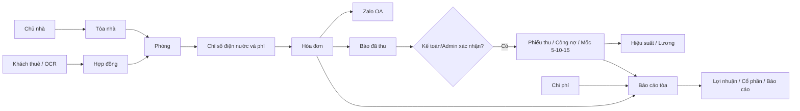

# TIMEHOUSE CORE — SRS GÓI D (90–100 TRIỆU ĐỒNG)

**Phiên bản:** DRAFT v1.1 — 20/10/2026  |  **Giá tham chiếu:** 95 triệu đồng  |  **Mục đích:** Đặc tả để khách duyệt phạm vi và thiết kế UI mockup.

> Tăng chiều sâu báo cáo và truy vết. Đây là **đặc tả trước khi thiết kế**, chưa phải giao diện đã được nghiệm thu. Các chức năng Gói D là phạm vi **cộng dồn** đúng theo sheet `D_90_100` của bảng báo giá; mọi khác biệt với SRS v2.3 đều cần khách phê duyệt.

> **BẢN CẬP NHẬT v1.1 — DEMO ĐA GÓI A/B/C/D (20/10/2026)**  
> Tài liệu gốc: SRS Gói D v1.0. Bản này **giữ nguyên** 39 UI/luồng và 52 nhóm chức năng từ bảng báo giá; bổ sung nhãn gói **ở từng màn và từng chức năng**, thêm một **cấu hình chuyển gói chỉ dành cho prototype**, quy tắc render và UAT chuyển gói.  
> **Nguồn chốt đối chiếu:** `TIMEHOUSE_BAO_GIA_CHI_TIET_4_GOI_KHACH_XAC_NHAN.xlsx`, các sheet `A_50_60`, `B_70_80`, `C_80_90`, `D_90_100`. Phần Settings chuyển gói là **[UX PROPOSED — DEMO ONLY]**, không có trong 39 UI bán cho khách nếu không ký bổ sung.  
> **Khoảng giá đúng:** A = 50–60 triệu; B = 70–80 triệu; C = 80–90 triệu; D = 90–100 triệu. Các nhãn giá 10–20, 30–50, 60–80 trong ảnh mockup cũ là **SAI**, phải sửa khi dựng lại.

## 0. Căn cứ và nguyên tắc truy vết

- **Nguồn ưu tiên 1:** `TIMEHOUSE_BAO_GIA_CHI_TIET_4_GOI_KHACH_XAC_NHAN.xlsx`, sheet `D_90_100` — 39 màn/luồng và 52 nhóm chức năng kèm mức xử lý riêng.
- **Nguồn ưu tiên 2:** `TIMEHOUSE_SRS_v2_3_Full.md` — tham khảo nghiệp vụ và các quy tắc chưa chốt; **không tự cộng toàn bộ 111 FR vào gói**.
- **Nguồn tham khảo:** file lương vận hành, mẫu hóa đơn, sổ điện nước, bảng chia cổ phần; chỉ triển khai thuật toán/tỷ lệ được khách duyệt qua UAT.
- **Skill áp dụng:** `srs-generator-skill v3.0`: business rule, screen description (`Fields | Format | Required? | Description`), user steps; phân loại web/grid/detail/form/popup.
- **Nền tảng:** website desktop quản trị, ứng dụng đáp ứng tablet theo thiết kế tiếp theo; giao diện mobile riêng không nằm trong báo giá nếu chưa xác nhận.
- **Quy tắc ưu tiên:** nếu Excel mô tả tính năng đơn giản hơn SRS v2.3, **phạm vi Excel được ưu tiên**; việc nâng cấp phải được ghi change request.

## 1. Business Rule

| Nhóm | Nội dung |
|---|---|
| Authorization | Admin/Kế toán/Quản lý tòa/nhân sự được gán quyền theo phạm vi. Quyền xem, sửa, duyệt phải xác minh phía backend; người báo đã thu không được tự duyệt tiền khi không có quyền. |
| Processing Rule | Thêm–sửa–import–OCR có bước kiểm tra dữ liệu; khoản thu thực nhận cần được xác nhận trước khi ghi vào công nợ/báo cáo. Mốc 5/10/15 dùng thời điểm thu đã xác nhận, tính hiệu suất 100%/90%/70%/0% theo quy tắc đã nêu, trừ khi khách phê duyệt ngoại lệ. Các mức OCR, Zalo, import, lương và chia lãi tuân thủ giới hạn gói D. Điều kiện chi tiết và mã lỗi **[CẦN XÁC NHẬN]**. |
| Processing Impact | Lưu hồ sơ/phiếu/chứng từ, trạng thái và nhật ký theo quyền; ghi nhận doanh thu, công nợ, chi phí, hiệu suất và báo cáo theo dữ liệu nguồn đã phê duyệt. Phân bổ cổ phần không đồng nghĩa chi trả; cọc không đồng nghĩa doanh thu. Không xóa cứng lịch sử giao dịch đã xác nhận. |

## 2. Nguyên tắc UI/UX dùng chung (khóa để tạo mockup)

- App shell thống nhất: sidebar theo phân hệ, topbar tìm kiếm/scope tòa, breadcrumb, trạng thái bản ghi và hành động theo vai trò.
- Desktop thiết kế tham chiếu 1440px; màu chủ đạo `#0F766E`, nền `#F8FAFC`, card trắng, viền `#E2E8F0`, font Inter; spacing 8px, radius 12px.
- Một màn hình = một tác vụ chính; list có bộ lọc/bảng/phân trang; detail chỉ hiện một tab; thao tác ghi nhận/duyệt dùng form hoặc dialog kiểm tra.
- State bắt buộc: Loading, Empty, Error, Forbidden (403), Draft/Chờ xác nhận/Đã xác nhận, Success; trạng thái nào chưa có nghiệp vụ duyệt phải ghi **DRAFT — CHỜ CHỐT**.
- Dữ liệu hiển thị trong mockup chỉ dùng dữ liệu giả; thông tin định danh khách phải che/mask. Không sử dụng ảnh mockup làm nguồn sự thật của field.

### 2.1. Package Preview Settings — yêu cầu mới cho mockup tương tác [UX PROPOSED]

**Mục tiêu:** dùng **một bộ mockup chuẩn Gói D** để khách chuyển giữa 4 mức A/B/C/D ngay trên giao diện, đối chiếu *các chức năng đã có* và *phần nâng cấp* mà không vẽ bốn hệ thống tách biệt. **Chuyển gói chỉ là trình diễn phạm vi của báo giá**; không nâng quyền người dùng, không thay đổi dữ liệu hoặc gói thuê bao thực tế.

| Package key | Nhãn trên toàn bộ UI | Mức chức năng | Phạm vi cộng dồn |
|---|---|---|---|
| `A` | **Gói A · 50–60 triệu** | Cơ bản | Đủ 39 UI/luồng & 52 nhóm nghiệp vụ **ở mức A**; nhập tay, OCR mẫu giới hạn có người xác nhận, báo cáo đơn giản theo Excel. |
| `B` | **Gói B · 70–80 triệu** | Tự động hóa | Toàn bộ A **+ chỉ các nâng cấp B** của Excel; không mặc nhiên có workflow C/D. |
| `C` | **Gói C · 80–90 triệu** | Kiểm soát | Toàn bộ B **+ chỉ các nâng cấp C**; thêm kiểm soát/duyệt theo đúng dòng chức năng. |
| `D` | **Gói D · 90–100 triệu** | Báo cáo & truy vết | Toàn bộ C **+ các nâng cấp D** được liệt kê trong SRS, không tự bật phần ngoài báo giá. |

**Quan trọng:** tất cả bốn gói trong Excel đều có **39 UI/luồng và 52 nhóm chức năng**; nhãn **“Có từ A/B/C/D” gắn với từng mức xử lý (increment)**, không phải gán toàn bộ phân hệ OCR/điện nước/lương/cổ phần sang B/C/D. Ví dụ OCR mẫu cơ bản đã có ở A; OCR thêm mẫu/độ tin cậy ở B; kiểm tra trùng ở C; thư viện mẫu/log ở D. Cấm render “gói A không có OCR” chỉ vì OCR nâng cao nằm ở B.

**Thiết kế component dùng chung trên MỌI màn** (mockup desktop 1440):

1. Trên **Topbar** có nút `Đang xem: Gói D (90–100 triệu)` kèm icon Settings; nhấn mở drawer phải `Xem thử các gói`. Desktop drawer 320–380px; có thể hiển thị dạng popover ở không gian hẹp. Thể hiện đây là **chế độ báo giá/demo**.
2. Drawer `Cấu hình hiển thị gói` có `Chọn gói A / B / C / D`, hiển thị đúng khoảng giá, mô tả một dòng, `Đang xem`/dấu chọn, bảng `So sánh 52 chức năng`, bộ lọc theo phân hệ và toggle `Hiện nội dung nâng cấp dưới dạng khóa` (mặc định **BẬT**). Nút `Xem toàn bộ gói` mở Gói D; nút `Đóng` không mất lựa chọn.
3. Trên màn chính, các bảng/form/tab/actions/quick links có cấp độ gói và tooltip (ví dụ `A · nhập thủ công`, `B · import có preview`, `C · duyệt`, `D · audit`). Chỉ phần nâng cấp vượt gói mới **bị khóa/ẩn**, **không khóa toàn màn hình** nếu chức năng lõi có ở A.
4. Nơi có dữ liệu nghiệp vụ chưa chốt ghi `DRAFT / CHỜ XÁC NHẬN`; không biến biểu tượng khóa gói thành thông báo `Không có quyền (403)`. Nếu vai trò không đủ quyền, 403/Forbidden phải độc lập với package demo.
5. Header và drawer phải giữ **cùng package state** khi chuyển màn, mở tab, modal hoặc refresh prototype; cho phép link mockup đến trực tiếp `?previewPackage=A|B|C|D` (*route/query là UX PROPOSED, không phải API backend*).
6. Mặc định khi mở link giới thiệu: `D`. Khi đổi gói, cùng dữ liệu minh họa nhất quán; chỉ đổi tính khả dụng của tính năng và nhãn, **không giả lập chỉnh sửa sổ thu, hợp đồng hay số tiền thật**. Prototype có thể dùng mock data tĩnh (read-only).
7. Kiểu hiển thị 3 trạng thái tính năng: `Có trong gói` (normal), `Nâng cấp để dùng` (locked/ghost + nhãn gói yêu cầu), `Không có quyền` (role forbidden riêng). Riêng `Không có dữ liệu`, `Đang tải`, `Lỗi` là data states, không phải feature gate.
8. Không lấy `Gói đang xem` làm `Gói khách đã mua`. Tuyệt đối không cho nút chọn gói thực thi cấp quyền, tạo giao dịch thanh toán hay cấp API thật.

### 2.2. Rule render theo package (FE prototype / Figma / ImageGen)

- **Một design master:** `D` là tổng hợp đầy đủ. Từng section/row/action có `featureId`, `minPackage` (A/B/C/D), `featureTierLabel` và `labelWhenLocked`. `minPackage` chỉ dùng cho **nâng cấp mới**; lõi vẫn là `A`.
- **Cách tính:** `packageLevel = {A:1, B:2, C:3, D:4}`; show/enable nâng cấp khi `packageLevel[selected] >= packageLevel[minPackage]`, đồng thời có quyền người dùng tương ứng. Nếu thấp hơn: hiện ghost có tooltip `Có từ gói ...` hoặc ẩn nếu toggle tắt.
- **Hạn chế dữ liệu:** cột chi tiết / tab audit mới có từ D không được render như số liệu đã duyệt ở A; dùng skeleton/placeholder rõ lý do. Tài chính DRAFT → PREVIEW → CONFIRMED không phụ thuộc package demo.
- **Khi chuyển gói lúc đang mở form/tab nâng cao:** tự về tab cơ bản/đóng panel nâng cấp và hiện chú thích; nếu có dữ liệu chưa lưu thì cảnh báo rồi mới đổi. Không reset các field đã nhập trong bản mockup trừ khi đã được người dùng xác nhận.
- **Điểm đặc biệt:** mức B/C/D là **nâng cấp trên chức năng hiện có**, không có chuyện “A thiếu mọi tính năng” vì icon mockup trước đó ghi nhầm.
- **Nguồn sự thật:** bảng **§4** bên dưới có ghi chú A/B/C/D ngay mỗi screen; bảng **§5A** chứa 52 quy tắc mức A→D chính xác theo Excel. Khi có mâu thuẫn giữa hình ImageGen cũ với Excel, **Excel được ưu tiên** và ghi vấn đề vào Decision Log.

**Ví dụ đối chiếu trên cùng màn `METER-01`:** A cho phép nhập chỉ số theo phòng và dùng chỉ số kỳ trước; B mở import/preview nếu có trong hàng Excel; C bổ sung kiểm tra và quy trình duyệt theo hàng Excel; D bổ sung lịch sử đối chiếu/audit. Đây chỉ là ví dụ trình bày, các điều kiện kỹ thuật chính thức lấy đúng dòng tính năng liên quan trong §5A.

## 3. Sơ đồ luồng nghiệp vụ tổng thể

## 4. Screen description — danh mục 39 màn hình và luồng

Mỗi mục dưới đây dùng trực tiếp để lập **Screen Contract** cho ImageGen/Figma/Codex. `Required?` ở các field chưa xác nhận trong nguồn được để **TBD**, không suy đoán yêu cầu pháp lý hoặc validation.

### Screen 01 — AUTH-01: Đăng nhập / chuyển đơn vị quản lý

- **Module:** Hệ thống · **Kiểu màn:** Input form / workflow · **Phân loại Excel:** Màn hình chính.
- **Phạm vi gói D:** Cơ bản: Quyền cơ bản, không tự duyệt tiền  \|  Nâng cấp 70–80: phân quyền theo chức năng  \|  Nâng cấp 80–90: log duyệt và scope theo tòa  \|  Nâng cấp 90–100: theo dõi phiên bản quyền.
- **Mockup:** chưa được phê duyệt; cần render từ Screen Contract này.

**[NOTES A/B/C/D — nguồn Excel UI-ID `AUTH-01`, chỉ để dựng 4 trạng thái mockup]**

| Chế độ preview | Hiện ở màn này / bổ sung so với gói trước |
|---|---|
| **A · 50–60 triệu** | **Cơ bản · khả dụng:** Quyền cơ bản, không tự duyệt tiền. |
| **B · 70–80 triệu** | **Nâng cấp mới ở B; chỉ enable khi chọn B hoặc cao hơn:** phân quyền theo chức năng. |
| **C · 80–90 triệu** | **Nâng cấp mới ở C; chỉ enable khi chọn C hoặc cao hơn:** log duyệt và scope theo tòa. |
| **D · 90–100 triệu** | **Nâng cấp mới ở D; chỉ enable khi chọn D hoặc cao hơn:** theo dõi phiên bản quyền. |

**Gợi ý render `AUTH-01`:** Giữ trường dữ liệu lõi, filter và điều hướng của A trong mọi gói; nâng cấp B/C/D dùng badge/tooltip/khóa khi gói thấp. **Action nguồn Excel:** Đăng nhập; chọn vai trò. **Fields nguồn Excel:** Tên đăng nhập; mật khẩu; vai trò, phạm vi tòa. Khi role không đủ quyền vẫn phải hiển thị trạng thái 403 riêng (không nhầm với khóa gói).

| Fields | Format | Required? | Description |
|---|---|:---:|---|
| Điều hướng / breadcrumb | Left menu + Text | No | Mở phân hệ Hệ thống → màn Đăng nhập / chuyển đơn vị quản lý; giữ scope tòa hiện tại nếu được cấp quyền. |
| Tiêu đề / trạng thái | Header + Tag | No | Hiển thị `Đăng nhập / chuyển đơn vị quản lý`; trạng thái thực tế lấy từ API, không giả định trạng thái đã duyệt. |
| Tên đăng nhập | Textbox / Text | TBD | Hiển thị/nhập `Tên đăng nhập` đúng nguồn đã duyệt; nếu thiếu dữ liệu hiển thị `—` hoặc lỗi validation rõ ràng; không tự sinh chính sách. |
| mật khẩu | Textbox / Text | TBD | Hiển thị/nhập `mật khẩu` đúng nguồn đã duyệt; nếu thiếu dữ liệu hiển thị `—` hoặc lỗi validation rõ ràng; không tự sinh chính sách. |
| vai trò | Dropdown / Tag | TBD | Hiển thị/nhập `vai trò` đúng nguồn đã duyệt; nếu thiếu dữ liệu hiển thị `—` hoặc lỗi validation rõ ràng; không tự sinh chính sách. |
| phạm vi tòa | Textbox / Text | TBD | Hiển thị/nhập `phạm vi tòa` đúng nguồn đã duyệt; nếu thiếu dữ liệu hiển thị `—` hoặc lỗi validation rõ ràng; không tự sinh chính sách. |

**Action / tương tác chi tiết**

- **Đăng nhập** → chỉ hiển thị khi có quyền; khi thao tác mở list/detail/form/modal phù hợp; lưu hoặc xác nhận thành công → cập nhật danh sách/số liệu và audit; lỗi → không thay đổi trạng thái.
- **chọn vai trò** → chỉ hiển thị khi có quyền; khi thao tác mở list/detail/form/modal phù hợp; lưu hoặc xác nhận thành công → cập nhật danh sách/số liệu và audit; lỗi → không thay đổi trạng thái.

**Business rules / tiêu chí kiểm thử liên quan**

- **Tài khoản, quyền theo tòa:** CƠ BẢN: Admin/Kế toán/QL tòa; quyền BE bắt buộc  \|  TỰ ĐỘNG HÓA: Phân quyền theo chức năng và tòa  \|  KIỂM SOÁT: Tách báo thu / duyệt thu / duyệt chi  \|  BÁO CÁO/ĐỐI CHIẾU: Quyền theo đội, ca và hiệu lực. **Kiểm thử:** API trả 403 khi gọi vượt scope. **Điều kiện:** Không có ghi chú đặc biệt.
- **Audit thay đổi dữ liệu tài chính:** CƠ BẢN: Lưu tạo/sửa/duyệt chứng từ  \|  TỰ ĐỘNG HÓA: Bộ lọc theo tòa và loại chứng từ  \|  KIỂM SOÁT: Log giao dịch/mốc thu thay đổi  \|  BÁO CÁO/ĐỐI CHIẾU: Báo cáo snapshot có revision truy vết. **Kiểm thử:** Không đổi dữ liệu confirmed mà không lưu lịch sử. **Điều kiện:** Không có ghi chú đặc biệt.
- **Sao lưu, import khởi tạo, vận hành:** CƠ BẢN: Staging + backup + hướng dẫn người dùng  \|  TỰ ĐỘNG HÓA: Kiểm thử phục hồi và dữ liệu đầu kỳ theo mẫu  \|  KIỂM SOÁT: Bộ test hồi quy tự động các dòng tiền  \|  BÁO CÁO/ĐỐI CHIẾU: Giám sát batch và cảnh báo lỗi gửi OA. **Kiểm thử:** Có phương án phục hồi, không mất bản ghi đã xác nhận. **Điều kiện:** Không có ghi chú đặc biệt.

**UI states & handoff:** Loading / Empty / Error / Forbidden; dữ liệu minh họa; thao tác phá hủy cần xác nhận; Tab/Popup con chỉ thiết kế khi có trong scope.

**User steps (chuyển màn):**
1. Từ sidebar/phân hệ `Hệ thống` → mở `Đăng nhập / chuyển đơn vị quản lý`.
2. Chọn `Đăng nhập` → hiển thị thao tác / form / trạng thái thích hợp; **[CẦN KHÁCH XÁC NHẬN]** tên route/màn đích nếu Excel chưa mô tả.
3. Lưu/Xác nhận hoặc Quay lại → màn danh sách hoặc chi tiết của cùng đối tượng; refresh dữ liệu khi giao dịch thành công.

---

### Screen 02 — OWN-01: Danh sách chủ nhà

- **Module:** Chủ nhà · **Kiểu màn:** Grid view / list · **Phân loại Excel:** Màn hình chính.
- **Phạm vi gói D:** Cơ bản: Nhập tay, Excel mẫu cố định  \|  Nâng cấp 70–80: preview lỗi/trùng trước lưu  \|  Nâng cấp 80–90: lịch sử chỉnh sửa/đổi liên kết  \|  Nâng cấp 90–100: audit/đối chiếu theo kỳ.
- **Mockup:** chưa được phê duyệt; cần render từ Screen Contract này.

**[NOTES A/B/C/D — nguồn Excel UI-ID `OWN-01`, chỉ để dựng 4 trạng thái mockup]**

| Chế độ preview | Hiện ở màn này / bổ sung so với gói trước |
|---|---|
| **A · 50–60 triệu** | **Cơ bản · khả dụng:** Nhập tay, Excel mẫu cố định. |
| **B · 70–80 triệu** | **Nâng cấp mới ở B; chỉ enable khi chọn B hoặc cao hơn:** preview lỗi/trùng trước lưu. |
| **C · 80–90 triệu** | **Nâng cấp mới ở C; chỉ enable khi chọn C hoặc cao hơn:** lịch sử chỉnh sửa/đổi liên kết. |
| **D · 90–100 triệu** | **Nâng cấp mới ở D; chỉ enable khi chọn D hoặc cao hơn:** audit/đối chiếu theo kỳ. |

**Gợi ý render `OWN-01`:** Giữ trường dữ liệu lõi, filter và điều hướng của A trong mọi gói; nâng cấp B/C/D dùng badge/tooltip/khóa khi gói thấp. **Action nguồn Excel:** Thêm; Import Excel; tìm/lọc. **Fields nguồn Excel:** Mã chủ, tên, liên hệ, trạng thái, số tòa. Khi role không đủ quyền vẫn phải hiển thị trạng thái 403 riêng (không nhầm với khóa gói).

| Fields | Format | Required? | Description |
|---|---|:---:|---|
| Điều hướng / breadcrumb | Left menu + Text | No | Mở phân hệ Chủ nhà → màn Danh sách chủ nhà; giữ scope tòa hiện tại nếu được cấp quyền. |
| Tiêu đề / trạng thái | Header + Tag | No | Hiển thị `Danh sách chủ nhà`; trạng thái thực tế lấy từ API, không giả định trạng thái đã duyệt. |
| Mã chủ | Text / Column | TBD | Hiển thị/nhập `Mã chủ` đúng nguồn đã duyệt; nếu thiếu dữ liệu hiển thị `—` hoặc lỗi validation rõ ràng; không tự sinh chính sách. |
| tên | Text / Column | TBD | Hiển thị/nhập `tên` đúng nguồn đã duyệt; nếu thiếu dữ liệu hiển thị `—` hoặc lỗi validation rõ ràng; không tự sinh chính sách. |
| liên hệ | Text / Column | TBD | Hiển thị/nhập `liên hệ` đúng nguồn đã duyệt; nếu thiếu dữ liệu hiển thị `—` hoặc lỗi validation rõ ràng; không tự sinh chính sách. |
| trạng thái | Dropdown / Tag | TBD | Hiển thị/nhập `trạng thái` đúng nguồn đã duyệt; nếu thiếu dữ liệu hiển thị `—` hoặc lỗi validation rõ ràng; không tự sinh chính sách. |
| số tòa | Currency / Number / Text | TBD | Hiển thị/nhập `số tòa` đúng nguồn đã duyệt; nếu thiếu dữ liệu hiển thị `—` hoặc lỗi validation rõ ràng; không tự sinh chính sách. |

**Action / tương tác chi tiết**

- **Thêm** → chỉ hiển thị khi có quyền; khi thao tác mở list/detail/form/modal phù hợp; lưu hoặc xác nhận thành công → cập nhật danh sách/số liệu và audit; lỗi → không thay đổi trạng thái.
- **Import Excel** → chỉ hiển thị khi có quyền; khi thao tác mở list/detail/form/modal phù hợp; lưu hoặc xác nhận thành công → cập nhật danh sách/số liệu và audit; lỗi → không thay đổi trạng thái.
- **tìm/lọc** → chỉ hiển thị khi có quyền; khi thao tác mở list/detail/form/modal phù hợp; lưu hoặc xác nhận thành công → cập nhật danh sách/số liệu và audit; lỗi → không thay đổi trạng thái.

**Business rules / tiêu chí kiểm thử liên quan**

- **Hồ sơ chủ nhà:** CƠ BẢN: CRUD 1 form chung  \|  TỰ ĐỘNG HÓA: Kiểm tra trùng tên/số liên hệ  \|  KIỂM SOÁT: Audit thay đổi + quyền theo tòa  \|  BÁO CÁO/ĐỐI CHIẾU: Nhập liệu theo kỳ hiệu lực + xem phiên bản. **Kiểm thử:** Tạo/sửa được chủ nhà mà không làm mất liên kết tòa. **Điều kiện:** Không có ghi chú đặc biệt.
- **Nhập Excel chủ nhà:** CƠ BẢN: Import 1 mẫu cố định; báo lỗi dòng  \|  TỰ ĐỘNG HÓA: Preview trước khi ghi; tải file lỗi  \|  KIỂM SOÁT: Upsert có chính sách trùng  \|  BÁO CÁO/ĐỐI CHIẾU: Batch import có lịch sử/rollback có kiểm soát. **Kiểm thử:** Dòng không hợp lệ không được ghi. **Điều kiện:** Không có ghi chú đặc biệt.
- **Gắn chủ nhà với tòa:** CƠ BẢN: 1 chủ nhà chính/tòa  \|  TỰ ĐỘNG HÓA: Lịch sử chủ nhà của tòa  \|  KIỂM SOÁT: Nhiều vai trò sở hữu/đại diện nếu chốt  \|  BÁO CÁO/ĐỐI CHIẾU: Quan hệ theo thời gian và đối chiếu báo cáo. **Kiểm thử:** Tòa có chủ nhà rõ ràng; đổi liên kết không sửa lịch sử. **Điều kiện:** Chưa có tự động chi tiền chủ nhà.

**UI states & handoff:** Loading / Empty / Error / Forbidden; dữ liệu minh họa; thao tác phá hủy cần xác nhận; Tab/Popup con chỉ thiết kế khi có trong scope.

**User steps (chuyển màn):**
1. Từ sidebar/phân hệ `Chủ nhà` → mở `Danh sách chủ nhà`.
2. Chọn `Thêm` → hiển thị thao tác / form / trạng thái thích hợp; **[CẦN KHÁCH XÁC NHẬN]** tên route/màn đích nếu Excel chưa mô tả.
3. Lưu/Xác nhận hoặc Quay lại → màn danh sách hoặc chi tiết của cùng đối tượng; refresh dữ liệu khi giao dịch thành công.

---

### Screen 03 — OWN-02: Hồ sơ chủ nhà

- **Module:** Chủ nhà · **Kiểu màn:** Detail / dashboard · **Phân loại Excel:** Màn hình chính.
- **Phạm vi gói D:** Cơ bản: Nhập tay, Excel mẫu cố định  \|  Nâng cấp 70–80: preview lỗi/trùng trước lưu  \|  Nâng cấp 80–90: lịch sử chỉnh sửa/đổi liên kết  \|  Nâng cấp 90–100: audit/đối chiếu theo kỳ.
- **Mockup:** chưa được phê duyệt; cần render từ Screen Contract này.

**[NOTES A/B/C/D — nguồn Excel UI-ID `OWN-02`, chỉ để dựng 4 trạng thái mockup]**

| Chế độ preview | Hiện ở màn này / bổ sung so với gói trước |
|---|---|
| **A · 50–60 triệu** | **Cơ bản · khả dụng:** Nhập tay, Excel mẫu cố định. |
| **B · 70–80 triệu** | **Nâng cấp mới ở B; chỉ enable khi chọn B hoặc cao hơn:** preview lỗi/trùng trước lưu. |
| **C · 80–90 triệu** | **Nâng cấp mới ở C; chỉ enable khi chọn C hoặc cao hơn:** lịch sử chỉnh sửa/đổi liên kết. |
| **D · 90–100 triệu** | **Nâng cấp mới ở D; chỉ enable khi chọn D hoặc cao hơn:** audit/đối chiếu theo kỳ. |

**Gợi ý render `OWN-02`:** Giữ trường dữ liệu lõi, filter và điều hướng của A trong mọi gói; nâng cấp B/C/D dùng badge/tooltip/khóa khi gói thấp. **Action nguồn Excel:** Sửa; gắn tòa; vô hiệu. **Fields nguồn Excel:** Thông tin chủ nhà; địa chỉ; tòa liên kết. Khi role không đủ quyền vẫn phải hiển thị trạng thái 403 riêng (không nhầm với khóa gói).

| Fields | Format | Required? | Description |
|---|---|:---:|---|
| Điều hướng / breadcrumb | Left menu + Text | No | Mở phân hệ Chủ nhà → màn Hồ sơ chủ nhà; giữ scope tòa hiện tại nếu được cấp quyền. |
| Tiêu đề / trạng thái | Header + Tag | No | Hiển thị `Hồ sơ chủ nhà`; trạng thái thực tế lấy từ API, không giả định trạng thái đã duyệt. |
| Thông tin chủ nhà | Text / Column | TBD | Hiển thị/nhập `Thông tin chủ nhà` đúng nguồn đã duyệt; nếu thiếu dữ liệu hiển thị `—` hoặc lỗi validation rõ ràng; không tự sinh chính sách. |
| địa chỉ | Text / Column | TBD | Hiển thị/nhập `địa chỉ` đúng nguồn đã duyệt; nếu thiếu dữ liệu hiển thị `—` hoặc lỗi validation rõ ràng; không tự sinh chính sách. |
| tòa liên kết | Text / Column | TBD | Hiển thị/nhập `tòa liên kết` đúng nguồn đã duyệt; nếu thiếu dữ liệu hiển thị `—` hoặc lỗi validation rõ ràng; không tự sinh chính sách. |

**Action / tương tác chi tiết**

- **Sửa** → chỉ hiển thị khi có quyền; khi thao tác mở list/detail/form/modal phù hợp; lưu hoặc xác nhận thành công → cập nhật danh sách/số liệu và audit; lỗi → không thay đổi trạng thái.
- **gắn tòa** → chỉ hiển thị khi có quyền; khi thao tác mở list/detail/form/modal phù hợp; lưu hoặc xác nhận thành công → cập nhật danh sách/số liệu và audit; lỗi → không thay đổi trạng thái.
- **vô hiệu** → chỉ hiển thị khi có quyền; khi thao tác mở list/detail/form/modal phù hợp; lưu hoặc xác nhận thành công → cập nhật danh sách/số liệu và audit; lỗi → không thay đổi trạng thái.

**Business rules / tiêu chí kiểm thử liên quan**

- **Hồ sơ chủ nhà:** CƠ BẢN: CRUD 1 form chung  \|  TỰ ĐỘNG HÓA: Kiểm tra trùng tên/số liên hệ  \|  KIỂM SOÁT: Audit thay đổi + quyền theo tòa  \|  BÁO CÁO/ĐỐI CHIẾU: Nhập liệu theo kỳ hiệu lực + xem phiên bản. **Kiểm thử:** Tạo/sửa được chủ nhà mà không làm mất liên kết tòa. **Điều kiện:** Không có ghi chú đặc biệt.
- **Nhập Excel chủ nhà:** CƠ BẢN: Import 1 mẫu cố định; báo lỗi dòng  \|  TỰ ĐỘNG HÓA: Preview trước khi ghi; tải file lỗi  \|  KIỂM SOÁT: Upsert có chính sách trùng  \|  BÁO CÁO/ĐỐI CHIẾU: Batch import có lịch sử/rollback có kiểm soát. **Kiểm thử:** Dòng không hợp lệ không được ghi. **Điều kiện:** Không có ghi chú đặc biệt.
- **Gắn chủ nhà với tòa:** CƠ BẢN: 1 chủ nhà chính/tòa  \|  TỰ ĐỘNG HÓA: Lịch sử chủ nhà của tòa  \|  KIỂM SOÁT: Nhiều vai trò sở hữu/đại diện nếu chốt  \|  BÁO CÁO/ĐỐI CHIẾU: Quan hệ theo thời gian và đối chiếu báo cáo. **Kiểm thử:** Tòa có chủ nhà rõ ràng; đổi liên kết không sửa lịch sử. **Điều kiện:** Chưa có tự động chi tiền chủ nhà.

**UI states & handoff:** Loading / Empty / Error / Forbidden; dữ liệu minh họa; thao tác phá hủy cần xác nhận; Tab/Popup con chỉ thiết kế khi có trong scope.

**User steps (chuyển màn):**
1. Từ sidebar/phân hệ `Chủ nhà` → mở `Hồ sơ chủ nhà`.
2. Chọn `Sửa` → hiển thị thao tác / form / trạng thái thích hợp; **[CẦN KHÁCH XÁC NHẬN]** tên route/màn đích nếu Excel chưa mô tả.
3. Lưu/Xác nhận hoặc Quay lại → màn danh sách hoặc chi tiết của cùng đối tượng; refresh dữ liệu khi giao dịch thành công.

---

### Screen 04 — BLD-01: Danh sách tòa

- **Module:** Tòa nhà · **Kiểu màn:** Grid view / list · **Phân loại Excel:** Màn hình chính.
- **Phạm vi gói D:** Cơ bản: Nhập tay, gắn chủ/QL  \|  Nâng cấp 70–80: tổng hợp phòng, kiểm import  \|  Nâng cấp 80–90: lịch sử phân công  \|  Nâng cấp 90–100: snapshot theo kỳ.
- **Mockup:** chưa được phê duyệt; cần render từ Screen Contract này.

**[NOTES A/B/C/D — nguồn Excel UI-ID `BLD-01`, chỉ để dựng 4 trạng thái mockup]**

| Chế độ preview | Hiện ở màn này / bổ sung so với gói trước |
|---|---|
| **A · 50–60 triệu** | **Cơ bản · khả dụng:** Nhập tay, gắn chủ/QL. |
| **B · 70–80 triệu** | **Nâng cấp mới ở B; chỉ enable khi chọn B hoặc cao hơn:** tổng hợp phòng, kiểm import. |
| **C · 80–90 triệu** | **Nâng cấp mới ở C; chỉ enable khi chọn C hoặc cao hơn:** lịch sử phân công. |
| **D · 90–100 triệu** | **Nâng cấp mới ở D; chỉ enable khi chọn D hoặc cao hơn:** snapshot theo kỳ. |

**Gợi ý render `BLD-01`:** Giữ trường dữ liệu lõi, filter và điều hướng của A trong mọi gói; nâng cấp B/C/D dùng badge/tooltip/khóa khi gói thấp. **Action nguồn Excel:** Thêm; Import Excel; lọc. **Fields nguồn Excel:** Mã tòa, tên, khu vực, chủ nhà, QL tòa, số phòng. Khi role không đủ quyền vẫn phải hiển thị trạng thái 403 riêng (không nhầm với khóa gói).

| Fields | Format | Required? | Description |
|---|---|:---:|---|
| Điều hướng / breadcrumb | Left menu + Text | No | Mở phân hệ Tòa nhà → màn Danh sách tòa; giữ scope tòa hiện tại nếu được cấp quyền. |
| Tiêu đề / trạng thái | Header + Tag | No | Hiển thị `Danh sách tòa`; trạng thái thực tế lấy từ API, không giả định trạng thái đã duyệt. |
| Mã tòa | Text / Column | TBD | Hiển thị/nhập `Mã tòa` đúng nguồn đã duyệt; nếu thiếu dữ liệu hiển thị `—` hoặc lỗi validation rõ ràng; không tự sinh chính sách. |
| tên | Text / Column | TBD | Hiển thị/nhập `tên` đúng nguồn đã duyệt; nếu thiếu dữ liệu hiển thị `—` hoặc lỗi validation rõ ràng; không tự sinh chính sách. |
| khu vực | Text / Column | TBD | Hiển thị/nhập `khu vực` đúng nguồn đã duyệt; nếu thiếu dữ liệu hiển thị `—` hoặc lỗi validation rõ ràng; không tự sinh chính sách. |
| chủ nhà | Text / Column | TBD | Hiển thị/nhập `chủ nhà` đúng nguồn đã duyệt; nếu thiếu dữ liệu hiển thị `—` hoặc lỗi validation rõ ràng; không tự sinh chính sách. |
| QL tòa | Text / Column | TBD | Hiển thị/nhập `QL tòa` đúng nguồn đã duyệt; nếu thiếu dữ liệu hiển thị `—` hoặc lỗi validation rõ ràng; không tự sinh chính sách. |
| số phòng | Currency / Number / Text | TBD | Hiển thị/nhập `số phòng` đúng nguồn đã duyệt; nếu thiếu dữ liệu hiển thị `—` hoặc lỗi validation rõ ràng; không tự sinh chính sách. |

**Action / tương tác chi tiết**

- **Thêm** → chỉ hiển thị khi có quyền; khi thao tác mở list/detail/form/modal phù hợp; lưu hoặc xác nhận thành công → cập nhật danh sách/số liệu và audit; lỗi → không thay đổi trạng thái.
- **Import Excel** → chỉ hiển thị khi có quyền; khi thao tác mở list/detail/form/modal phù hợp; lưu hoặc xác nhận thành công → cập nhật danh sách/số liệu và audit; lỗi → không thay đổi trạng thái.
- **lọc** → chỉ hiển thị khi có quyền; khi thao tác mở list/detail/form/modal phù hợp; lưu hoặc xác nhận thành công → cập nhật danh sách/số liệu và audit; lỗi → không thay đổi trạng thái.

**Business rules / tiêu chí kiểm thử liên quan**

- **Danh mục tòa nhà:** CƠ BẢN: CRUD tòa cơ bản  \|  TỰ ĐỘNG HÓA: Tổng hợp số phòng/công suất từ dữ liệu phòng  \|  KIỂM SOÁT: Lịch sử phân công quản lý  \|  BÁO CÁO/ĐỐI CHIẾU: Snapshot dữ liệu tòa theo kỳ báo cáo. **Kiểm thử:** Dữ liệu tòa được dùng chung ở hóa đơn/báo cáo. **Điều kiện:** Không có ghi chú đặc biệt.
- **Nhập Excel tòa nhà:** CƠ BẢN: 1 mẫu cố định; yêu cầu owner tồn tại  \|  TỰ ĐỘNG HÓA: Dò mã chủ nhà và báo lỗi liên kết  \|  KIỂM SOÁT: So trùng theo mã tòa và chính sách upsert  \|  BÁO CÁO/ĐỐI CHIẾU: Log batch, đối chiếu số dòng. **Kiểm thử:** Không tạo trùng mã tòa/không gán owner sai. **Điều kiện:** Không có ghi chú đặc biệt.
- **Phân công quản lý tòa:** CƠ BẢN: Một quản lý chính hiện tại  \|  TỰ ĐỘNG HÓA: Phân công nhiều người theo vai trò  \|  KIỂM SOÁT: Hiệu lực theo ngày; phục vụ tính hiệu suất  \|  BÁO CÁO/ĐỐI CHIẾU: Tách người tạo/cập nhật/xác nhận doanh thu. **Kiểm thử:** Quản lý chỉ xem/báo thu đúng tòa được giao. **Điều kiện:** Không có ghi chú đặc biệt.

**UI states & handoff:** Loading / Empty / Error / Forbidden; dữ liệu minh họa; thao tác phá hủy cần xác nhận; Tab/Popup con chỉ thiết kế khi có trong scope.

**User steps (chuyển màn):**
1. Từ sidebar/phân hệ `Tòa nhà` → mở `Danh sách tòa`.
2. Chọn `Thêm` → hiển thị thao tác / form / trạng thái thích hợp; **[CẦN KHÁCH XÁC NHẬN]** tên route/màn đích nếu Excel chưa mô tả.
3. Lưu/Xác nhận hoặc Quay lại → màn danh sách hoặc chi tiết của cùng đối tượng; refresh dữ liệu khi giao dịch thành công.

---

### Screen 05 — BLD-02: Hồ sơ tòa & phân công quản lý

- **Module:** Tòa nhà · **Kiểu màn:** Detail / dashboard · **Phân loại Excel:** Màn hình chính.
- **Phạm vi gói D:** Cơ bản: Nhập tay, gắn chủ/QL  \|  Nâng cấp 70–80: tổng hợp phòng, kiểm import  \|  Nâng cấp 80–90: lịch sử phân công  \|  Nâng cấp 90–100: snapshot theo kỳ.
- **Mockup:** chưa được phê duyệt; cần render từ Screen Contract này.

**[NOTES A/B/C/D — nguồn Excel UI-ID `BLD-02`, chỉ để dựng 4 trạng thái mockup]**

| Chế độ preview | Hiện ở màn này / bổ sung so với gói trước |
|---|---|
| **A · 50–60 triệu** | **Cơ bản · khả dụng:** Nhập tay, gắn chủ/QL. |
| **B · 70–80 triệu** | **Nâng cấp mới ở B; chỉ enable khi chọn B hoặc cao hơn:** tổng hợp phòng, kiểm import. |
| **C · 80–90 triệu** | **Nâng cấp mới ở C; chỉ enable khi chọn C hoặc cao hơn:** lịch sử phân công. |
| **D · 90–100 triệu** | **Nâng cấp mới ở D; chỉ enable khi chọn D hoặc cao hơn:** snapshot theo kỳ. |

**Gợi ý render `BLD-02`:** Giữ trường dữ liệu lõi, filter và điều hướng của A trong mọi gói; nâng cấp B/C/D dùng badge/tooltip/khóa khi gói thấp. **Action nguồn Excel:** Sửa; gán người phụ trách. **Fields nguồn Excel:** Hồ sơ tòa, địa chỉ, chủ nhà, QL, danh sách phòng. Khi role không đủ quyền vẫn phải hiển thị trạng thái 403 riêng (không nhầm với khóa gói).

| Fields | Format | Required? | Description |
|---|---|:---:|---|
| Điều hướng / breadcrumb | Left menu + Text | No | Mở phân hệ Tòa nhà → màn Hồ sơ tòa & phân công quản lý; giữ scope tòa hiện tại nếu được cấp quyền. |
| Tiêu đề / trạng thái | Header + Tag | No | Hiển thị `Hồ sơ tòa & phân công quản lý`; trạng thái thực tế lấy từ API, không giả định trạng thái đã duyệt. |
| Hồ sơ tòa | Text / Column | TBD | Hiển thị/nhập `Hồ sơ tòa` đúng nguồn đã duyệt; nếu thiếu dữ liệu hiển thị `—` hoặc lỗi validation rõ ràng; không tự sinh chính sách. |
| địa chỉ | Text / Column | TBD | Hiển thị/nhập `địa chỉ` đúng nguồn đã duyệt; nếu thiếu dữ liệu hiển thị `—` hoặc lỗi validation rõ ràng; không tự sinh chính sách. |
| chủ nhà | Text / Column | TBD | Hiển thị/nhập `chủ nhà` đúng nguồn đã duyệt; nếu thiếu dữ liệu hiển thị `—` hoặc lỗi validation rõ ràng; không tự sinh chính sách. |
| QL | Text / Column | TBD | Hiển thị/nhập `QL` đúng nguồn đã duyệt; nếu thiếu dữ liệu hiển thị `—` hoặc lỗi validation rõ ràng; không tự sinh chính sách. |
| danh sách phòng | Text / Column | TBD | Hiển thị/nhập `danh sách phòng` đúng nguồn đã duyệt; nếu thiếu dữ liệu hiển thị `—` hoặc lỗi validation rõ ràng; không tự sinh chính sách. |

**Action / tương tác chi tiết**

- **Sửa** → chỉ hiển thị khi có quyền; khi thao tác mở list/detail/form/modal phù hợp; lưu hoặc xác nhận thành công → cập nhật danh sách/số liệu và audit; lỗi → không thay đổi trạng thái.
- **gán người phụ trách** → chỉ hiển thị khi có quyền; khi thao tác mở list/detail/form/modal phù hợp; lưu hoặc xác nhận thành công → cập nhật danh sách/số liệu và audit; lỗi → không thay đổi trạng thái.

**Business rules / tiêu chí kiểm thử liên quan**

- **Danh mục tòa nhà:** CƠ BẢN: CRUD tòa cơ bản  \|  TỰ ĐỘNG HÓA: Tổng hợp số phòng/công suất từ dữ liệu phòng  \|  KIỂM SOÁT: Lịch sử phân công quản lý  \|  BÁO CÁO/ĐỐI CHIẾU: Snapshot dữ liệu tòa theo kỳ báo cáo. **Kiểm thử:** Dữ liệu tòa được dùng chung ở hóa đơn/báo cáo. **Điều kiện:** Không có ghi chú đặc biệt.
- **Nhập Excel tòa nhà:** CƠ BẢN: 1 mẫu cố định; yêu cầu owner tồn tại  \|  TỰ ĐỘNG HÓA: Dò mã chủ nhà và báo lỗi liên kết  \|  KIỂM SOÁT: So trùng theo mã tòa và chính sách upsert  \|  BÁO CÁO/ĐỐI CHIẾU: Log batch, đối chiếu số dòng. **Kiểm thử:** Không tạo trùng mã tòa/không gán owner sai. **Điều kiện:** Không có ghi chú đặc biệt.
- **Phân công quản lý tòa:** CƠ BẢN: Một quản lý chính hiện tại  \|  TỰ ĐỘNG HÓA: Phân công nhiều người theo vai trò  \|  KIỂM SOÁT: Hiệu lực theo ngày; phục vụ tính hiệu suất  \|  BÁO CÁO/ĐỐI CHIẾU: Tách người tạo/cập nhật/xác nhận doanh thu. **Kiểm thử:** Quản lý chỉ xem/báo thu đúng tòa được giao. **Điều kiện:** Không có ghi chú đặc biệt.

**UI states & handoff:** Loading / Empty / Error / Forbidden; dữ liệu minh họa; thao tác phá hủy cần xác nhận; Tab/Popup con chỉ thiết kế khi có trong scope.

**User steps (chuyển màn):**
1. Từ sidebar/phân hệ `Tòa nhà` → mở `Hồ sơ tòa & phân công quản lý`.
2. Chọn `Sửa` → hiển thị thao tác / form / trạng thái thích hợp; **[CẦN KHÁCH XÁC NHẬN]** tên route/màn đích nếu Excel chưa mô tả.
3. Lưu/Xác nhận hoặc Quay lại → màn danh sách hoặc chi tiết của cùng đối tượng; refresh dữ liệu khi giao dịch thành công.

---

### Screen 06 — ROOM-01: Danh sách phòng

- **Module:** Phòng · **Kiểu màn:** Grid view / list · **Phân loại Excel:** Màn hình chính.
- **Phạm vi gói D:** Cơ bản: Tạo/sửa và import theo tòa  \|  Nâng cấp 70–80: kiểm trạng thái phòng theo HĐ  \|  Nâng cấp 80–90: lịch sử trạng thái và giá  \|  Nâng cấp 90–100: audit thay đổi giá/kỳ.
- **Mockup:** chưa được phê duyệt; cần render từ Screen Contract này.

**[NOTES A/B/C/D — nguồn Excel UI-ID `ROOM-01`, chỉ để dựng 4 trạng thái mockup]**

| Chế độ preview | Hiện ở màn này / bổ sung so với gói trước |
|---|---|
| **A · 50–60 triệu** | **Cơ bản · khả dụng:** Tạo/sửa và import theo tòa. |
| **B · 70–80 triệu** | **Nâng cấp mới ở B; chỉ enable khi chọn B hoặc cao hơn:** kiểm trạng thái phòng theo HĐ. |
| **C · 80–90 triệu** | **Nâng cấp mới ở C; chỉ enable khi chọn C hoặc cao hơn:** lịch sử trạng thái và giá. |
| **D · 90–100 triệu** | **Nâng cấp mới ở D; chỉ enable khi chọn D hoặc cao hơn:** audit thay đổi giá/kỳ. |

**Gợi ý render `ROOM-01`:** Giữ trường dữ liệu lõi, filter và điều hướng của A trong mọi gói; nâng cấp B/C/D dùng badge/tooltip/khóa khi gói thấp. **Action nguồn Excel:** Thêm; Import Excel; lọc. **Fields nguồn Excel:** Mã phòng, tòa, tầng, giá, trạng thái, khách/HĐ. Khi role không đủ quyền vẫn phải hiển thị trạng thái 403 riêng (không nhầm với khóa gói).

| Fields | Format | Required? | Description |
|---|---|:---:|---|
| Điều hướng / breadcrumb | Left menu + Text | No | Mở phân hệ Phòng → màn Danh sách phòng; giữ scope tòa hiện tại nếu được cấp quyền. |
| Tiêu đề / trạng thái | Header + Tag | No | Hiển thị `Danh sách phòng`; trạng thái thực tế lấy từ API, không giả định trạng thái đã duyệt. |
| Mã phòng | Text / Column | TBD | Hiển thị/nhập `Mã phòng` đúng nguồn đã duyệt; nếu thiếu dữ liệu hiển thị `—` hoặc lỗi validation rõ ràng; không tự sinh chính sách. |
| tòa | Dropdown / Tag | TBD | Hiển thị/nhập `tòa` đúng nguồn đã duyệt; nếu thiếu dữ liệu hiển thị `—` hoặc lỗi validation rõ ràng; không tự sinh chính sách. |
| tầng | Text / Column | TBD | Hiển thị/nhập `tầng` đúng nguồn đã duyệt; nếu thiếu dữ liệu hiển thị `—` hoặc lỗi validation rõ ràng; không tự sinh chính sách. |
| giá | Currency / Number / Text | TBD | Hiển thị/nhập `giá` đúng nguồn đã duyệt; nếu thiếu dữ liệu hiển thị `—` hoặc lỗi validation rõ ràng; không tự sinh chính sách. |
| trạng thái | Dropdown / Tag | TBD | Hiển thị/nhập `trạng thái` đúng nguồn đã duyệt; nếu thiếu dữ liệu hiển thị `—` hoặc lỗi validation rõ ràng; không tự sinh chính sách. |
| khách/HĐ | Text / Column | TBD | Hiển thị/nhập `khách/HĐ` đúng nguồn đã duyệt; nếu thiếu dữ liệu hiển thị `—` hoặc lỗi validation rõ ràng; không tự sinh chính sách. |

**Action / tương tác chi tiết**

- **Thêm** → chỉ hiển thị khi có quyền; khi thao tác mở list/detail/form/modal phù hợp; lưu hoặc xác nhận thành công → cập nhật danh sách/số liệu và audit; lỗi → không thay đổi trạng thái.
- **Import Excel** → chỉ hiển thị khi có quyền; khi thao tác mở list/detail/form/modal phù hợp; lưu hoặc xác nhận thành công → cập nhật danh sách/số liệu và audit; lỗi → không thay đổi trạng thái.
- **lọc** → chỉ hiển thị khi có quyền; khi thao tác mở list/detail/form/modal phù hợp; lưu hoặc xác nhận thành công → cập nhật danh sách/số liệu và audit; lỗi → không thay đổi trạng thái.

**Business rules / tiêu chí kiểm thử liên quan**

- **Danh mục và trạng thái phòng:** CƠ BẢN: CRUD + trạng thái cơ bản  \|  TỰ ĐỘNG HÓA: Kiểm tra đổi trạng thái theo HĐ đang thuê  \|  KIỂM SOÁT: Event lịch sử trạng thái phòng  \|  BÁO CÁO/ĐỐI CHIẾU: Theo dõi thay đổi giá/phòng qua hiệu lực. **Kiểm thử:** Không bán/cho thuê cùng phòng khi HĐ xung đột. **Điều kiện:** Không có ghi chú đặc biệt.
- **Nhập Excel phòng theo tòa:** CƠ BẢN: 1 mẫu cố định, tạo mới theo mã tòa  \|  TỰ ĐỘNG HÓA: Preview và kiểm tra lỗi từng dòng  \|  KIỂM SOÁT: Upsert có soát lịch sử giá  \|  BÁO CÁO/ĐỐI CHIẾU: Nhập theo nhiều tòa có thống kê batch. **Kiểm thử:** Trùng mã phòng trong cùng tòa phải báo lỗi. **Điều kiện:** Không có ghi chú đặc biệt.
- **Hồ sơ phòng và các mối liên kết:** CƠ BẢN: Tab tổng quan/khách/HĐ  \|  TỰ ĐỘNG HÓA: Tab chỉ số điện nước và phí  \|  KIỂM SOÁT: Timeline thu/khai thác có bộ lọc  \|  BÁO CÁO/ĐỐI CHIẾU: Tập hợp đầy đủ lịch sử theo kỳ. **Kiểm thử:** Mở phòng nhìn được người ở, HĐ và hóa đơn. **Điều kiện:** Không có ghi chú đặc biệt.

**UI states & handoff:** Loading / Empty / Error / Forbidden; dữ liệu minh họa; thao tác phá hủy cần xác nhận; Tab/Popup con chỉ thiết kế khi có trong scope.

**User steps (chuyển màn):**
1. Từ sidebar/phân hệ `Phòng` → mở `Danh sách phòng`.
2. Chọn `Thêm` → hiển thị thao tác / form / trạng thái thích hợp; **[CẦN KHÁCH XÁC NHẬN]** tên route/màn đích nếu Excel chưa mô tả.
3. Lưu/Xác nhận hoặc Quay lại → màn danh sách hoặc chi tiết của cùng đối tượng; refresh dữ liệu khi giao dịch thành công.

---

### Screen 07 — ROOM-02: Hồ sơ phòng

- **Module:** Phòng · **Kiểu màn:** Detail / dashboard · **Phân loại Excel:** Màn hình chính.
- **Phạm vi gói D:** Cơ bản: Tạo/sửa và import theo tòa  \|  Nâng cấp 70–80: kiểm trạng thái phòng theo HĐ  \|  Nâng cấp 80–90: lịch sử trạng thái và giá  \|  Nâng cấp 90–100: audit thay đổi giá/kỳ.
- **Mockup:** chưa được phê duyệt; cần render từ Screen Contract này.

**[NOTES A/B/C/D — nguồn Excel UI-ID `ROOM-02`, chỉ để dựng 4 trạng thái mockup]**

| Chế độ preview | Hiện ở màn này / bổ sung so với gói trước |
|---|---|
| **A · 50–60 triệu** | **Cơ bản · khả dụng:** Tạo/sửa và import theo tòa. |
| **B · 70–80 triệu** | **Nâng cấp mới ở B; chỉ enable khi chọn B hoặc cao hơn:** kiểm trạng thái phòng theo HĐ. |
| **C · 80–90 triệu** | **Nâng cấp mới ở C; chỉ enable khi chọn C hoặc cao hơn:** lịch sử trạng thái và giá. |
| **D · 90–100 triệu** | **Nâng cấp mới ở D; chỉ enable khi chọn D hoặc cao hơn:** audit thay đổi giá/kỳ. |

**Gợi ý render `ROOM-02`:** Giữ trường dữ liệu lõi, filter và điều hướng của A trong mọi gói; nâng cấp B/C/D dùng badge/tooltip/khóa khi gói thấp. **Action nguồn Excel:** Sửa; chỉ số; lịch sử. **Fields nguồn Excel:** Chi tiết phòng, công tơ, phí, lịch sử, hợp đồng. Khi role không đủ quyền vẫn phải hiển thị trạng thái 403 riêng (không nhầm với khóa gói).

| Fields | Format | Required? | Description |
|---|---|:---:|---|
| Điều hướng / breadcrumb | Left menu + Text | No | Mở phân hệ Phòng → màn Hồ sơ phòng; giữ scope tòa hiện tại nếu được cấp quyền. |
| Tiêu đề / trạng thái | Header + Tag | No | Hiển thị `Hồ sơ phòng`; trạng thái thực tế lấy từ API, không giả định trạng thái đã duyệt. |
| Chi tiết phòng | Text / Column | TBD | Hiển thị/nhập `Chi tiết phòng` đúng nguồn đã duyệt; nếu thiếu dữ liệu hiển thị `—` hoặc lỗi validation rõ ràng; không tự sinh chính sách. |
| công tơ | Text / Column | TBD | Hiển thị/nhập `công tơ` đúng nguồn đã duyệt; nếu thiếu dữ liệu hiển thị `—` hoặc lỗi validation rõ ràng; không tự sinh chính sách. |
| phí | Currency / Number / Text | TBD | Hiển thị/nhập `phí` đúng nguồn đã duyệt; nếu thiếu dữ liệu hiển thị `—` hoặc lỗi validation rõ ràng; không tự sinh chính sách. |
| lịch sử | Text / Column | TBD | Hiển thị/nhập `lịch sử` đúng nguồn đã duyệt; nếu thiếu dữ liệu hiển thị `—` hoặc lỗi validation rõ ràng; không tự sinh chính sách. |
| hợp đồng | Text / Column | TBD | Hiển thị/nhập `hợp đồng` đúng nguồn đã duyệt; nếu thiếu dữ liệu hiển thị `—` hoặc lỗi validation rõ ràng; không tự sinh chính sách. |

**Action / tương tác chi tiết**

- **Sửa** → chỉ hiển thị khi có quyền; khi thao tác mở list/detail/form/modal phù hợp; lưu hoặc xác nhận thành công → cập nhật danh sách/số liệu và audit; lỗi → không thay đổi trạng thái.
- **chỉ số** → chỉ hiển thị khi có quyền; khi thao tác mở list/detail/form/modal phù hợp; lưu hoặc xác nhận thành công → cập nhật danh sách/số liệu và audit; lỗi → không thay đổi trạng thái.
- **lịch sử** → chỉ hiển thị khi có quyền; khi thao tác mở list/detail/form/modal phù hợp; lưu hoặc xác nhận thành công → cập nhật danh sách/số liệu và audit; lỗi → không thay đổi trạng thái.

**Business rules / tiêu chí kiểm thử liên quan**

- **Danh mục và trạng thái phòng:** CƠ BẢN: CRUD + trạng thái cơ bản  \|  TỰ ĐỘNG HÓA: Kiểm tra đổi trạng thái theo HĐ đang thuê  \|  KIỂM SOÁT: Event lịch sử trạng thái phòng  \|  BÁO CÁO/ĐỐI CHIẾU: Theo dõi thay đổi giá/phòng qua hiệu lực. **Kiểm thử:** Không bán/cho thuê cùng phòng khi HĐ xung đột. **Điều kiện:** Không có ghi chú đặc biệt.
- **Nhập Excel phòng theo tòa:** CƠ BẢN: 1 mẫu cố định, tạo mới theo mã tòa  \|  TỰ ĐỘNG HÓA: Preview và kiểm tra lỗi từng dòng  \|  KIỂM SOÁT: Upsert có soát lịch sử giá  \|  BÁO CÁO/ĐỐI CHIẾU: Nhập theo nhiều tòa có thống kê batch. **Kiểm thử:** Trùng mã phòng trong cùng tòa phải báo lỗi. **Điều kiện:** Không có ghi chú đặc biệt.
- **Hồ sơ phòng và các mối liên kết:** CƠ BẢN: Tab tổng quan/khách/HĐ  \|  TỰ ĐỘNG HÓA: Tab chỉ số điện nước và phí  \|  KIỂM SOÁT: Timeline thu/khai thác có bộ lọc  \|  BÁO CÁO/ĐỐI CHIẾU: Tập hợp đầy đủ lịch sử theo kỳ. **Kiểm thử:** Mở phòng nhìn được người ở, HĐ và hóa đơn. **Điều kiện:** Không có ghi chú đặc biệt.

**UI states & handoff:** Loading / Empty / Error / Forbidden; dữ liệu minh họa; thao tác phá hủy cần xác nhận; Tab/Popup con chỉ thiết kế khi có trong scope.

**User steps (chuyển màn):**
1. Từ sidebar/phân hệ `Phòng` → mở `Hồ sơ phòng`.
2. Chọn `Sửa` → hiển thị thao tác / form / trạng thái thích hợp; **[CẦN KHÁCH XÁC NHẬN]** tên route/màn đích nếu Excel chưa mô tả.
3. Lưu/Xác nhận hoặc Quay lại → màn danh sách hoặc chi tiết của cùng đối tượng; refresh dữ liệu khi giao dịch thành công.

---

### Screen 08 — CUS-01: Danh sách khách

- **Module:** Khách hàng · **Kiểu màn:** Grid view / list · **Phân loại Excel:** Màn hình chính.
- **Phạm vi gói D:** Cơ bản: Nhập tay, OCR 1 mẫu xác nhận  \|  Nâng cấp 70–80: oCR 2 mẫu/cảnh báo thiếu  \|  Nâng cấp 80–90: soát trùng, phân quyền sâu  \|  Nâng cấp 90–100: lịch sử OCR, audit.
- **Mockup:** chưa được phê duyệt; cần render từ Screen Contract này.

**[NOTES A/B/C/D — nguồn Excel UI-ID `CUS-01`, chỉ để dựng 4 trạng thái mockup]**

| Chế độ preview | Hiện ở màn này / bổ sung so với gói trước |
|---|---|
| **A · 50–60 triệu** | **Cơ bản · khả dụng:** Nhập tay, OCR 1 mẫu xác nhận. |
| **B · 70–80 triệu** | **Nâng cấp mới ở B; chỉ enable khi chọn B hoặc cao hơn:** oCR 2 mẫu/cảnh báo thiếu. |
| **C · 80–90 triệu** | **Nâng cấp mới ở C; chỉ enable khi chọn C hoặc cao hơn:** soát trùng, phân quyền sâu. |
| **D · 90–100 triệu** | **Nâng cấp mới ở D; chỉ enable khi chọn D hoặc cao hơn:** lịch sử OCR, audit. |

**Gợi ý render `CUS-01`:** Giữ trường dữ liệu lõi, filter và điều hướng của A trong mọi gói; nâng cấp B/C/D dùng badge/tooltip/khóa khi gói thấp. **Action nguồn Excel:** Thêm; tìm; lọc. **Fields nguồn Excel:** Mã khách, tên, số liên hệ, phòng, HĐ, trạng thái. Khi role không đủ quyền vẫn phải hiển thị trạng thái 403 riêng (không nhầm với khóa gói).

| Fields | Format | Required? | Description |
|---|---|:---:|---|
| Điều hướng / breadcrumb | Left menu + Text | No | Mở phân hệ Khách hàng → màn Danh sách khách; giữ scope tòa hiện tại nếu được cấp quyền. |
| Tiêu đề / trạng thái | Header + Tag | No | Hiển thị `Danh sách khách`; trạng thái thực tế lấy từ API, không giả định trạng thái đã duyệt. |
| Mã khách | Text / Column | TBD | Hiển thị/nhập `Mã khách` đúng nguồn đã duyệt; nếu thiếu dữ liệu hiển thị `—` hoặc lỗi validation rõ ràng; không tự sinh chính sách. |
| tên | Text / Column | TBD | Hiển thị/nhập `tên` đúng nguồn đã duyệt; nếu thiếu dữ liệu hiển thị `—` hoặc lỗi validation rõ ràng; không tự sinh chính sách. |
| số liên hệ | Currency / Number / Text | TBD | Hiển thị/nhập `số liên hệ` đúng nguồn đã duyệt; nếu thiếu dữ liệu hiển thị `—` hoặc lỗi validation rõ ràng; không tự sinh chính sách. |
| phòng | Text / Column | TBD | Hiển thị/nhập `phòng` đúng nguồn đã duyệt; nếu thiếu dữ liệu hiển thị `—` hoặc lỗi validation rõ ràng; không tự sinh chính sách. |
| HĐ | Text / Column | TBD | Hiển thị/nhập `HĐ` đúng nguồn đã duyệt; nếu thiếu dữ liệu hiển thị `—` hoặc lỗi validation rõ ràng; không tự sinh chính sách. |
| trạng thái | Dropdown / Tag | TBD | Hiển thị/nhập `trạng thái` đúng nguồn đã duyệt; nếu thiếu dữ liệu hiển thị `—` hoặc lỗi validation rõ ràng; không tự sinh chính sách. |

**Action / tương tác chi tiết**

- **Thêm** → chỉ hiển thị khi có quyền; khi thao tác mở list/detail/form/modal phù hợp; lưu hoặc xác nhận thành công → cập nhật danh sách/số liệu và audit; lỗi → không thay đổi trạng thái.
- **tìm** → chỉ hiển thị khi có quyền; khi thao tác mở list/detail/form/modal phù hợp; lưu hoặc xác nhận thành công → cập nhật danh sách/số liệu và audit; lỗi → không thay đổi trạng thái.
- **lọc** → chỉ hiển thị khi có quyền; khi thao tác mở list/detail/form/modal phù hợp; lưu hoặc xác nhận thành công → cập nhật danh sách/số liệu và audit; lỗi → không thay đổi trạng thái.

**Business rules / tiêu chí kiểm thử liên quan**

- **Hồ sơ khách thuê:** CƠ BẢN: Nhập tay, tìm kiếm và gán hợp đồng  \|  TỰ ĐỘNG HÓA: Kiểm trùng theo trường nhận dạng đã duyệt  \|  KIỂM SOÁT: Log lịch sử thông tin liên hệ  \|  BÁO CÁO/ĐỐI CHIẾU: Quản lý phiên bản thông tin hợp đồng/định danh. **Kiểm thử:** Hồ sơ khách liên kết được HĐ và OA đúng quyền. **Điều kiện:** Không có ghi chú đặc biệt.
- **OCR giấy tờ khách:** CƠ BẢN: 1 loại mẫu/định dạng đã chọn, OCR API + người sửa; có fallback nhập tay  \|  TỰ ĐỘNG HÓA: Hiển thị field độ tin cậy thấp; tối đa 2 mẫu  \|  KIỂM SOÁT: Cảnh báo trùng hồ sơ/tính hợp lệ bằng rule  \|  BÁO CÁO/ĐỐI CHIẾU: Thư viện mẫu đã duyệt; dashboard lỗi nhận dạng. **Kiểm thử:** Không lưu tự động dữ liệu OCR chưa xác nhận. **Điều kiện:** Phí OCR vendor ngoài; PoC và data consent bắt buộc.
- **OCR hợp đồng thuê:** CƠ BẢN: Trích một mẫu HĐ chuẩn; mỗi field phải được người dùng xác nhận  \|  TỰ ĐỘNG HÓA: Tối đa 2 mẫu HĐ, map phí cố định  \|  KIỂM SOÁT: So khớp phòng–khách–HĐ và cảnh báo lệch  \|  BÁO CÁO/ĐỐI CHIẾU: Nhiều mẫu cố định đã duyệt + log correction. **Kiểm thử:** OCR không tự kích hoạt HĐ hoặc tạo hóa đơn. **Điều kiện:** Scan xấu/chữ viết tay ngoài cam kết nếu chưa PoC.
- **Tài liệu đính kèm và tra cứu:** CƠ BẢN: Lưu file gắn hồ sơ  \|  TỰ ĐỘNG HÓA: Tìm theo HĐ/khách/phòng  \|  KIỂM SOÁT: Quyền file theo tòa và người dùng  \|  BÁO CÁO/ĐỐI CHIẾU: Phiên bản tài liệu và audit lượt xem. **Kiểm thử:** Khách liên quan được truy file có quyền; không lộ dữ liệu. **Điều kiện:** Không có ghi chú đặc biệt.

**UI states & handoff:** Loading / Empty / Error / Forbidden; dữ liệu minh họa; thao tác phá hủy cần xác nhận; Tab/Popup con chỉ thiết kế khi có trong scope.

**User steps (chuyển màn):**
1. Từ sidebar/phân hệ `Khách hàng` → mở `Danh sách khách`.
2. Chọn `Thêm` → hiển thị thao tác / form / trạng thái thích hợp; **[CẦN KHÁCH XÁC NHẬN]** tên route/màn đích nếu Excel chưa mô tả.
3. Lưu/Xác nhận hoặc Quay lại → màn danh sách hoặc chi tiết của cùng đối tượng; refresh dữ liệu khi giao dịch thành công.

---

### Screen 09 — CUS-02: Hồ sơ khách & OCR

- **Module:** Khách hàng · **Kiểu màn:** Input form / workflow · **Phân loại Excel:** Màn hình chính.
- **Phạm vi gói D:** Cơ bản: Nhập tay, OCR 1 mẫu xác nhận  \|  Nâng cấp 70–80: oCR 2 mẫu/cảnh báo thiếu  \|  Nâng cấp 80–90: soát trùng, phân quyền sâu  \|  Nâng cấp 90–100: lịch sử OCR, audit.
- **Mockup:** chưa được phê duyệt; cần render từ Screen Contract này.

**[NOTES A/B/C/D — nguồn Excel UI-ID `CUS-02`, chỉ để dựng 4 trạng thái mockup]**

| Chế độ preview | Hiện ở màn này / bổ sung so với gói trước |
|---|---|
| **A · 50–60 triệu** | **Cơ bản · khả dụng:** Nhập tay, OCR 1 mẫu xác nhận. |
| **B · 70–80 triệu** | **Nâng cấp mới ở B; chỉ enable khi chọn B hoặc cao hơn:** oCR 2 mẫu/cảnh báo thiếu. |
| **C · 80–90 triệu** | **Nâng cấp mới ở C; chỉ enable khi chọn C hoặc cao hơn:** soát trùng, phân quyền sâu. |
| **D · 90–100 triệu** | **Nâng cấp mới ở D; chỉ enable khi chọn D hoặc cao hơn:** lịch sử OCR, audit. |

**Gợi ý render `CUS-02`:** Giữ trường dữ liệu lõi, filter và điều hướng của A trong mọi gói; nâng cấp B/C/D dùng badge/tooltip/khóa khi gói thấp. **Action nguồn Excel:** Upload; OCR; review; xác nhận. **Fields nguồn Excel:** Giấy tờ (mask), số liên hệ, OA, hợp đồng, tài liệu. Khi role không đủ quyền vẫn phải hiển thị trạng thái 403 riêng (không nhầm với khóa gói).

| Fields | Format | Required? | Description |
|---|---|:---:|---|
| Điều hướng / breadcrumb | Left menu + Text | No | Mở phân hệ Khách hàng → màn Hồ sơ khách & OCR; giữ scope tòa hiện tại nếu được cấp quyền. |
| Tiêu đề / trạng thái | Header + Tag | No | Hiển thị `Hồ sơ khách & OCR`; trạng thái thực tế lấy từ API, không giả định trạng thái đã duyệt. |
| Giấy tờ (mask) | File uploader / Text | TBD | Hiển thị/nhập `Giấy tờ (mask)` đúng nguồn đã duyệt; nếu thiếu dữ liệu hiển thị `—` hoặc lỗi validation rõ ràng; không tự sinh chính sách. |
| số liên hệ | Currency / Number / Text | TBD | Hiển thị/nhập `số liên hệ` đúng nguồn đã duyệt; nếu thiếu dữ liệu hiển thị `—` hoặc lỗi validation rõ ràng; không tự sinh chính sách. |
| OA | Textbox / Text | TBD | Hiển thị/nhập `OA` đúng nguồn đã duyệt; nếu thiếu dữ liệu hiển thị `—` hoặc lỗi validation rõ ràng; không tự sinh chính sách. |
| hợp đồng | Textbox / Text | TBD | Hiển thị/nhập `hợp đồng` đúng nguồn đã duyệt; nếu thiếu dữ liệu hiển thị `—` hoặc lỗi validation rõ ràng; không tự sinh chính sách. |
| tài liệu | File uploader / Text | TBD | Hiển thị/nhập `tài liệu` đúng nguồn đã duyệt; nếu thiếu dữ liệu hiển thị `—` hoặc lỗi validation rõ ràng; không tự sinh chính sách. |

**Action / tương tác chi tiết**

- **Upload** → chỉ hiển thị khi có quyền; khi thao tác mở list/detail/form/modal phù hợp; lưu hoặc xác nhận thành công → cập nhật danh sách/số liệu và audit; lỗi → không thay đổi trạng thái.
- **OCR** → chỉ hiển thị khi có quyền; khi thao tác mở list/detail/form/modal phù hợp; lưu hoặc xác nhận thành công → cập nhật danh sách/số liệu và audit; lỗi → không thay đổi trạng thái.
- **review** → chỉ hiển thị khi có quyền; khi thao tác mở list/detail/form/modal phù hợp; lưu hoặc xác nhận thành công → cập nhật danh sách/số liệu và audit; lỗi → không thay đổi trạng thái.
- **xác nhận** → chỉ hiển thị khi có quyền; khi thao tác mở list/detail/form/modal phù hợp; lưu hoặc xác nhận thành công → cập nhật danh sách/số liệu và audit; lỗi → không thay đổi trạng thái.

**Business rules / tiêu chí kiểm thử liên quan**

- **Hồ sơ khách thuê:** CƠ BẢN: Nhập tay, tìm kiếm và gán hợp đồng  \|  TỰ ĐỘNG HÓA: Kiểm trùng theo trường nhận dạng đã duyệt  \|  KIỂM SOÁT: Log lịch sử thông tin liên hệ  \|  BÁO CÁO/ĐỐI CHIẾU: Quản lý phiên bản thông tin hợp đồng/định danh. **Kiểm thử:** Hồ sơ khách liên kết được HĐ và OA đúng quyền. **Điều kiện:** Không có ghi chú đặc biệt.
- **OCR giấy tờ khách:** CƠ BẢN: 1 loại mẫu/định dạng đã chọn, OCR API + người sửa; có fallback nhập tay  \|  TỰ ĐỘNG HÓA: Hiển thị field độ tin cậy thấp; tối đa 2 mẫu  \|  KIỂM SOÁT: Cảnh báo trùng hồ sơ/tính hợp lệ bằng rule  \|  BÁO CÁO/ĐỐI CHIẾU: Thư viện mẫu đã duyệt; dashboard lỗi nhận dạng. **Kiểm thử:** Không lưu tự động dữ liệu OCR chưa xác nhận. **Điều kiện:** Phí OCR vendor ngoài; PoC và data consent bắt buộc.
- **OCR hợp đồng thuê:** CƠ BẢN: Trích một mẫu HĐ chuẩn; mỗi field phải được người dùng xác nhận  \|  TỰ ĐỘNG HÓA: Tối đa 2 mẫu HĐ, map phí cố định  \|  KIỂM SOÁT: So khớp phòng–khách–HĐ và cảnh báo lệch  \|  BÁO CÁO/ĐỐI CHIẾU: Nhiều mẫu cố định đã duyệt + log correction. **Kiểm thử:** OCR không tự kích hoạt HĐ hoặc tạo hóa đơn. **Điều kiện:** Scan xấu/chữ viết tay ngoài cam kết nếu chưa PoC.
- **Tài liệu đính kèm và tra cứu:** CƠ BẢN: Lưu file gắn hồ sơ  \|  TỰ ĐỘNG HÓA: Tìm theo HĐ/khách/phòng  \|  KIỂM SOÁT: Quyền file theo tòa và người dùng  \|  BÁO CÁO/ĐỐI CHIẾU: Phiên bản tài liệu và audit lượt xem. **Kiểm thử:** Khách liên quan được truy file có quyền; không lộ dữ liệu. **Điều kiện:** Không có ghi chú đặc biệt.

**UI states & handoff:** Loading / Empty / Error / Forbidden; dữ liệu minh họa; thao tác phá hủy cần xác nhận; Tab/Popup con chỉ thiết kế khi có trong scope.

**User steps (chuyển màn):**
1. Từ sidebar/phân hệ `Khách hàng` → mở `Hồ sơ khách & OCR`.
2. Chọn `Upload` → hiển thị thao tác / form / trạng thái thích hợp; **[CẦN KHÁCH XÁC NHẬN]** tên route/màn đích nếu Excel chưa mô tả.
3. Lưu/Xác nhận hoặc Quay lại → màn danh sách hoặc chi tiết của cùng đối tượng; refresh dữ liệu khi giao dịch thành công.

---

### Screen 10 — CON-01: Danh sách hợp đồng

- **Module:** Hợp đồng · **Kiểu màn:** Grid view / list · **Phân loại Excel:** Màn hình chính.
- **Phạm vi gói D:** Cơ bản: Tạo/sửa nháp, OCR 1 mẫu xác nhận; xuất hết hạn  \|  Nâng cấp 70–80: oCR nâng mẫu, theo dõi lịch gọi  \|  Nâng cấp 80–90: duyệt thay đổi/phụ lục giới hạn  \|  Nâng cấp 90–100: phiên bản điều khoản.
- **Mockup:** chưa được phê duyệt; cần render từ Screen Contract này.

**[NOTES A/B/C/D — nguồn Excel UI-ID `CON-01`, chỉ để dựng 4 trạng thái mockup]**

| Chế độ preview | Hiện ở màn này / bổ sung so với gói trước |
|---|---|
| **A · 50–60 triệu** | **Cơ bản · khả dụng:** Tạo/sửa nháp, OCR 1 mẫu xác nhận; xuất hết hạn. |
| **B · 70–80 triệu** | **Nâng cấp mới ở B; chỉ enable khi chọn B hoặc cao hơn:** oCR nâng mẫu, theo dõi lịch gọi. |
| **C · 80–90 triệu** | **Nâng cấp mới ở C; chỉ enable khi chọn C hoặc cao hơn:** duyệt thay đổi/phụ lục giới hạn. |
| **D · 90–100 triệu** | **Nâng cấp mới ở D; chỉ enable khi chọn D hoặc cao hơn:** phiên bản điều khoản. |

**Gợi ý render `CON-01`:** Giữ trường dữ liệu lõi, filter và điều hướng của A trong mọi gói; nâng cấp B/C/D dùng badge/tooltip/khóa khi gói thấp. **Action nguồn Excel:** Tạo; tìm; lọc. **Fields nguồn Excel:** Số HĐ, khách, tòa/phòng, giá, kỳ, hiệu lực, hết hạn. Khi role không đủ quyền vẫn phải hiển thị trạng thái 403 riêng (không nhầm với khóa gói).

| Fields | Format | Required? | Description |
|---|---|:---:|---|
| Điều hướng / breadcrumb | Left menu + Text | No | Mở phân hệ Hợp đồng → màn Danh sách hợp đồng; giữ scope tòa hiện tại nếu được cấp quyền. |
| Tiêu đề / trạng thái | Header + Tag | No | Hiển thị `Danh sách hợp đồng`; trạng thái thực tế lấy từ API, không giả định trạng thái đã duyệt. |
| Số HĐ | Currency / Number / Text | TBD | Hiển thị/nhập `Số HĐ` đúng nguồn đã duyệt; nếu thiếu dữ liệu hiển thị `—` hoặc lỗi validation rõ ràng; không tự sinh chính sách. |
| khách | Text / Column | TBD | Hiển thị/nhập `khách` đúng nguồn đã duyệt; nếu thiếu dữ liệu hiển thị `—` hoặc lỗi validation rõ ràng; không tự sinh chính sách. |
| tòa/phòng | Text / Column | TBD | Hiển thị/nhập `tòa/phòng` đúng nguồn đã duyệt; nếu thiếu dữ liệu hiển thị `—` hoặc lỗi validation rõ ràng; không tự sinh chính sách. |
| giá | Currency / Number / Text | TBD | Hiển thị/nhập `giá` đúng nguồn đã duyệt; nếu thiếu dữ liệu hiển thị `—` hoặc lỗi validation rõ ràng; không tự sinh chính sách. |
| kỳ | Datepicker / Text | TBD | Hiển thị/nhập `kỳ` đúng nguồn đã duyệt; nếu thiếu dữ liệu hiển thị `—` hoặc lỗi validation rõ ràng; không tự sinh chính sách. |
| hiệu lực | Text / Column | TBD | Hiển thị/nhập `hiệu lực` đúng nguồn đã duyệt; nếu thiếu dữ liệu hiển thị `—` hoặc lỗi validation rõ ràng; không tự sinh chính sách. |
| hết hạn | Text / Column | TBD | Hiển thị/nhập `hết hạn` đúng nguồn đã duyệt; nếu thiếu dữ liệu hiển thị `—` hoặc lỗi validation rõ ràng; không tự sinh chính sách. |

**Action / tương tác chi tiết**

- **Tạo** → chỉ hiển thị khi có quyền; khi thao tác mở list/detail/form/modal phù hợp; lưu hoặc xác nhận thành công → cập nhật danh sách/số liệu và audit; lỗi → không thay đổi trạng thái.
- **tìm** → chỉ hiển thị khi có quyền; khi thao tác mở list/detail/form/modal phù hợp; lưu hoặc xác nhận thành công → cập nhật danh sách/số liệu và audit; lỗi → không thay đổi trạng thái.
- **lọc** → chỉ hiển thị khi có quyền; khi thao tác mở list/detail/form/modal phù hợp; lưu hoặc xác nhận thành công → cập nhật danh sách/số liệu và audit; lỗi → không thay đổi trạng thái.

**Business rules / tiêu chí kiểm thử liên quan**

- **Hợp đồng khách thuê:** CƠ BẢN: Form 1 hợp đồng/phòng; tải bản scan  \|  TỰ ĐỘNG HÓA: Từ OCR xác nhận chuyển vào form; lịch sử cơ bản  \|  KIỂM SOÁT: Phụ lục thay đổi giá có hiệu lực từ tháng  \|  BÁO CÁO/ĐỐI CHIẾU: Hợp đồng/điều khoản nhiều phiên bản có audit. **Kiểm thử:** Bản đã xác nhận không bị sửa trực tiếp. **Điều kiện:** Không ký số/pháp lý tự động.
- **Phí cố định theo hợp đồng:** CƠ BẢN: Một bộ phí cố định hiện hành  \|  TỰ ĐỘNG HÓA: Nhiều dòng phí với hiệu lực từ kỳ  \|  KIỂM SOÁT: Preview tác động khi đổi biểu phí  \|  BÁO CÁO/ĐỐI CHIẾU: Nhiều giai đoạn giá và lịch sử thay đổi. **Kiểm thử:** Lập HĐơn tự lấy đúng khoản phí đã xác nhận. **Điều kiện:** Không có ghi chú đặc biệt.
- **Hợp đồng sắp hết hạn:** CƠ BẢN: Danh sách đến hạn trong N ngày, xuất Excel  \|  TỰ ĐỘNG HÓA: Tạo danh sách theo quản lý tòa và nhóm  \|  KIỂM SOÁT: Nhật ký nhắc, trạng thái đã hỏi/chưa hỏi  \|  BÁO CÁO/ĐỐI CHIẾU: Phân công/tổng hợp tỷ lệ gia hạn chuyển đi. **Kiểm thử:** Xuất được danh sách đúng scope của quản lý. **Điều kiện:** Không có ghi chú đặc biệt.
- **Kết quả hỏi gia hạn/chuyển đi:** CƠ BẢN: Nhập tay: gia hạn/chuyển đi/chưa trả lời  \|  TỰ ĐỘNG HÓA: Ghi lịch hẹn gọi lại; tạo nháp gia hạn  \|  KIỂM SOÁT: Duyệt gia hạn/đổi giá trước khi áp dụng  \|  BÁO CÁO/ĐỐI CHIẾU: Quy trình gia hạn/thu hồi theo bước đã chốt. **Kiểm thử:** Kết quả khảo sát không tự sửa hợp đồng gốc. **Điều kiện:** Không có ghi chú đặc biệt.

**UI states & handoff:** Loading / Empty / Error / Forbidden; dữ liệu minh họa; thao tác phá hủy cần xác nhận; Tab/Popup con chỉ thiết kế khi có trong scope.

**User steps (chuyển màn):**
1. Từ sidebar/phân hệ `Hợp đồng` → mở `Danh sách hợp đồng`.
2. Chọn `Tạo` → hiển thị thao tác / form / trạng thái thích hợp; **[CẦN KHÁCH XÁC NHẬN]** tên route/màn đích nếu Excel chưa mô tả.
3. Lưu/Xác nhận hoặc Quay lại → màn danh sách hoặc chi tiết của cùng đối tượng; refresh dữ liệu khi giao dịch thành công.

---

### Screen 11 — CON-02: Form hợp đồng / OCR / phí cố định

- **Module:** Hợp đồng · **Kiểu màn:** Input form / workflow · **Phân loại Excel:** Màn hình chính.
- **Phạm vi gói D:** Cơ bản: Tạo/sửa nháp, OCR 1 mẫu xác nhận; xuất hết hạn  \|  Nâng cấp 70–80: oCR nâng mẫu, theo dõi lịch gọi  \|  Nâng cấp 80–90: duyệt thay đổi/phụ lục giới hạn  \|  Nâng cấp 90–100: phiên bản điều khoản.
- **Mockup:** chưa được phê duyệt; cần render từ Screen Contract này.

**[NOTES A/B/C/D — nguồn Excel UI-ID `CON-02`, chỉ để dựng 4 trạng thái mockup]**

| Chế độ preview | Hiện ở màn này / bổ sung so với gói trước |
|---|---|
| **A · 50–60 triệu** | **Cơ bản · khả dụng:** Tạo/sửa nháp, OCR 1 mẫu xác nhận; xuất hết hạn. |
| **B · 70–80 triệu** | **Nâng cấp mới ở B; chỉ enable khi chọn B hoặc cao hơn:** oCR nâng mẫu, theo dõi lịch gọi. |
| **C · 80–90 triệu** | **Nâng cấp mới ở C; chỉ enable khi chọn C hoặc cao hơn:** duyệt thay đổi/phụ lục giới hạn. |
| **D · 90–100 triệu** | **Nâng cấp mới ở D; chỉ enable khi chọn D hoặc cao hơn:** phiên bản điều khoản. |

**Gợi ý render `CON-02`:** Giữ trường dữ liệu lõi, filter và điều hướng của A trong mọi gói; nâng cấp B/C/D dùng badge/tooltip/khóa khi gói thấp. **Action nguồn Excel:** Upload; OCR; chỉnh; duyệt. **Fields nguồn Excel:** Khách, phòng, giá thuê, ngày/kỳ, cọc, phí cố định, file OCR. Khi role không đủ quyền vẫn phải hiển thị trạng thái 403 riêng (không nhầm với khóa gói).

| Fields | Format | Required? | Description |
|---|---|:---:|---|
| Điều hướng / breadcrumb | Left menu + Text | No | Mở phân hệ Hợp đồng → màn Form hợp đồng / OCR / phí cố định; giữ scope tòa hiện tại nếu được cấp quyền. |
| Tiêu đề / trạng thái | Header + Tag | No | Hiển thị `Form hợp đồng / OCR / phí cố định`; trạng thái thực tế lấy từ API, không giả định trạng thái đã duyệt. |
| Khách | Textbox / Text | TBD | Hiển thị/nhập `Khách` đúng nguồn đã duyệt; nếu thiếu dữ liệu hiển thị `—` hoặc lỗi validation rõ ràng; không tự sinh chính sách. |
| phòng | Textbox / Text | TBD | Hiển thị/nhập `phòng` đúng nguồn đã duyệt; nếu thiếu dữ liệu hiển thị `—` hoặc lỗi validation rõ ràng; không tự sinh chính sách. |
| giá thuê | Currency / Number / Text | TBD | Hiển thị/nhập `giá thuê` đúng nguồn đã duyệt; nếu thiếu dữ liệu hiển thị `—` hoặc lỗi validation rõ ràng; không tự sinh chính sách. |
| ngày/kỳ | Datepicker / Text | TBD | Hiển thị/nhập `ngày/kỳ` đúng nguồn đã duyệt; nếu thiếu dữ liệu hiển thị `—` hoặc lỗi validation rõ ràng; không tự sinh chính sách. |
| cọc | Textbox / Text | TBD | Hiển thị/nhập `cọc` đúng nguồn đã duyệt; nếu thiếu dữ liệu hiển thị `—` hoặc lỗi validation rõ ràng; không tự sinh chính sách. |
| phí cố định | Currency / Number / Text | TBD | Hiển thị/nhập `phí cố định` đúng nguồn đã duyệt; nếu thiếu dữ liệu hiển thị `—` hoặc lỗi validation rõ ràng; không tự sinh chính sách. |
| file OCR | File uploader / Text | TBD | Hiển thị/nhập `file OCR` đúng nguồn đã duyệt; nếu thiếu dữ liệu hiển thị `—` hoặc lỗi validation rõ ràng; không tự sinh chính sách. |

**Action / tương tác chi tiết**

- **Upload** → chỉ hiển thị khi có quyền; khi thao tác mở list/detail/form/modal phù hợp; lưu hoặc xác nhận thành công → cập nhật danh sách/số liệu và audit; lỗi → không thay đổi trạng thái.
- **OCR** → chỉ hiển thị khi có quyền; khi thao tác mở list/detail/form/modal phù hợp; lưu hoặc xác nhận thành công → cập nhật danh sách/số liệu và audit; lỗi → không thay đổi trạng thái.
- **chỉnh** → chỉ hiển thị khi có quyền; khi thao tác mở list/detail/form/modal phù hợp; lưu hoặc xác nhận thành công → cập nhật danh sách/số liệu và audit; lỗi → không thay đổi trạng thái.
- **duyệt** → chỉ hiển thị khi có quyền; khi thao tác mở list/detail/form/modal phù hợp; lưu hoặc xác nhận thành công → cập nhật danh sách/số liệu và audit; lỗi → không thay đổi trạng thái.

**Business rules / tiêu chí kiểm thử liên quan**

- **Hợp đồng khách thuê:** CƠ BẢN: Form 1 hợp đồng/phòng; tải bản scan  \|  TỰ ĐỘNG HÓA: Từ OCR xác nhận chuyển vào form; lịch sử cơ bản  \|  KIỂM SOÁT: Phụ lục thay đổi giá có hiệu lực từ tháng  \|  BÁO CÁO/ĐỐI CHIẾU: Hợp đồng/điều khoản nhiều phiên bản có audit. **Kiểm thử:** Bản đã xác nhận không bị sửa trực tiếp. **Điều kiện:** Không ký số/pháp lý tự động.
- **Phí cố định theo hợp đồng:** CƠ BẢN: Một bộ phí cố định hiện hành  \|  TỰ ĐỘNG HÓA: Nhiều dòng phí với hiệu lực từ kỳ  \|  KIỂM SOÁT: Preview tác động khi đổi biểu phí  \|  BÁO CÁO/ĐỐI CHIẾU: Nhiều giai đoạn giá và lịch sử thay đổi. **Kiểm thử:** Lập HĐơn tự lấy đúng khoản phí đã xác nhận. **Điều kiện:** Không có ghi chú đặc biệt.
- **Hợp đồng sắp hết hạn:** CƠ BẢN: Danh sách đến hạn trong N ngày, xuất Excel  \|  TỰ ĐỘNG HÓA: Tạo danh sách theo quản lý tòa và nhóm  \|  KIỂM SOÁT: Nhật ký nhắc, trạng thái đã hỏi/chưa hỏi  \|  BÁO CÁO/ĐỐI CHIẾU: Phân công/tổng hợp tỷ lệ gia hạn chuyển đi. **Kiểm thử:** Xuất được danh sách đúng scope của quản lý. **Điều kiện:** Không có ghi chú đặc biệt.
- **Kết quả hỏi gia hạn/chuyển đi:** CƠ BẢN: Nhập tay: gia hạn/chuyển đi/chưa trả lời  \|  TỰ ĐỘNG HÓA: Ghi lịch hẹn gọi lại; tạo nháp gia hạn  \|  KIỂM SOÁT: Duyệt gia hạn/đổi giá trước khi áp dụng  \|  BÁO CÁO/ĐỐI CHIẾU: Quy trình gia hạn/thu hồi theo bước đã chốt. **Kiểm thử:** Kết quả khảo sát không tự sửa hợp đồng gốc. **Điều kiện:** Không có ghi chú đặc biệt.

**UI states & handoff:** Loading / Empty / Error / Forbidden; dữ liệu minh họa; thao tác phá hủy cần xác nhận; Tab/Popup con chỉ thiết kế khi có trong scope.

**User steps (chuyển màn):**
1. Từ sidebar/phân hệ `Hợp đồng` → mở `Form hợp đồng / OCR / phí cố định`.
2. Chọn `Upload` → hiển thị thao tác / form / trạng thái thích hợp; **[CẦN KHÁCH XÁC NHẬN]** tên route/màn đích nếu Excel chưa mô tả.
3. Lưu/Xác nhận hoặc Quay lại → màn danh sách hoặc chi tiết của cùng đối tượng; refresh dữ liệu khi giao dịch thành công.

---

### Screen 12 — CON-03: Hợp đồng sắp hết hạn

- **Module:** Hợp đồng · **Kiểu màn:** Grid view / list · **Phân loại Excel:** Màn hình chính.
- **Phạm vi gói D:** Cơ bản: Tạo/sửa nháp, OCR 1 mẫu xác nhận; xuất hết hạn  \|  Nâng cấp 70–80: oCR nâng mẫu, theo dõi lịch gọi  \|  Nâng cấp 80–90: duyệt thay đổi/phụ lục giới hạn  \|  Nâng cấp 90–100: phiên bản điều khoản.
- **Mockup:** chưa được phê duyệt; cần render từ Screen Contract này.

**[NOTES A/B/C/D — nguồn Excel UI-ID `CON-03`, chỉ để dựng 4 trạng thái mockup]**

| Chế độ preview | Hiện ở màn này / bổ sung so với gói trước |
|---|---|
| **A · 50–60 triệu** | **Cơ bản · khả dụng:** Tạo/sửa nháp, OCR 1 mẫu xác nhận; xuất hết hạn. |
| **B · 70–80 triệu** | **Nâng cấp mới ở B; chỉ enable khi chọn B hoặc cao hơn:** oCR nâng mẫu, theo dõi lịch gọi. |
| **C · 80–90 triệu** | **Nâng cấp mới ở C; chỉ enable khi chọn C hoặc cao hơn:** duyệt thay đổi/phụ lục giới hạn. |
| **D · 90–100 triệu** | **Nâng cấp mới ở D; chỉ enable khi chọn D hoặc cao hơn:** phiên bản điều khoản. |

**Gợi ý render `CON-03`:** Giữ trường dữ liệu lõi, filter và điều hướng của A trong mọi gói; nâng cấp B/C/D dùng badge/tooltip/khóa khi gói thấp. **Action nguồn Excel:** Xuất danh sách; ghi khảo sát gia hạn. **Fields nguồn Excel:** HĐ sắp hết hạn, khách, liên hệ, phòng, QL tòa, kết quả gọi. Khi role không đủ quyền vẫn phải hiển thị trạng thái 403 riêng (không nhầm với khóa gói).

| Fields | Format | Required? | Description |
|---|---|:---:|---|
| Điều hướng / breadcrumb | Left menu + Text | No | Mở phân hệ Hợp đồng → màn Hợp đồng sắp hết hạn; giữ scope tòa hiện tại nếu được cấp quyền. |
| Tiêu đề / trạng thái | Header + Tag | No | Hiển thị `Hợp đồng sắp hết hạn`; trạng thái thực tế lấy từ API, không giả định trạng thái đã duyệt. |
| HĐ sắp hết hạn | Text / Column | TBD | Hiển thị/nhập `HĐ sắp hết hạn` đúng nguồn đã duyệt; nếu thiếu dữ liệu hiển thị `—` hoặc lỗi validation rõ ràng; không tự sinh chính sách. |
| khách | Text / Column | TBD | Hiển thị/nhập `khách` đúng nguồn đã duyệt; nếu thiếu dữ liệu hiển thị `—` hoặc lỗi validation rõ ràng; không tự sinh chính sách. |
| liên hệ | Text / Column | TBD | Hiển thị/nhập `liên hệ` đúng nguồn đã duyệt; nếu thiếu dữ liệu hiển thị `—` hoặc lỗi validation rõ ràng; không tự sinh chính sách. |
| phòng | Text / Column | TBD | Hiển thị/nhập `phòng` đúng nguồn đã duyệt; nếu thiếu dữ liệu hiển thị `—` hoặc lỗi validation rõ ràng; không tự sinh chính sách. |
| QL tòa | Text / Column | TBD | Hiển thị/nhập `QL tòa` đúng nguồn đã duyệt; nếu thiếu dữ liệu hiển thị `—` hoặc lỗi validation rõ ràng; không tự sinh chính sách. |
| kết quả gọi | Text / Column | TBD | Hiển thị/nhập `kết quả gọi` đúng nguồn đã duyệt; nếu thiếu dữ liệu hiển thị `—` hoặc lỗi validation rõ ràng; không tự sinh chính sách. |

**Action / tương tác chi tiết**

- **Xuất danh sách** → chỉ hiển thị khi có quyền; khi thao tác mở list/detail/form/modal phù hợp; lưu hoặc xác nhận thành công → cập nhật danh sách/số liệu và audit; lỗi → không thay đổi trạng thái.
- **ghi khảo sát gia hạn** → chỉ hiển thị khi có quyền; khi thao tác mở list/detail/form/modal phù hợp; lưu hoặc xác nhận thành công → cập nhật danh sách/số liệu và audit; lỗi → không thay đổi trạng thái.

**Business rules / tiêu chí kiểm thử liên quan**

- **Hợp đồng khách thuê:** CƠ BẢN: Form 1 hợp đồng/phòng; tải bản scan  \|  TỰ ĐỘNG HÓA: Từ OCR xác nhận chuyển vào form; lịch sử cơ bản  \|  KIỂM SOÁT: Phụ lục thay đổi giá có hiệu lực từ tháng  \|  BÁO CÁO/ĐỐI CHIẾU: Hợp đồng/điều khoản nhiều phiên bản có audit. **Kiểm thử:** Bản đã xác nhận không bị sửa trực tiếp. **Điều kiện:** Không ký số/pháp lý tự động.
- **Phí cố định theo hợp đồng:** CƠ BẢN: Một bộ phí cố định hiện hành  \|  TỰ ĐỘNG HÓA: Nhiều dòng phí với hiệu lực từ kỳ  \|  KIỂM SOÁT: Preview tác động khi đổi biểu phí  \|  BÁO CÁO/ĐỐI CHIẾU: Nhiều giai đoạn giá và lịch sử thay đổi. **Kiểm thử:** Lập HĐơn tự lấy đúng khoản phí đã xác nhận. **Điều kiện:** Không có ghi chú đặc biệt.
- **Hợp đồng sắp hết hạn:** CƠ BẢN: Danh sách đến hạn trong N ngày, xuất Excel  \|  TỰ ĐỘNG HÓA: Tạo danh sách theo quản lý tòa và nhóm  \|  KIỂM SOÁT: Nhật ký nhắc, trạng thái đã hỏi/chưa hỏi  \|  BÁO CÁO/ĐỐI CHIẾU: Phân công/tổng hợp tỷ lệ gia hạn chuyển đi. **Kiểm thử:** Xuất được danh sách đúng scope của quản lý. **Điều kiện:** Không có ghi chú đặc biệt.
- **Kết quả hỏi gia hạn/chuyển đi:** CƠ BẢN: Nhập tay: gia hạn/chuyển đi/chưa trả lời  \|  TỰ ĐỘNG HÓA: Ghi lịch hẹn gọi lại; tạo nháp gia hạn  \|  KIỂM SOÁT: Duyệt gia hạn/đổi giá trước khi áp dụng  \|  BÁO CÁO/ĐỐI CHIẾU: Quy trình gia hạn/thu hồi theo bước đã chốt. **Kiểm thử:** Kết quả khảo sát không tự sửa hợp đồng gốc. **Điều kiện:** Không có ghi chú đặc biệt.

**UI states & handoff:** Loading / Empty / Error / Forbidden; dữ liệu minh họa; thao tác phá hủy cần xác nhận; Tab/Popup con chỉ thiết kế khi có trong scope.

**User steps (chuyển màn):**
1. Từ sidebar/phân hệ `Hợp đồng` → mở `Hợp đồng sắp hết hạn`.
2. Chọn `Xuất danh sách` → hiển thị thao tác / form / trạng thái thích hợp; **[CẦN KHÁCH XÁC NHẬN]** tên route/màn đích nếu Excel chưa mô tả.
3. Lưu/Xác nhận hoặc Quay lại → màn danh sách hoặc chi tiết của cùng đối tượng; refresh dữ liệu khi giao dịch thành công.

---

### Screen 13 — METER-01: Bảng điện nước theo tòa/kỳ

- **Module:** Điện nước · **Kiểu màn:** Grid view / list · **Phân loại Excel:** Màn hình chính.
- **Phạm vi gói D:** Cơ bản: Nhập và lưu số theo tháng  \|  Nâng cấp 70–80: nhập hàng loạt + rà thiếu  \|  Nâng cấp 80–90: duyệt bất thường/đổi công tơ  \|  Nâng cấp 90–100: đối chiếu chỉ số chốt kỳ.
- **Mockup:** chưa được phê duyệt; cần render từ Screen Contract này.

**[NOTES A/B/C/D — nguồn Excel UI-ID `METER-01`, chỉ để dựng 4 trạng thái mockup]**

| Chế độ preview | Hiện ở màn này / bổ sung so với gói trước |
|---|---|
| **A · 50–60 triệu** | **Cơ bản · khả dụng:** Nhập và lưu số theo tháng. |
| **B · 70–80 triệu** | **Nâng cấp mới ở B; chỉ enable khi chọn B hoặc cao hơn:** nhập hàng loạt + rà thiếu. |
| **C · 80–90 triệu** | **Nâng cấp mới ở C; chỉ enable khi chọn C hoặc cao hơn:** duyệt bất thường/đổi công tơ. |
| **D · 90–100 triệu** | **Nâng cấp mới ở D; chỉ enable khi chọn D hoặc cao hơn:** đối chiếu chỉ số chốt kỳ. |

**Gợi ý render `METER-01`:** Giữ trường dữ liệu lõi, filter và điều hướng của A trong mọi gói; nâng cấp B/C/D dùng badge/tooltip/khóa khi gói thấp. **Action nguồn Excel:** Nhập chỉ số; preview; duyệt. **Fields nguồn Excel:** Tòa, phòng, tháng, số cũ, số mới, lượng tiêu thụ, đơn giá. Khi role không đủ quyền vẫn phải hiển thị trạng thái 403 riêng (không nhầm với khóa gói).

| Fields | Format | Required? | Description |
|---|---|:---:|---|
| Điều hướng / breadcrumb | Left menu + Text | No | Mở phân hệ Điện nước → màn Bảng điện nước theo tòa/kỳ; giữ scope tòa hiện tại nếu được cấp quyền. |
| Tiêu đề / trạng thái | Header + Tag | No | Hiển thị `Bảng điện nước theo tòa/kỳ`; trạng thái thực tế lấy từ API, không giả định trạng thái đã duyệt. |
| Tòa | Dropdown / Tag | TBD | Hiển thị/nhập `Tòa` đúng nguồn đã duyệt; nếu thiếu dữ liệu hiển thị `—` hoặc lỗi validation rõ ràng; không tự sinh chính sách. |
| phòng | Text / Column | TBD | Hiển thị/nhập `phòng` đúng nguồn đã duyệt; nếu thiếu dữ liệu hiển thị `—` hoặc lỗi validation rõ ràng; không tự sinh chính sách. |
| tháng | Text / Column | TBD | Hiển thị/nhập `tháng` đúng nguồn đã duyệt; nếu thiếu dữ liệu hiển thị `—` hoặc lỗi validation rõ ràng; không tự sinh chính sách. |
| số cũ | Currency / Number / Text | TBD | Hiển thị/nhập `số cũ` đúng nguồn đã duyệt; nếu thiếu dữ liệu hiển thị `—` hoặc lỗi validation rõ ràng; không tự sinh chính sách. |
| số mới | Currency / Number / Text | TBD | Hiển thị/nhập `số mới` đúng nguồn đã duyệt; nếu thiếu dữ liệu hiển thị `—` hoặc lỗi validation rõ ràng; không tự sinh chính sách. |
| lượng tiêu thụ | Text / Column | TBD | Hiển thị/nhập `lượng tiêu thụ` đúng nguồn đã duyệt; nếu thiếu dữ liệu hiển thị `—` hoặc lỗi validation rõ ràng; không tự sinh chính sách. |
| đơn giá | Currency / Number / Text | TBD | Hiển thị/nhập `đơn giá` đúng nguồn đã duyệt; nếu thiếu dữ liệu hiển thị `—` hoặc lỗi validation rõ ràng; không tự sinh chính sách. |

**Action / tương tác chi tiết**

- **Nhập chỉ số** → chỉ hiển thị khi có quyền; khi thao tác mở list/detail/form/modal phù hợp; lưu hoặc xác nhận thành công → cập nhật danh sách/số liệu và audit; lỗi → không thay đổi trạng thái.
- **preview** → chỉ hiển thị khi có quyền; khi thao tác mở list/detail/form/modal phù hợp; lưu hoặc xác nhận thành công → cập nhật danh sách/số liệu và audit; lỗi → không thay đổi trạng thái.
- **duyệt** → chỉ hiển thị khi có quyền; khi thao tác mở list/detail/form/modal phù hợp; lưu hoặc xác nhận thành công → cập nhật danh sách/số liệu và audit; lỗi → không thay đổi trạng thái.

**Business rules / tiêu chí kiểm thử liên quan**

- **Công tơ theo phòng:** CƠ BẢN: 1 điện + 1 nước/phòng (giả định)  \|  TỰ ĐỘNG HÓA: Quản lý thay/đổi công tơ có ngày  \|  KIỂM SOÁT: Lịch sử thay công tơ và xử lý số reset  \|  BÁO CÁO/ĐỐI CHIẾU: Nhiều công tơ/phòng với quy tắc phân bổ. **Kiểm thử:** Không nhầm chỉ số công tơ giữa các phòng. **Điều kiện:** Nhiều công tơ chung cần thiết kế riêng.
- **Lưu chỉ số tháng trước:** CƠ BẢN: Tự lấy chỉ số tháng trước nếu có; nhập tháng đầu  \|  TỰ ĐỘNG HÓA: Nhập hàng loạt bằng bảng theo tòa  \|  KIỂM SOÁT: Giám sát thiếu số/đột biến + người duyệt  \|  BÁO CÁO/ĐỐI CHIẾU: Snapshot chỉ số sau chốt kỳ và đối chiếu. **Kiểm thử:** Kỳ tháng sau tự dùng current của kỳ trước. **Điều kiện:** Không có ghi chú đặc biệt.
- **Tính phí điện nước:** CƠ BẢN: (số mới-số cũ) × đơn giá cố định  \|  TỰ ĐỘNG HÓA: Đơn giá riêng theo tòa hoặc kỳ  \|  KIỂM SOÁT: Thang giá/định mức đã phê duyệt, nếu có  \|  BÁO CÁO/ĐỐI CHIẾU: Đối chiếu hóa đơn công tơ nguồn vs thu. **Kiểm thử:** Không âm khi số mới nhỏ hơn cũ: báo kiểm tra. **Điều kiện:** Chốt đơn giá và công tơ reset.
- **Phí phát sinh khác:** CƠ BẢN: Nhập thủ công trước khi xác nhận HĐơn  \|  TỰ ĐỘNG HÓA: Mẫu nhóm phí thường dùng  \|  KIỂM SOÁT: Duyệt dòng phí nhạy cảm/theo quyền  \|  BÁO CÁO/ĐỐI CHIẾU: Quy tắc hiệu lực, lịch sử thay phí. **Kiểm thử:** Không phát sinh phí tự động nếu chưa có nguồn. **Điều kiện:** Không có ghi chú đặc biệt.

**UI states & handoff:** Loading / Empty / Error / Forbidden; dữ liệu minh họa; thao tác phá hủy cần xác nhận; Tab/Popup con chỉ thiết kế khi có trong scope.

**User steps (chuyển màn):**
1. Từ sidebar/phân hệ `Điện nước` → mở `Bảng điện nước theo tòa/kỳ`.
2. Chọn `Nhập chỉ số` → hiển thị thao tác / form / trạng thái thích hợp; **[CẦN KHÁCH XÁC NHẬN]** tên route/màn đích nếu Excel chưa mô tả.
3. Lưu/Xác nhận hoặc Quay lại → màn danh sách hoặc chi tiết của cùng đối tượng; refresh dữ liệu khi giao dịch thành công.

---

### Screen 14 — INV-01: Lập hóa đơn theo tòa/kỳ

- **Module:** Hóa đơn · **Kiểu màn:** Input form / workflow · **Phân loại Excel:** Màn hình chính.
- **Phạm vi gói D:** Cơ bản: Lập nháp theo tòa, xem trước, chốt, PDF nội bộ  \|  Nâng cấp 70–80: batch/preview hàng loạt; lẻ kỳ giới hạn  \|  Nâng cấp 80–90: duyệt hủy/chỉnh hóa đơn chưa thu  \|  Nâng cấp 90–100: khóa kỳ và audit chứng từ.
- **Mockup:** chưa được phê duyệt; cần render từ Screen Contract này.

**[NOTES A/B/C/D — nguồn Excel UI-ID `INV-01`, chỉ để dựng 4 trạng thái mockup]**

| Chế độ preview | Hiện ở màn này / bổ sung so với gói trước |
|---|---|
| **A · 50–60 triệu** | **Cơ bản · khả dụng:** Lập nháp theo tòa, xem trước, chốt, PDF nội bộ. |
| **B · 70–80 triệu** | **Nâng cấp mới ở B; chỉ enable khi chọn B hoặc cao hơn:** batch/preview hàng loạt; lẻ kỳ giới hạn. |
| **C · 80–90 triệu** | **Nâng cấp mới ở C; chỉ enable khi chọn C hoặc cao hơn:** duyệt hủy/chỉnh hóa đơn chưa thu. |
| **D · 90–100 triệu** | **Nâng cấp mới ở D; chỉ enable khi chọn D hoặc cao hơn:** khóa kỳ và audit chứng từ. |

**Gợi ý render `INV-01`:** Giữ trường dữ liệu lõi, filter và điều hướng của A trong mọi gói; nâng cấp B/C/D dùng badge/tooltip/khóa khi gói thấp. **Action nguồn Excel:** Chọn tòa; sinh; bổ sung phí; duyệt. **Fields nguồn Excel:** Tòa, kỳ, phòng ở, tiền phòng/phí/điện nước/phát sinh. Khi role không đủ quyền vẫn phải hiển thị trạng thái 403 riêng (không nhầm với khóa gói).

| Fields | Format | Required? | Description |
|---|---|:---:|---|
| Điều hướng / breadcrumb | Left menu + Text | No | Mở phân hệ Hóa đơn → màn Lập hóa đơn theo tòa/kỳ; giữ scope tòa hiện tại nếu được cấp quyền. |
| Tiêu đề / trạng thái | Header + Tag | No | Hiển thị `Lập hóa đơn theo tòa/kỳ`; trạng thái thực tế lấy từ API, không giả định trạng thái đã duyệt. |
| Tòa | Dropdown / Tag | TBD | Hiển thị/nhập `Tòa` đúng nguồn đã duyệt; nếu thiếu dữ liệu hiển thị `—` hoặc lỗi validation rõ ràng; không tự sinh chính sách. |
| kỳ | Datepicker / Text | TBD | Hiển thị/nhập `kỳ` đúng nguồn đã duyệt; nếu thiếu dữ liệu hiển thị `—` hoặc lỗi validation rõ ràng; không tự sinh chính sách. |
| phòng ở | Textbox / Text | TBD | Hiển thị/nhập `phòng ở` đúng nguồn đã duyệt; nếu thiếu dữ liệu hiển thị `—` hoặc lỗi validation rõ ràng; không tự sinh chính sách. |
| tiền phòng/phí/điện nước/phát sinh | Currency / Number / Text | TBD | Hiển thị/nhập `tiền phòng/phí/điện nước/phát sinh` đúng nguồn đã duyệt; nếu thiếu dữ liệu hiển thị `—` hoặc lỗi validation rõ ràng; không tự sinh chính sách. |

**Action / tương tác chi tiết**

- **Chọn tòa** → chỉ hiển thị khi có quyền; khi thao tác mở list/detail/form/modal phù hợp; lưu hoặc xác nhận thành công → cập nhật danh sách/số liệu và audit; lỗi → không thay đổi trạng thái.
- **sinh** → chỉ hiển thị khi có quyền; khi thao tác mở list/detail/form/modal phù hợp; lưu hoặc xác nhận thành công → cập nhật danh sách/số liệu và audit; lỗi → không thay đổi trạng thái.
- **bổ sung phí** → chỉ hiển thị khi có quyền; khi thao tác mở list/detail/form/modal phù hợp; lưu hoặc xác nhận thành công → cập nhật danh sách/số liệu và audit; lỗi → không thay đổi trạng thái.
- **duyệt** → chỉ hiển thị khi có quyền; khi thao tác mở list/detail/form/modal phù hợp; lưu hoặc xác nhận thành công → cập nhật danh sách/số liệu và audit; lỗi → không thay đổi trạng thái.

**Business rules / tiêu chí kiểm thử liên quan**

- **Công tơ theo phòng:** CƠ BẢN: 1 điện + 1 nước/phòng (giả định)  \|  TỰ ĐỘNG HÓA: Quản lý thay/đổi công tơ có ngày  \|  KIỂM SOÁT: Lịch sử thay công tơ và xử lý số reset  \|  BÁO CÁO/ĐỐI CHIẾU: Nhiều công tơ/phòng với quy tắc phân bổ. **Kiểm thử:** Không nhầm chỉ số công tơ giữa các phòng. **Điều kiện:** Nhiều công tơ chung cần thiết kế riêng.
- **Lưu chỉ số tháng trước:** CƠ BẢN: Tự lấy chỉ số tháng trước nếu có; nhập tháng đầu  \|  TỰ ĐỘNG HÓA: Nhập hàng loạt bằng bảng theo tòa  \|  KIỂM SOÁT: Giám sát thiếu số/đột biến + người duyệt  \|  BÁO CÁO/ĐỐI CHIẾU: Snapshot chỉ số sau chốt kỳ và đối chiếu. **Kiểm thử:** Kỳ tháng sau tự dùng current của kỳ trước. **Điều kiện:** Không có ghi chú đặc biệt.
- **Tính phí điện nước:** CƠ BẢN: (số mới-số cũ) × đơn giá cố định  \|  TỰ ĐỘNG HÓA: Đơn giá riêng theo tòa hoặc kỳ  \|  KIỂM SOÁT: Thang giá/định mức đã phê duyệt, nếu có  \|  BÁO CÁO/ĐỐI CHIẾU: Đối chiếu hóa đơn công tơ nguồn vs thu. **Kiểm thử:** Không âm khi số mới nhỏ hơn cũ: báo kiểm tra. **Điều kiện:** Chốt đơn giá và công tơ reset.
- **Phí phát sinh khác:** CƠ BẢN: Nhập thủ công trước khi xác nhận HĐơn  \|  TỰ ĐỘNG HÓA: Mẫu nhóm phí thường dùng  \|  KIỂM SOÁT: Duyệt dòng phí nhạy cảm/theo quyền  \|  BÁO CÁO/ĐỐI CHIẾU: Quy tắc hiệu lực, lịch sử thay phí. **Kiểm thử:** Không phát sinh phí tự động nếu chưa có nguồn. **Điều kiện:** Không có ghi chú đặc biệt.
- **Lập hóa đơn theo tòa → phòng:** CƠ BẢN: Sinh nháp từng phòng theo tòa; một lần bấm theo batch  \|  TỰ ĐỘNG HÓA: Lập hàng loạt, có preview bảng tổng hợp  \|  KIỂM SOÁT: Kiểm lỗi phòng/HĐ thiếu biểu phí trước commit  \|  BÁO CÁO/ĐỐI CHIẾU: Chạy lại batch an toàn, idempotent + audit. **Kiểm thử:** Không tạo trùng hóa đơn phòng–kỳ. **Điều kiện:** Không có ghi chú đặc biệt.
- **Tính tiền phòng + phí cố định:** CƠ BẢN: Lấy đơn giá hiện hành; kỳ tròn tháng  \|  TỰ ĐỘNG HÓA: Prorate đầu/cuối tháng theo rule duyệt  \|  KIỂM SOÁT: Biểu phí thay đổi kỳ có version  \|  BÁO CÁO/ĐỐI CHIẾU: Nhiều đoạn hiệu lực có kiểm chứng. **Kiểm thử:** Tiền phòng + phí cố định tự lên dòng chi tiết. **Điều kiện:** Không có ghi chú đặc biệt.
- **Điện nước + phí phát sinh vào hóa đơn:** CƠ BẢN: Tự kéo số đã nhập/đơn giá và phí phát sinh  \|  TỰ ĐỘNG HÓA: Nhập bảng công tơ ngay tại kỳ hóa đơn  \|  KIỂM SOÁT: Soát chỉ số bất thường và cảnh báo thiếu số  \|  BÁO CÁO/ĐỐI CHIẾU: Đối chiếu công tơ/đơn giá theo version. **Kiểm thử:** HĐơn bị khóa nếu còn chỉ số bắt buộc chưa xác nhận. **Điều kiện:** Không có ghi chú đặc biệt.
- **Duyệt hóa đơn và xuất PDF nội bộ:** CƠ BẢN: Nháp → xác nhận bởi kế toán/Admin, PDF cơ bản  \|  TỰ ĐỘNG HÓA: Xuất hàng loạt và gửi danh sách khách  \|  KIỂM SOÁT: Phiên bản chỉnh sửa/hủy hóa đơn chưa thu  \|  BÁO CÁO/ĐỐI CHIẾU: Khóa kỳ, biên bản điều chỉnh và audit. **Kiểm thử:** Không thay đổi im lặng hóa đơn đã xác nhận. **Điều kiện:** Không có ghi chú đặc biệt.

**UI states & handoff:** Loading / Empty / Error / Forbidden; dữ liệu minh họa; thao tác phá hủy cần xác nhận; Tab/Popup con chỉ thiết kế khi có trong scope.

**User steps (chuyển màn):**
1. Từ sidebar/phân hệ `Hóa đơn` → mở `Lập hóa đơn theo tòa/kỳ`.
2. Chọn `Chọn tòa` → hiển thị thao tác / form / trạng thái thích hợp; **[CẦN KHÁCH XÁC NHẬN]** tên route/màn đích nếu Excel chưa mô tả.
3. Lưu/Xác nhận hoặc Quay lại → màn danh sách hoặc chi tiết của cùng đối tượng; refresh dữ liệu khi giao dịch thành công.

---

### Screen 15 — INV-02: Danh sách hóa đơn & công nợ

- **Module:** Hóa đơn · **Kiểu màn:** Grid view / list · **Phân loại Excel:** Màn hình chính.
- **Phạm vi gói D:** Cơ bản: Lập nháp theo tòa, xem trước, chốt, PDF nội bộ  \|  Nâng cấp 70–80: batch/preview hàng loạt; lẻ kỳ giới hạn  \|  Nâng cấp 80–90: duyệt hủy/chỉnh hóa đơn chưa thu  \|  Nâng cấp 90–100: khóa kỳ và audit chứng từ.
- **Mockup:** chưa được phê duyệt; cần render từ Screen Contract này.

**[NOTES A/B/C/D — nguồn Excel UI-ID `INV-02`, chỉ để dựng 4 trạng thái mockup]**

| Chế độ preview | Hiện ở màn này / bổ sung so với gói trước |
|---|---|
| **A · 50–60 triệu** | **Cơ bản · khả dụng:** Lập nháp theo tòa, xem trước, chốt, PDF nội bộ. |
| **B · 70–80 triệu** | **Nâng cấp mới ở B; chỉ enable khi chọn B hoặc cao hơn:** batch/preview hàng loạt; lẻ kỳ giới hạn. |
| **C · 80–90 triệu** | **Nâng cấp mới ở C; chỉ enable khi chọn C hoặc cao hơn:** duyệt hủy/chỉnh hóa đơn chưa thu. |
| **D · 90–100 triệu** | **Nâng cấp mới ở D; chỉ enable khi chọn D hoặc cao hơn:** khóa kỳ và audit chứng từ. |

**Gợi ý render `INV-02`:** Giữ trường dữ liệu lõi, filter và điều hướng của A trong mọi gói; nâng cấp B/C/D dùng badge/tooltip/khóa khi gói thấp. **Action nguồn Excel:** Tìm; lọc; xem; xuất. **Fields nguồn Excel:** Số HĐơn, phòng, khách, tổng tiền, đã thu, còn nợ, trạng thái. Khi role không đủ quyền vẫn phải hiển thị trạng thái 403 riêng (không nhầm với khóa gói).

| Fields | Format | Required? | Description |
|---|---|:---:|---|
| Điều hướng / breadcrumb | Left menu + Text | No | Mở phân hệ Hóa đơn → màn Danh sách hóa đơn & công nợ; giữ scope tòa hiện tại nếu được cấp quyền. |
| Tiêu đề / trạng thái | Header + Tag | No | Hiển thị `Danh sách hóa đơn & công nợ`; trạng thái thực tế lấy từ API, không giả định trạng thái đã duyệt. |
| Số HĐơn | Currency / Number / Text | TBD | Hiển thị/nhập `Số HĐơn` đúng nguồn đã duyệt; nếu thiếu dữ liệu hiển thị `—` hoặc lỗi validation rõ ràng; không tự sinh chính sách. |
| phòng | Text / Column | TBD | Hiển thị/nhập `phòng` đúng nguồn đã duyệt; nếu thiếu dữ liệu hiển thị `—` hoặc lỗi validation rõ ràng; không tự sinh chính sách. |
| khách | Text / Column | TBD | Hiển thị/nhập `khách` đúng nguồn đã duyệt; nếu thiếu dữ liệu hiển thị `—` hoặc lỗi validation rõ ràng; không tự sinh chính sách. |
| tổng tiền | Currency / Number / Text | TBD | Hiển thị/nhập `tổng tiền` đúng nguồn đã duyệt; nếu thiếu dữ liệu hiển thị `—` hoặc lỗi validation rõ ràng; không tự sinh chính sách. |
| đã thu | Text / Column | TBD | Hiển thị/nhập `đã thu` đúng nguồn đã duyệt; nếu thiếu dữ liệu hiển thị `—` hoặc lỗi validation rõ ràng; không tự sinh chính sách. |
| còn nợ | Text / Column | TBD | Hiển thị/nhập `còn nợ` đúng nguồn đã duyệt; nếu thiếu dữ liệu hiển thị `—` hoặc lỗi validation rõ ràng; không tự sinh chính sách. |
| trạng thái | Dropdown / Tag | TBD | Hiển thị/nhập `trạng thái` đúng nguồn đã duyệt; nếu thiếu dữ liệu hiển thị `—` hoặc lỗi validation rõ ràng; không tự sinh chính sách. |

**Action / tương tác chi tiết**

- **Tìm** → chỉ hiển thị khi có quyền; khi thao tác mở list/detail/form/modal phù hợp; lưu hoặc xác nhận thành công → cập nhật danh sách/số liệu và audit; lỗi → không thay đổi trạng thái.
- **lọc** → chỉ hiển thị khi có quyền; khi thao tác mở list/detail/form/modal phù hợp; lưu hoặc xác nhận thành công → cập nhật danh sách/số liệu và audit; lỗi → không thay đổi trạng thái.
- **xem** → chỉ hiển thị khi có quyền; khi thao tác mở list/detail/form/modal phù hợp; lưu hoặc xác nhận thành công → cập nhật danh sách/số liệu và audit; lỗi → không thay đổi trạng thái.
- **xuất** → chỉ hiển thị khi có quyền; khi thao tác mở list/detail/form/modal phù hợp; lưu hoặc xác nhận thành công → cập nhật danh sách/số liệu và audit; lỗi → không thay đổi trạng thái.

**Business rules / tiêu chí kiểm thử liên quan**

- **Lập hóa đơn theo tòa → phòng:** CƠ BẢN: Sinh nháp từng phòng theo tòa; một lần bấm theo batch  \|  TỰ ĐỘNG HÓA: Lập hàng loạt, có preview bảng tổng hợp  \|  KIỂM SOÁT: Kiểm lỗi phòng/HĐ thiếu biểu phí trước commit  \|  BÁO CÁO/ĐỐI CHIẾU: Chạy lại batch an toàn, idempotent + audit. **Kiểm thử:** Không tạo trùng hóa đơn phòng–kỳ. **Điều kiện:** Không có ghi chú đặc biệt.
- **Tính tiền phòng + phí cố định:** CƠ BẢN: Lấy đơn giá hiện hành; kỳ tròn tháng  \|  TỰ ĐỘNG HÓA: Prorate đầu/cuối tháng theo rule duyệt  \|  KIỂM SOÁT: Biểu phí thay đổi kỳ có version  \|  BÁO CÁO/ĐỐI CHIẾU: Nhiều đoạn hiệu lực có kiểm chứng. **Kiểm thử:** Tiền phòng + phí cố định tự lên dòng chi tiết. **Điều kiện:** Không có ghi chú đặc biệt.
- **Điện nước + phí phát sinh vào hóa đơn:** CƠ BẢN: Tự kéo số đã nhập/đơn giá và phí phát sinh  \|  TỰ ĐỘNG HÓA: Nhập bảng công tơ ngay tại kỳ hóa đơn  \|  KIỂM SOÁT: Soát chỉ số bất thường và cảnh báo thiếu số  \|  BÁO CÁO/ĐỐI CHIẾU: Đối chiếu công tơ/đơn giá theo version. **Kiểm thử:** HĐơn bị khóa nếu còn chỉ số bắt buộc chưa xác nhận. **Điều kiện:** Không có ghi chú đặc biệt.
- **Duyệt hóa đơn và xuất PDF nội bộ:** CƠ BẢN: Nháp → xác nhận bởi kế toán/Admin, PDF cơ bản  \|  TỰ ĐỘNG HÓA: Xuất hàng loạt và gửi danh sách khách  \|  KIỂM SOÁT: Phiên bản chỉnh sửa/hủy hóa đơn chưa thu  \|  BÁO CÁO/ĐỐI CHIẾU: Khóa kỳ, biên bản điều chỉnh và audit. **Kiểm thử:** Không thay đổi im lặng hóa đơn đã xác nhận. **Điều kiện:** Không có ghi chú đặc biệt.

**UI states & handoff:** Loading / Empty / Error / Forbidden; dữ liệu minh họa; thao tác phá hủy cần xác nhận; Tab/Popup con chỉ thiết kế khi có trong scope.

**User steps (chuyển màn):**
1. Từ sidebar/phân hệ `Hóa đơn` → mở `Danh sách hóa đơn & công nợ`.
2. Chọn `Tìm` → hiển thị thao tác / form / trạng thái thích hợp; **[CẦN KHÁCH XÁC NHẬN]** tên route/màn đích nếu Excel chưa mô tả.
3. Lưu/Xác nhận hoặc Quay lại → màn danh sách hoặc chi tiết của cùng đối tượng; refresh dữ liệu khi giao dịch thành công.

---

### Screen 16 — INV-03: Chi tiết hóa đơn

- **Module:** Hóa đơn · **Kiểu màn:** Detail / dashboard · **Phân loại Excel:** Màn hình chính.
- **Phạm vi gói D:** Cơ bản: Lập nháp theo tòa, xem trước, chốt, PDF nội bộ  \|  Nâng cấp 70–80: batch/preview hàng loạt; lẻ kỳ giới hạn  \|  Nâng cấp 80–90: duyệt hủy/chỉnh hóa đơn chưa thu  \|  Nâng cấp 90–100: khóa kỳ và audit chứng từ.
- **Mockup:** chưa được phê duyệt; cần render từ Screen Contract này.

**[NOTES A/B/C/D — nguồn Excel UI-ID `INV-03`, chỉ để dựng 4 trạng thái mockup]**

| Chế độ preview | Hiện ở màn này / bổ sung so với gói trước |
|---|---|
| **A · 50–60 triệu** | **Cơ bản · khả dụng:** Lập nháp theo tòa, xem trước, chốt, PDF nội bộ. |
| **B · 70–80 triệu** | **Nâng cấp mới ở B; chỉ enable khi chọn B hoặc cao hơn:** batch/preview hàng loạt; lẻ kỳ giới hạn. |
| **C · 80–90 triệu** | **Nâng cấp mới ở C; chỉ enable khi chọn C hoặc cao hơn:** duyệt hủy/chỉnh hóa đơn chưa thu. |
| **D · 90–100 triệu** | **Nâng cấp mới ở D; chỉ enable khi chọn D hoặc cao hơn:** khóa kỳ và audit chứng từ. |

**Gợi ý render `INV-03`:** Giữ trường dữ liệu lõi, filter và điều hướng của A trong mọi gói; nâng cấp B/C/D dùng badge/tooltip/khóa khi gói thấp. **Action nguồn Excel:** PDF; gửi Zalo; xem tiền đã thu. **Fields nguồn Excel:** Số HĐơn, tất cả dòng phí, PDF, lịch gửi và thu tiền. Khi role không đủ quyền vẫn phải hiển thị trạng thái 403 riêng (không nhầm với khóa gói).

| Fields | Format | Required? | Description |
|---|---|:---:|---|
| Điều hướng / breadcrumb | Left menu + Text | No | Mở phân hệ Hóa đơn → màn Chi tiết hóa đơn; giữ scope tòa hiện tại nếu được cấp quyền. |
| Tiêu đề / trạng thái | Header + Tag | No | Hiển thị `Chi tiết hóa đơn`; trạng thái thực tế lấy từ API, không giả định trạng thái đã duyệt. |
| Số HĐơn | Currency / Number / Text | TBD | Hiển thị/nhập `Số HĐơn` đúng nguồn đã duyệt; nếu thiếu dữ liệu hiển thị `—` hoặc lỗi validation rõ ràng; không tự sinh chính sách. |
| tất cả dòng phí | Currency / Number / Text | TBD | Hiển thị/nhập `tất cả dòng phí` đúng nguồn đã duyệt; nếu thiếu dữ liệu hiển thị `—` hoặc lỗi validation rõ ràng; không tự sinh chính sách. |
| PDF | Text / Column | TBD | Hiển thị/nhập `PDF` đúng nguồn đã duyệt; nếu thiếu dữ liệu hiển thị `—` hoặc lỗi validation rõ ràng; không tự sinh chính sách. |
| lịch gửi và thu tiền | Currency / Number / Text | TBD | Hiển thị/nhập `lịch gửi và thu tiền` đúng nguồn đã duyệt; nếu thiếu dữ liệu hiển thị `—` hoặc lỗi validation rõ ràng; không tự sinh chính sách. |

**Action / tương tác chi tiết**

- **PDF** → chỉ hiển thị khi có quyền; khi thao tác mở list/detail/form/modal phù hợp; lưu hoặc xác nhận thành công → cập nhật danh sách/số liệu và audit; lỗi → không thay đổi trạng thái.
- **gửi Zalo** → chỉ hiển thị khi có quyền; khi thao tác mở list/detail/form/modal phù hợp; lưu hoặc xác nhận thành công → cập nhật danh sách/số liệu và audit; lỗi → không thay đổi trạng thái.
- **xem tiền đã thu** → chỉ hiển thị khi có quyền; khi thao tác mở list/detail/form/modal phù hợp; lưu hoặc xác nhận thành công → cập nhật danh sách/số liệu và audit; lỗi → không thay đổi trạng thái.

**Business rules / tiêu chí kiểm thử liên quan**

- **Lập hóa đơn theo tòa → phòng:** CƠ BẢN: Sinh nháp từng phòng theo tòa; một lần bấm theo batch  \|  TỰ ĐỘNG HÓA: Lập hàng loạt, có preview bảng tổng hợp  \|  KIỂM SOÁT: Kiểm lỗi phòng/HĐ thiếu biểu phí trước commit  \|  BÁO CÁO/ĐỐI CHIẾU: Chạy lại batch an toàn, idempotent + audit. **Kiểm thử:** Không tạo trùng hóa đơn phòng–kỳ. **Điều kiện:** Không có ghi chú đặc biệt.
- **Tính tiền phòng + phí cố định:** CƠ BẢN: Lấy đơn giá hiện hành; kỳ tròn tháng  \|  TỰ ĐỘNG HÓA: Prorate đầu/cuối tháng theo rule duyệt  \|  KIỂM SOÁT: Biểu phí thay đổi kỳ có version  \|  BÁO CÁO/ĐỐI CHIẾU: Nhiều đoạn hiệu lực có kiểm chứng. **Kiểm thử:** Tiền phòng + phí cố định tự lên dòng chi tiết. **Điều kiện:** Không có ghi chú đặc biệt.
- **Điện nước + phí phát sinh vào hóa đơn:** CƠ BẢN: Tự kéo số đã nhập/đơn giá và phí phát sinh  \|  TỰ ĐỘNG HÓA: Nhập bảng công tơ ngay tại kỳ hóa đơn  \|  KIỂM SOÁT: Soát chỉ số bất thường và cảnh báo thiếu số  \|  BÁO CÁO/ĐỐI CHIẾU: Đối chiếu công tơ/đơn giá theo version. **Kiểm thử:** HĐơn bị khóa nếu còn chỉ số bắt buộc chưa xác nhận. **Điều kiện:** Không có ghi chú đặc biệt.
- **Duyệt hóa đơn và xuất PDF nội bộ:** CƠ BẢN: Nháp → xác nhận bởi kế toán/Admin, PDF cơ bản  \|  TỰ ĐỘNG HÓA: Xuất hàng loạt và gửi danh sách khách  \|  KIỂM SOÁT: Phiên bản chỉnh sửa/hủy hóa đơn chưa thu  \|  BÁO CÁO/ĐỐI CHIẾU: Khóa kỳ, biên bản điều chỉnh và audit. **Kiểm thử:** Không thay đổi im lặng hóa đơn đã xác nhận. **Điều kiện:** Không có ghi chú đặc biệt.

**UI states & handoff:** Loading / Empty / Error / Forbidden; dữ liệu minh họa; thao tác phá hủy cần xác nhận; Tab/Popup con chỉ thiết kế khi có trong scope.

**User steps (chuyển màn):**
1. Từ sidebar/phân hệ `Hóa đơn` → mở `Chi tiết hóa đơn`.
2. Chọn `PDF` → hiển thị thao tác / form / trạng thái thích hợp; **[CẦN KHÁCH XÁC NHẬN]** tên route/màn đích nếu Excel chưa mô tả.
3. Lưu/Xác nhận hoặc Quay lại → màn danh sách hoặc chi tiết của cùng đối tượng; refresh dữ liệu khi giao dịch thành công.

---

### Screen 17 — OA-01: Cấu hình và gửi thông báo

- **Module:** Zalo OA · **Kiểu màn:** Input form / workflow · **Phân loại Excel:** Màn hình chính.
- **Phạm vi gói D:** Cơ bản: Gửi tay + 1 lịch cơ bản (phụ thuộc OA)  \|  Nâng cấp 70–80: 3 mốc nhắc đã duyệt  \|  Nâng cấp 80–90: retry/chống trùng/soát đã thu  \|  Nâng cấp 90–100: báo cáo trạng thái nhà cung cấp.
- **Mockup:** chưa được phê duyệt; cần render từ Screen Contract này.

**[NOTES A/B/C/D — nguồn Excel UI-ID `OA-01`, chỉ để dựng 4 trạng thái mockup]**

| Chế độ preview | Hiện ở màn này / bổ sung so với gói trước |
|---|---|
| **A · 50–60 triệu** | **Cơ bản · khả dụng:** Gửi tay + 1 lịch cơ bản (phụ thuộc OA). |
| **B · 70–80 triệu** | **Nâng cấp mới ở B; chỉ enable khi chọn B hoặc cao hơn:** 3 mốc nhắc đã duyệt. |
| **C · 80–90 triệu** | **Nâng cấp mới ở C; chỉ enable khi chọn C hoặc cao hơn:** retry/chống trùng/soát đã thu. |
| **D · 90–100 triệu** | **Nâng cấp mới ở D; chỉ enable khi chọn D hoặc cao hơn:** báo cáo trạng thái nhà cung cấp. |

**Gợi ý render `OA-01`:** Giữ trường dữ liệu lõi, filter và điều hướng của A trong mọi gói; nâng cấp B/C/D dùng badge/tooltip/khóa khi gói thấp. **Action nguồn Excel:** Cấu hình; gửi thủ công; lịch đơn giản. **Fields nguồn Excel:** OA, template, danh sách khách, lịch nhắc. Khi role không đủ quyền vẫn phải hiển thị trạng thái 403 riêng (không nhầm với khóa gói).

| Fields | Format | Required? | Description |
|---|---|:---:|---|
| Điều hướng / breadcrumb | Left menu + Text | No | Mở phân hệ Zalo OA → màn Cấu hình và gửi thông báo; giữ scope tòa hiện tại nếu được cấp quyền. |
| Tiêu đề / trạng thái | Header + Tag | No | Hiển thị `Cấu hình và gửi thông báo`; trạng thái thực tế lấy từ API, không giả định trạng thái đã duyệt. |
| OA | Textbox / Text | TBD | Hiển thị/nhập `OA` đúng nguồn đã duyệt; nếu thiếu dữ liệu hiển thị `—` hoặc lỗi validation rõ ràng; không tự sinh chính sách. |
| template | Textbox / Text | TBD | Hiển thị/nhập `template` đúng nguồn đã duyệt; nếu thiếu dữ liệu hiển thị `—` hoặc lỗi validation rõ ràng; không tự sinh chính sách. |
| danh sách khách | Textbox / Text | TBD | Hiển thị/nhập `danh sách khách` đúng nguồn đã duyệt; nếu thiếu dữ liệu hiển thị `—` hoặc lỗi validation rõ ràng; không tự sinh chính sách. |
| lịch nhắc | Textbox / Text | TBD | Hiển thị/nhập `lịch nhắc` đúng nguồn đã duyệt; nếu thiếu dữ liệu hiển thị `—` hoặc lỗi validation rõ ràng; không tự sinh chính sách. |

**Action / tương tác chi tiết**

- **Cấu hình** → chỉ hiển thị khi có quyền; khi thao tác mở list/detail/form/modal phù hợp; lưu hoặc xác nhận thành công → cập nhật danh sách/số liệu và audit; lỗi → không thay đổi trạng thái.
- **gửi thủ công** → chỉ hiển thị khi có quyền; khi thao tác mở list/detail/form/modal phù hợp; lưu hoặc xác nhận thành công → cập nhật danh sách/số liệu và audit; lỗi → không thay đổi trạng thái.
- **lịch đơn giản** → chỉ hiển thị khi có quyền; khi thao tác mở list/detail/form/modal phù hợp; lưu hoặc xác nhận thành công → cập nhật danh sách/số liệu và audit; lỗi → không thay đổi trạng thái.

**Business rules / tiêu chí kiểm thử liên quan**

- **Kết nối và cấu hình OA:** CƠ BẢN: 1 OA, 1–2 mẫu được duyệt, liên kết người nhận  \|  TỰ ĐỘNG HÓA: Mẫu riêng hóa đơn / nhắc nợ / hết hạn HĐ  \|  KIỂM SOÁT: Quy tắc cá nhân hóa nội dung theo tòa  \|  BÁO CÁO/ĐỐI CHIẾU: Quản lý phiên bản mẫu và lịch sử đồng ý. **Kiểm thử:** Chưa có recipient đủ điều kiện thì không gửi. **Điều kiện:** Phụ thuộc provider; phí ngoài.
- **Gửi hóa đơn và nhắc thanh toán:** CƠ BẢN: Gửi thủ công + 1 lịch nhắc đơn giản nếu OA cho phép  \|  TỰ ĐỘNG HÓA: 3 mốc nhắc cấu hình; skip HĐơn đã đủ tiền  \|  KIỂM SOÁT: Tự dừng nhắc sau kế toán xác nhận; queue retry  \|  BÁO CÁO/ĐỐI CHIẾU: Thống kê gửi/lỗi/bounce và retry có kiểm soát. **Kiểm thử:** Không nhắc khoản đã thu đủ; không gửi trùng. **Điều kiện:** Không có ghi chú đặc biệt.
- **Nhật ký trạng thái gửi:** CƠ BẢN: Log đã gửi/lỗi cơ bản  \|  TỰ ĐỘNG HÓA: Tra cứu theo tòa/kỳ/khách  \|  KIỂM SOÁT: Người duyệt retry và dead-letter  \|  BÁO CÁO/ĐỐI CHIẾU: Dashboard hiệu quả gửi theo kỳ. **Kiểm thử:** Có bằng chứng gửi theo từng HĐơn. **Điều kiện:** Không có ghi chú đặc biệt.

**UI states & handoff:** Loading / Empty / Error / Forbidden; dữ liệu minh họa; thao tác phá hủy cần xác nhận; Tab/Popup con chỉ thiết kế khi có trong scope.

**User steps (chuyển màn):**
1. Từ sidebar/phân hệ `Zalo OA` → mở `Cấu hình và gửi thông báo`.
2. Chọn `Cấu hình` → hiển thị thao tác / form / trạng thái thích hợp; **[CẦN KHÁCH XÁC NHẬN]** tên route/màn đích nếu Excel chưa mô tả.
3. Lưu/Xác nhận hoặc Quay lại → màn danh sách hoặc chi tiết của cùng đối tượng; refresh dữ liệu khi giao dịch thành công.

---

### Screen 18 — OA-02: Lịch sử Zalo

- **Module:** Zalo OA · **Kiểu màn:** Grid view / list · **Phân loại Excel:** Màn hình chính.
- **Phạm vi gói D:** Cơ bản: Gửi tay + 1 lịch cơ bản (phụ thuộc OA)  \|  Nâng cấp 70–80: 3 mốc nhắc đã duyệt  \|  Nâng cấp 80–90: retry/chống trùng/soát đã thu  \|  Nâng cấp 90–100: báo cáo trạng thái nhà cung cấp.
- **Mockup:** chưa được phê duyệt; cần render từ Screen Contract này.

**[NOTES A/B/C/D — nguồn Excel UI-ID `OA-02`, chỉ để dựng 4 trạng thái mockup]**

| Chế độ preview | Hiện ở màn này / bổ sung so với gói trước |
|---|---|
| **A · 50–60 triệu** | **Cơ bản · khả dụng:** Gửi tay + 1 lịch cơ bản (phụ thuộc OA). |
| **B · 70–80 triệu** | **Nâng cấp mới ở B; chỉ enable khi chọn B hoặc cao hơn:** 3 mốc nhắc đã duyệt. |
| **C · 80–90 triệu** | **Nâng cấp mới ở C; chỉ enable khi chọn C hoặc cao hơn:** retry/chống trùng/soát đã thu. |
| **D · 90–100 triệu** | **Nâng cấp mới ở D; chỉ enable khi chọn D hoặc cao hơn:** báo cáo trạng thái nhà cung cấp. |

**Gợi ý render `OA-02`:** Giữ trường dữ liệu lõi, filter và điều hướng của A trong mọi gói; nâng cấp B/C/D dùng badge/tooltip/khóa khi gói thấp. **Action nguồn Excel:** Xem trạng thái; lọc. **Fields nguồn Excel:** HĐơn, người nhận, thời gian, kết quả gửi, lỗi. Khi role không đủ quyền vẫn phải hiển thị trạng thái 403 riêng (không nhầm với khóa gói).

| Fields | Format | Required? | Description |
|---|---|:---:|---|
| Điều hướng / breadcrumb | Left menu + Text | No | Mở phân hệ Zalo OA → màn Lịch sử Zalo; giữ scope tòa hiện tại nếu được cấp quyền. |
| Tiêu đề / trạng thái | Header + Tag | No | Hiển thị `Lịch sử Zalo`; trạng thái thực tế lấy từ API, không giả định trạng thái đã duyệt. |
| HĐơn | Text / Column | TBD | Hiển thị/nhập `HĐơn` đúng nguồn đã duyệt; nếu thiếu dữ liệu hiển thị `—` hoặc lỗi validation rõ ràng; không tự sinh chính sách. |
| người nhận | Text / Column | TBD | Hiển thị/nhập `người nhận` đúng nguồn đã duyệt; nếu thiếu dữ liệu hiển thị `—` hoặc lỗi validation rõ ràng; không tự sinh chính sách. |
| thời gian | Text / Column | TBD | Hiển thị/nhập `thời gian` đúng nguồn đã duyệt; nếu thiếu dữ liệu hiển thị `—` hoặc lỗi validation rõ ràng; không tự sinh chính sách. |
| kết quả gửi | Text / Column | TBD | Hiển thị/nhập `kết quả gửi` đúng nguồn đã duyệt; nếu thiếu dữ liệu hiển thị `—` hoặc lỗi validation rõ ràng; không tự sinh chính sách. |
| lỗi | Text / Column | TBD | Hiển thị/nhập `lỗi` đúng nguồn đã duyệt; nếu thiếu dữ liệu hiển thị `—` hoặc lỗi validation rõ ràng; không tự sinh chính sách. |

**Action / tương tác chi tiết**

- **Xem trạng thái** → chỉ hiển thị khi có quyền; khi thao tác mở list/detail/form/modal phù hợp; lưu hoặc xác nhận thành công → cập nhật danh sách/số liệu và audit; lỗi → không thay đổi trạng thái.
- **lọc** → chỉ hiển thị khi có quyền; khi thao tác mở list/detail/form/modal phù hợp; lưu hoặc xác nhận thành công → cập nhật danh sách/số liệu và audit; lỗi → không thay đổi trạng thái.

**Business rules / tiêu chí kiểm thử liên quan**

- **Kết nối và cấu hình OA:** CƠ BẢN: 1 OA, 1–2 mẫu được duyệt, liên kết người nhận  \|  TỰ ĐỘNG HÓA: Mẫu riêng hóa đơn / nhắc nợ / hết hạn HĐ  \|  KIỂM SOÁT: Quy tắc cá nhân hóa nội dung theo tòa  \|  BÁO CÁO/ĐỐI CHIẾU: Quản lý phiên bản mẫu và lịch sử đồng ý. **Kiểm thử:** Chưa có recipient đủ điều kiện thì không gửi. **Điều kiện:** Phụ thuộc provider; phí ngoài.
- **Gửi hóa đơn và nhắc thanh toán:** CƠ BẢN: Gửi thủ công + 1 lịch nhắc đơn giản nếu OA cho phép  \|  TỰ ĐỘNG HÓA: 3 mốc nhắc cấu hình; skip HĐơn đã đủ tiền  \|  KIỂM SOÁT: Tự dừng nhắc sau kế toán xác nhận; queue retry  \|  BÁO CÁO/ĐỐI CHIẾU: Thống kê gửi/lỗi/bounce và retry có kiểm soát. **Kiểm thử:** Không nhắc khoản đã thu đủ; không gửi trùng. **Điều kiện:** Không có ghi chú đặc biệt.
- **Nhật ký trạng thái gửi:** CƠ BẢN: Log đã gửi/lỗi cơ bản  \|  TỰ ĐỘNG HÓA: Tra cứu theo tòa/kỳ/khách  \|  KIỂM SOÁT: Người duyệt retry và dead-letter  \|  BÁO CÁO/ĐỐI CHIẾU: Dashboard hiệu quả gửi theo kỳ. **Kiểm thử:** Có bằng chứng gửi theo từng HĐơn. **Điều kiện:** Không có ghi chú đặc biệt.

**UI states & handoff:** Loading / Empty / Error / Forbidden; dữ liệu minh họa; thao tác phá hủy cần xác nhận; Tab/Popup con chỉ thiết kế khi có trong scope.

**User steps (chuyển màn):**
1. Từ sidebar/phân hệ `Zalo OA` → mở `Lịch sử Zalo`.
2. Chọn `Xem trạng thái` → hiển thị thao tác / form / trạng thái thích hợp; **[CẦN KHÁCH XÁC NHẬN]** tên route/màn đích nếu Excel chưa mô tả.
3. Lưu/Xác nhận hoặc Quay lại → màn danh sách hoặc chi tiết của cùng đối tượng; refresh dữ liệu khi giao dịch thành công.

---

### Screen 19 — PAY-01: Báo đã thu theo tòa

- **Module:** Thu tiền · **Kiểu màn:** Grid view / list · **Phân loại Excel:** Màn hình chính.
- **Phạm vi gói D:** Cơ bản: QL báo thu, kế toán duyệt, 100/90/70/0  \|  Nâng cấp 70–80: theo dõi tiến độ và dữ liệu kỳ  \|  Nâng cấp 80–90: duyệt và log điều chỉnh ngày tiền  \|  Nâng cấp 90–100: phân bổ thu nâng cao giới hạn.
- **Mockup:** chưa được phê duyệt; cần render từ Screen Contract này.

**[NOTES A/B/C/D — nguồn Excel UI-ID `PAY-01`, chỉ để dựng 4 trạng thái mockup]**

| Chế độ preview | Hiện ở màn này / bổ sung so với gói trước |
|---|---|
| **A · 50–60 triệu** | **Cơ bản · khả dụng:** QL báo thu, kế toán duyệt, 100/90/70/0. |
| **B · 70–80 triệu** | **Nâng cấp mới ở B; chỉ enable khi chọn B hoặc cao hơn:** theo dõi tiến độ và dữ liệu kỳ. |
| **C · 80–90 triệu** | **Nâng cấp mới ở C; chỉ enable khi chọn C hoặc cao hơn:** duyệt và log điều chỉnh ngày tiền. |
| **D · 90–100 triệu** | **Nâng cấp mới ở D; chỉ enable khi chọn D hoặc cao hơn:** phân bổ thu nâng cao giới hạn. |

**Gợi ý render `PAY-01`:** Giữ trường dữ liệu lõi, filter và điều hướng của A trong mọi gói; nâng cấp B/C/D dùng badge/tooltip/khóa khi gói thấp. **Action nguồn Excel:** Quản lý báo; kế toán duyệt. **Fields nguồn Excel:** QL tòa, HĐơn, số báo thu, ngày báo, chứng từ. Khi role không đủ quyền vẫn phải hiển thị trạng thái 403 riêng (không nhầm với khóa gói).

| Fields | Format | Required? | Description |
|---|---|:---:|---|
| Điều hướng / breadcrumb | Left menu + Text | No | Mở phân hệ Thu tiền → màn Báo đã thu theo tòa; giữ scope tòa hiện tại nếu được cấp quyền. |
| Tiêu đề / trạng thái | Header + Tag | No | Hiển thị `Báo đã thu theo tòa`; trạng thái thực tế lấy từ API, không giả định trạng thái đã duyệt. |
| QL tòa | Text / Column | TBD | Hiển thị/nhập `QL tòa` đúng nguồn đã duyệt; nếu thiếu dữ liệu hiển thị `—` hoặc lỗi validation rõ ràng; không tự sinh chính sách. |
| HĐơn | Text / Column | TBD | Hiển thị/nhập `HĐơn` đúng nguồn đã duyệt; nếu thiếu dữ liệu hiển thị `—` hoặc lỗi validation rõ ràng; không tự sinh chính sách. |
| số báo thu | Currency / Number / Text | TBD | Hiển thị/nhập `số báo thu` đúng nguồn đã duyệt; nếu thiếu dữ liệu hiển thị `—` hoặc lỗi validation rõ ràng; không tự sinh chính sách. |
| ngày báo | Datepicker / Text | TBD | Hiển thị/nhập `ngày báo` đúng nguồn đã duyệt; nếu thiếu dữ liệu hiển thị `—` hoặc lỗi validation rõ ràng; không tự sinh chính sách. |
| chứng từ | Text / Column | TBD | Hiển thị/nhập `chứng từ` đúng nguồn đã duyệt; nếu thiếu dữ liệu hiển thị `—` hoặc lỗi validation rõ ràng; không tự sinh chính sách. |

**Action / tương tác chi tiết**

- **Quản lý báo** → chỉ hiển thị khi có quyền; khi thao tác mở list/detail/form/modal phù hợp; lưu hoặc xác nhận thành công → cập nhật danh sách/số liệu và audit; lỗi → không thay đổi trạng thái.
- **kế toán duyệt** → chỉ hiển thị khi có quyền; khi thao tác mở list/detail/form/modal phù hợp; lưu hoặc xác nhận thành công → cập nhật danh sách/số liệu và audit; lỗi → không thay đổi trạng thái.

**Business rules / tiêu chí kiểm thử liên quan**

- **Báo đã thu từ trưởng nhóm/quản lý:** CƠ BẢN: Quản lý tạo yêu cầu báo đã thu theo tòa  \|  TỰ ĐỘNG HÓA: Danh sách báo thu theo kỳ và trạng thái  \|  KIỂM SOÁT: Chống trùng yêu cầu/nguồn tiền  \|  BÁO CÁO/ĐỐI CHIẾU: Nhật ký giao tiếp duyệt và đối chiếu chi tiết. **Kiểm thử:** Báo thu không làm giảm công nợ. **Điều kiện:** Không có ghi chú đặc biệt.
- **Kế toán/Admin xác nhận thực thu:** CƠ BẢN: Kế toán xác nhận từng báo thu; 1 phiếu/1 HĐơn  \|  TỰ ĐỘNG HÓA: Batch xác nhận theo danh sách đã kiểm  \|  KIỂM SOÁT: Kiểm tra số tiền/phiếu thu trùng và tranh chấp  \|  BÁO CÁO/ĐỐI CHIẾU: Đối soát với sao kê nhập thủ công (không bank API). **Kiểm thử:** Chỉ phiếu confirmed giảm công nợ. **Điều kiện:** Không có ghi chú đặc biệt.
- **Thu nhiều lần và công nợ:** CƠ BẢN: Nhiều lần thu / 1 HĐơn, không âm dư nợ  \|  TỰ ĐỘNG HÓA: Danh sách quá hạn và CSV  \|  KIỂM SOÁT: Phiếu điều chỉnh có lý do/duyệt  \|  BÁO CÁO/ĐỐI CHIẾU: Phân bổ 1 phiếu thu cho nhiều HĐơn cùng khách. **Kiểm thử:** Nợ = confirmed invoice - confirmed receipts. **Điều kiện:** Không có ghi chú đặc biệt.
- **Báo cáo thu tiền mốc 5/10/15:** CƠ BẢN: Tổng hợp 3 mốc từ phiếu confirmed  \|  TỰ ĐỘNG HÓA: Tự snapshot mỗi mốc, lọc trưởng nhóm  \|  KIỂM SOÁT: Soát backdate/điều chỉnh sau khóa  \|  BÁO CÁO/ĐỐI CHIẾU: Chốt mốc và đối chiếu phiên bản. **Kiểm thử:** Ngày 5/10/15 theo ngày thực nhận đã xác nhận. **Điều kiện:** Mốc cố định; chính sách kỳ cần chốt.
- **Quy đổi hiệu suất thu tiền:** CƠ BẢN: Tự áp trọng số 100/90/70/0 trên thu tiền phòng hiện kỳ đủ điều kiện  \|  TỰ ĐỘNG HÓA: Tách loại trừ cọc, phí DV, thu trước  \|  KIỂM SOÁT: Nhánh đặc biệt / thêm bậc hiệu suất theo policy  \|  BÁO CÁO/ĐỐI CHIẾU: Version công thức & kiểm thử từng ngoại lệ lương. **Kiểm thử:** Thu sau 15 giảm nợ nhưng HS = 0. **Điều kiện:** Không đồng nhất KPI báo cáo với HS lương.

**UI states & handoff:** Loading / Empty / Error / Forbidden; dữ liệu minh họa; thao tác phá hủy cần xác nhận; Tab/Popup con chỉ thiết kế khi có trong scope.

**User steps (chuyển màn):**
1. Từ sidebar/phân hệ `Thu tiền` → mở `Báo đã thu theo tòa`.
2. Chọn `Quản lý báo` → hiển thị thao tác / form / trạng thái thích hợp; **[CẦN KHÁCH XÁC NHẬN]** tên route/màn đích nếu Excel chưa mô tả.
3. Lưu/Xác nhận hoặc Quay lại → màn danh sách hoặc chi tiết của cùng đối tượng; refresh dữ liệu khi giao dịch thành công.

---

### Screen 20 — PAY-02: Bảng công nợ và mốc 5/10/15

- **Module:** Thu tiền · **Kiểu màn:** Grid view / list · **Phân loại Excel:** Màn hình chính.
- **Phạm vi gói D:** Cơ bản: QL báo thu, kế toán duyệt, 100/90/70/0  \|  Nâng cấp 70–80: theo dõi tiến độ và dữ liệu kỳ  \|  Nâng cấp 80–90: duyệt và log điều chỉnh ngày tiền  \|  Nâng cấp 90–100: phân bổ thu nâng cao giới hạn.
- **Mockup:** chưa được phê duyệt; cần render từ Screen Contract này.

**[NOTES A/B/C/D — nguồn Excel UI-ID `PAY-02`, chỉ để dựng 4 trạng thái mockup]**

| Chế độ preview | Hiện ở màn này / bổ sung so với gói trước |
|---|---|
| **A · 50–60 triệu** | **Cơ bản · khả dụng:** QL báo thu, kế toán duyệt, 100/90/70/0. |
| **B · 70–80 triệu** | **Nâng cấp mới ở B; chỉ enable khi chọn B hoặc cao hơn:** theo dõi tiến độ và dữ liệu kỳ. |
| **C · 80–90 triệu** | **Nâng cấp mới ở C; chỉ enable khi chọn C hoặc cao hơn:** duyệt và log điều chỉnh ngày tiền. |
| **D · 90–100 triệu** | **Nâng cấp mới ở D; chỉ enable khi chọn D hoặc cao hơn:** phân bổ thu nâng cao giới hạn. |

**Gợi ý render `PAY-02`:** Giữ trường dữ liệu lõi, filter và điều hướng của A trong mọi gói; nâng cấp B/C/D dùng badge/tooltip/khóa khi gói thấp. **Action nguồn Excel:** Lọc; báo cáo; xuất. **Fields nguồn Excel:** Tòa, phòng, HĐơn, khoản thu 5/10/15, thực thu, nợ. Khi role không đủ quyền vẫn phải hiển thị trạng thái 403 riêng (không nhầm với khóa gói).

| Fields | Format | Required? | Description |
|---|---|:---:|---|
| Điều hướng / breadcrumb | Left menu + Text | No | Mở phân hệ Thu tiền → màn Bảng công nợ và mốc 5/10/15; giữ scope tòa hiện tại nếu được cấp quyền. |
| Tiêu đề / trạng thái | Header + Tag | No | Hiển thị `Bảng công nợ và mốc 5/10/15`; trạng thái thực tế lấy từ API, không giả định trạng thái đã duyệt. |
| Tòa | Dropdown / Tag | TBD | Hiển thị/nhập `Tòa` đúng nguồn đã duyệt; nếu thiếu dữ liệu hiển thị `—` hoặc lỗi validation rõ ràng; không tự sinh chính sách. |
| phòng | Text / Column | TBD | Hiển thị/nhập `phòng` đúng nguồn đã duyệt; nếu thiếu dữ liệu hiển thị `—` hoặc lỗi validation rõ ràng; không tự sinh chính sách. |
| HĐơn | Text / Column | TBD | Hiển thị/nhập `HĐơn` đúng nguồn đã duyệt; nếu thiếu dữ liệu hiển thị `—` hoặc lỗi validation rõ ràng; không tự sinh chính sách. |
| khoản thu 5/10/15 | Text / Column | TBD | Hiển thị/nhập `khoản thu 5/10/15` đúng nguồn đã duyệt; nếu thiếu dữ liệu hiển thị `—` hoặc lỗi validation rõ ràng; không tự sinh chính sách. |
| thực thu | Text / Column | TBD | Hiển thị/nhập `thực thu` đúng nguồn đã duyệt; nếu thiếu dữ liệu hiển thị `—` hoặc lỗi validation rõ ràng; không tự sinh chính sách. |
| nợ | Text / Column | TBD | Hiển thị/nhập `nợ` đúng nguồn đã duyệt; nếu thiếu dữ liệu hiển thị `—` hoặc lỗi validation rõ ràng; không tự sinh chính sách. |

**Action / tương tác chi tiết**

- **Lọc** → chỉ hiển thị khi có quyền; khi thao tác mở list/detail/form/modal phù hợp; lưu hoặc xác nhận thành công → cập nhật danh sách/số liệu và audit; lỗi → không thay đổi trạng thái.
- **báo cáo** → chỉ hiển thị khi có quyền; khi thao tác mở list/detail/form/modal phù hợp; lưu hoặc xác nhận thành công → cập nhật danh sách/số liệu và audit; lỗi → không thay đổi trạng thái.
- **xuất** → chỉ hiển thị khi có quyền; khi thao tác mở list/detail/form/modal phù hợp; lưu hoặc xác nhận thành công → cập nhật danh sách/số liệu và audit; lỗi → không thay đổi trạng thái.

**Business rules / tiêu chí kiểm thử liên quan**

- **Báo đã thu từ trưởng nhóm/quản lý:** CƠ BẢN: Quản lý tạo yêu cầu báo đã thu theo tòa  \|  TỰ ĐỘNG HÓA: Danh sách báo thu theo kỳ và trạng thái  \|  KIỂM SOÁT: Chống trùng yêu cầu/nguồn tiền  \|  BÁO CÁO/ĐỐI CHIẾU: Nhật ký giao tiếp duyệt và đối chiếu chi tiết. **Kiểm thử:** Báo thu không làm giảm công nợ. **Điều kiện:** Không có ghi chú đặc biệt.
- **Kế toán/Admin xác nhận thực thu:** CƠ BẢN: Kế toán xác nhận từng báo thu; 1 phiếu/1 HĐơn  \|  TỰ ĐỘNG HÓA: Batch xác nhận theo danh sách đã kiểm  \|  KIỂM SOÁT: Kiểm tra số tiền/phiếu thu trùng và tranh chấp  \|  BÁO CÁO/ĐỐI CHIẾU: Đối soát với sao kê nhập thủ công (không bank API). **Kiểm thử:** Chỉ phiếu confirmed giảm công nợ. **Điều kiện:** Không có ghi chú đặc biệt.
- **Thu nhiều lần và công nợ:** CƠ BẢN: Nhiều lần thu / 1 HĐơn, không âm dư nợ  \|  TỰ ĐỘNG HÓA: Danh sách quá hạn và CSV  \|  KIỂM SOÁT: Phiếu điều chỉnh có lý do/duyệt  \|  BÁO CÁO/ĐỐI CHIẾU: Phân bổ 1 phiếu thu cho nhiều HĐơn cùng khách. **Kiểm thử:** Nợ = confirmed invoice - confirmed receipts. **Điều kiện:** Không có ghi chú đặc biệt.
- **Báo cáo thu tiền mốc 5/10/15:** CƠ BẢN: Tổng hợp 3 mốc từ phiếu confirmed  \|  TỰ ĐỘNG HÓA: Tự snapshot mỗi mốc, lọc trưởng nhóm  \|  KIỂM SOÁT: Soát backdate/điều chỉnh sau khóa  \|  BÁO CÁO/ĐỐI CHIẾU: Chốt mốc và đối chiếu phiên bản. **Kiểm thử:** Ngày 5/10/15 theo ngày thực nhận đã xác nhận. **Điều kiện:** Mốc cố định; chính sách kỳ cần chốt.
- **Quy đổi hiệu suất thu tiền:** CƠ BẢN: Tự áp trọng số 100/90/70/0 trên thu tiền phòng hiện kỳ đủ điều kiện  \|  TỰ ĐỘNG HÓA: Tách loại trừ cọc, phí DV, thu trước  \|  KIỂM SOÁT: Nhánh đặc biệt / thêm bậc hiệu suất theo policy  \|  BÁO CÁO/ĐỐI CHIẾU: Version công thức & kiểm thử từng ngoại lệ lương. **Kiểm thử:** Thu sau 15 giảm nợ nhưng HS = 0. **Điều kiện:** Không đồng nhất KPI báo cáo với HS lương.

**UI states & handoff:** Loading / Empty / Error / Forbidden; dữ liệu minh họa; thao tác phá hủy cần xác nhận; Tab/Popup con chỉ thiết kế khi có trong scope.

**User steps (chuyển màn):**
1. Từ sidebar/phân hệ `Thu tiền` → mở `Bảng công nợ và mốc 5/10/15`.
2. Chọn `Lọc` → hiển thị thao tác / form / trạng thái thích hợp; **[CẦN KHÁCH XÁC NHẬN]** tên route/màn đích nếu Excel chưa mô tả.
3. Lưu/Xác nhận hoặc Quay lại → màn danh sách hoặc chi tiết của cùng đối tượng; refresh dữ liệu khi giao dịch thành công.

---

### Screen 21 — EXP-01: Danh sách & nhập chi phí

- **Module:** Chi phí · **Kiểu màn:** Input form / workflow · **Phân loại Excel:** Màn hình chính.
- **Phạm vi gói D:** Cơ bản: Nhập chi phí, duyệt, xuất  \|  Nâng cấp 70–80: import chi phí, danh mục chuẩn  \|  Nâng cấp 80–90: phân bổ phí chung theo rule  \|  Nâng cấp 90–100: đối chiếu và chốt kỳ.
- **Mockup:** chưa được phê duyệt; cần render từ Screen Contract này.

**[NOTES A/B/C/D — nguồn Excel UI-ID `EXP-01`, chỉ để dựng 4 trạng thái mockup]**

| Chế độ preview | Hiện ở màn này / bổ sung so với gói trước |
|---|---|
| **A · 50–60 triệu** | **Cơ bản · khả dụng:** Nhập chi phí, duyệt, xuất. |
| **B · 70–80 triệu** | **Nâng cấp mới ở B; chỉ enable khi chọn B hoặc cao hơn:** import chi phí, danh mục chuẩn. |
| **C · 80–90 triệu** | **Nâng cấp mới ở C; chỉ enable khi chọn C hoặc cao hơn:** phân bổ phí chung theo rule. |
| **D · 90–100 triệu** | **Nâng cấp mới ở D; chỉ enable khi chọn D hoặc cao hơn:** đối chiếu và chốt kỳ. |

**Gợi ý render `EXP-01`:** Giữ trường dữ liệu lõi, filter và điều hướng của A trong mọi gói; nâng cấp B/C/D dùng badge/tooltip/khóa khi gói thấp. **Action nguồn Excel:** Tạo; sửa nháp; duyệt. **Fields nguồn Excel:** Tòa, kỳ, nhóm chi, giá trị, người nhập/duyệt. Khi role không đủ quyền vẫn phải hiển thị trạng thái 403 riêng (không nhầm với khóa gói).

| Fields | Format | Required? | Description |
|---|---|:---:|---|
| Điều hướng / breadcrumb | Left menu + Text | No | Mở phân hệ Chi phí → màn Danh sách & nhập chi phí; giữ scope tòa hiện tại nếu được cấp quyền. |
| Tiêu đề / trạng thái | Header + Tag | No | Hiển thị `Danh sách & nhập chi phí`; trạng thái thực tế lấy từ API, không giả định trạng thái đã duyệt. |
| Tòa | Dropdown / Tag | TBD | Hiển thị/nhập `Tòa` đúng nguồn đã duyệt; nếu thiếu dữ liệu hiển thị `—` hoặc lỗi validation rõ ràng; không tự sinh chính sách. |
| kỳ | Datepicker / Text | TBD | Hiển thị/nhập `kỳ` đúng nguồn đã duyệt; nếu thiếu dữ liệu hiển thị `—` hoặc lỗi validation rõ ràng; không tự sinh chính sách. |
| nhóm chi | Textbox / Text | TBD | Hiển thị/nhập `nhóm chi` đúng nguồn đã duyệt; nếu thiếu dữ liệu hiển thị `—` hoặc lỗi validation rõ ràng; không tự sinh chính sách. |
| giá trị | Currency / Number / Text | TBD | Hiển thị/nhập `giá trị` đúng nguồn đã duyệt; nếu thiếu dữ liệu hiển thị `—` hoặc lỗi validation rõ ràng; không tự sinh chính sách. |
| người nhập/duyệt | Textbox / Text | TBD | Hiển thị/nhập `người nhập/duyệt` đúng nguồn đã duyệt; nếu thiếu dữ liệu hiển thị `—` hoặc lỗi validation rõ ràng; không tự sinh chính sách. |

**Action / tương tác chi tiết**

- **Tạo** → chỉ hiển thị khi có quyền; khi thao tác mở list/detail/form/modal phù hợp; lưu hoặc xác nhận thành công → cập nhật danh sách/số liệu và audit; lỗi → không thay đổi trạng thái.
- **sửa nháp** → chỉ hiển thị khi có quyền; khi thao tác mở list/detail/form/modal phù hợp; lưu hoặc xác nhận thành công → cập nhật danh sách/số liệu và audit; lỗi → không thay đổi trạng thái.
- **duyệt** → chỉ hiển thị khi có quyền; khi thao tác mở list/detail/form/modal phù hợp; lưu hoặc xác nhận thành công → cập nhật danh sách/số liệu và audit; lỗi → không thay đổi trạng thái.

**Business rules / tiêu chí kiểm thử liên quan**

- **Nhập chi phí theo tòa:** CƠ BẢN: Form thủ công theo tòa; trạng thái nháp/đã duyệt  \|  TỰ ĐỘNG HÓA: Import Excel mẫu chi phí  \|  KIỂM SOÁT: Phân quyền người nhập/người duyệt  \|  BÁO CÁO/ĐỐI CHIẾU: Chi phí chung phân bổ nhiều tòa theo tỷ lệ đã duyệt. **Kiểm thử:** Báo cáo chỉ cộng chi phí đã duyệt. **Điều kiện:** Không có ghi chú đặc biệt.
- **Xác nhận chi phí và loại trùng:** CƠ BẢN: Kế toán duyệt; lưu lý do  \|  TỰ ĐỘNG HÓA: Danh sách duyệt theo kỳ  \|  KIỂM SOÁT: Kiểm trùng chứng từ theo tòa và số hóa đơn  \|  BÁO CÁO/ĐỐI CHIẾU: Nhật ký sửa sau duyệt và reversal. **Kiểm thử:** Không xóa được chi phí đã tính báo cáo. **Điều kiện:** Không có ghi chú đặc biệt.
- **Chi phí chủ nhà và vận hành:** CƠ BẢN: Nhập tiền trả chủ nhà như một loại chi phí  \|  TỰ ĐỘNG HÓA: Tự sinh lịch phải trả từ điều khoản thuê tòa  \|  KIỂM SOÁT: Tách phải trả/chưa trả và lịch trả  \|  BÁO CÁO/ĐỐI CHIẾU: Đối chiếu payable + cost center. **Kiểm thử:** Không cộng trùng khoản trả chủ nhà và chi phí. **Điều kiện:** Không có ghi chú đặc biệt.

**UI states & handoff:** Loading / Empty / Error / Forbidden; dữ liệu minh họa; thao tác phá hủy cần xác nhận; Tab/Popup con chỉ thiết kế khi có trong scope.

**User steps (chuyển màn):**
1. Từ sidebar/phân hệ `Chi phí` → mở `Danh sách & nhập chi phí`.
2. Chọn `Tạo` → hiển thị thao tác / form / trạng thái thích hợp; **[CẦN KHÁCH XÁC NHẬN]** tên route/màn đích nếu Excel chưa mô tả.
3. Lưu/Xác nhận hoặc Quay lại → màn danh sách hoặc chi tiết của cùng đối tượng; refresh dữ liệu khi giao dịch thành công.

---

### Screen 22 — HR-01: Hồ sơ nhân sự & đội nhóm

- **Module:** Nhân sự · **Kiểu màn:** Detail / dashboard · **Phân loại Excel:** Màn hình chính.
- **Phạm vi gói D:** Cơ bản: Thêm/sửa/vô hiệu, gán QL tòa  \|  Nâng cấp 70–80: import và sơ đồ đội nhóm  \|  Nâng cấp 80–90: lịch sử phân công  \|  Nâng cấp 90–100: phân quyền tuyến quản lý.
- **Mockup:** chưa được phê duyệt; cần render từ Screen Contract này.

**[NOTES A/B/C/D — nguồn Excel UI-ID `HR-01`, chỉ để dựng 4 trạng thái mockup]**

| Chế độ preview | Hiện ở màn này / bổ sung so với gói trước |
|---|---|
| **A · 50–60 triệu** | **Cơ bản · khả dụng:** Thêm/sửa/vô hiệu, gán QL tòa. |
| **B · 70–80 triệu** | **Nâng cấp mới ở B; chỉ enable khi chọn B hoặc cao hơn:** import và sơ đồ đội nhóm. |
| **C · 80–90 triệu** | **Nâng cấp mới ở C; chỉ enable khi chọn C hoặc cao hơn:** lịch sử phân công. |
| **D · 90–100 triệu** | **Nâng cấp mới ở D; chỉ enable khi chọn D hoặc cao hơn:** phân quyền tuyến quản lý. |

**Gợi ý render `HR-01`:** Giữ trường dữ liệu lõi, filter và điều hướng của A trong mọi gói; nâng cấp B/C/D dùng badge/tooltip/khóa khi gói thấp. **Action nguồn Excel:** Thêm; sửa; phân công. **Fields nguồn Excel:** Mã NV, họ tên, chức vụ, đội, QL, tòa, trạng thái. Khi role không đủ quyền vẫn phải hiển thị trạng thái 403 riêng (không nhầm với khóa gói).

| Fields | Format | Required? | Description |
|---|---|:---:|---|
| Điều hướng / breadcrumb | Left menu + Text | No | Mở phân hệ Nhân sự → màn Hồ sơ nhân sự & đội nhóm; giữ scope tòa hiện tại nếu được cấp quyền. |
| Tiêu đề / trạng thái | Header + Tag | No | Hiển thị `Hồ sơ nhân sự & đội nhóm`; trạng thái thực tế lấy từ API, không giả định trạng thái đã duyệt. |
| Mã NV | Text / Column | TBD | Hiển thị/nhập `Mã NV` đúng nguồn đã duyệt; nếu thiếu dữ liệu hiển thị `—` hoặc lỗi validation rõ ràng; không tự sinh chính sách. |
| họ tên | Text / Column | TBD | Hiển thị/nhập `họ tên` đúng nguồn đã duyệt; nếu thiếu dữ liệu hiển thị `—` hoặc lỗi validation rõ ràng; không tự sinh chính sách. |
| chức vụ | Text / Column | TBD | Hiển thị/nhập `chức vụ` đúng nguồn đã duyệt; nếu thiếu dữ liệu hiển thị `—` hoặc lỗi validation rõ ràng; không tự sinh chính sách. |
| đội | Text / Column | TBD | Hiển thị/nhập `đội` đúng nguồn đã duyệt; nếu thiếu dữ liệu hiển thị `—` hoặc lỗi validation rõ ràng; không tự sinh chính sách. |
| QL | Text / Column | TBD | Hiển thị/nhập `QL` đúng nguồn đã duyệt; nếu thiếu dữ liệu hiển thị `—` hoặc lỗi validation rõ ràng; không tự sinh chính sách. |
| tòa | Dropdown / Tag | TBD | Hiển thị/nhập `tòa` đúng nguồn đã duyệt; nếu thiếu dữ liệu hiển thị `—` hoặc lỗi validation rõ ràng; không tự sinh chính sách. |
| trạng thái | Dropdown / Tag | TBD | Hiển thị/nhập `trạng thái` đúng nguồn đã duyệt; nếu thiếu dữ liệu hiển thị `—` hoặc lỗi validation rõ ràng; không tự sinh chính sách. |

**Action / tương tác chi tiết**

- **Thêm** → chỉ hiển thị khi có quyền; khi thao tác mở list/detail/form/modal phù hợp; lưu hoặc xác nhận thành công → cập nhật danh sách/số liệu và audit; lỗi → không thay đổi trạng thái.
- **sửa** → chỉ hiển thị khi có quyền; khi thao tác mở list/detail/form/modal phù hợp; lưu hoặc xác nhận thành công → cập nhật danh sách/số liệu và audit; lỗi → không thay đổi trạng thái.
- **phân công** → chỉ hiển thị khi có quyền; khi thao tác mở list/detail/form/modal phù hợp; lưu hoặc xác nhận thành công → cập nhật danh sách/số liệu và audit; lỗi → không thay đổi trạng thái.

**Business rules / tiêu chí kiểm thử liên quan**

- **Danh sách và hồ sơ nhân sự:** CƠ BẢN: CRUD + phân công tòa; xóa mềm  \|  TỰ ĐỘNG HÓA: Import Excel nhân viên và mapping đội  \|  KIỂM SOÁT: Lưu lịch sử phân công và thay đổi chức vụ  \|  BÁO CÁO/ĐỐI CHIẾU: Phân quyền theo tuyến quản lý. **Kiểm thử:** Không xóa cứng người đã có lương/phiếu thu. **Điều kiện:** Không có ghi chú đặc biệt.
- **Sơ đồ tổ chức & đội trưởng:** CƠ BẢN: Danh sách nhóm/trưởng nhóm dạng bảng  \|  TỰ ĐỘNG HÓA: Cây tổ chức 2–3 cấp  \|  KIỂM SOÁT: Cơ chế phụ trách nhiều tòa  \|  BÁO CÁO/ĐỐI CHIẾU: Điều chuyển có hiệu lực lịch sử. **Kiểm thử:** Trưởng nhóm chỉ được báo thu ở tòa đã giao. **Điều kiện:** Không có ghi chú đặc biệt.

**UI states & handoff:** Loading / Empty / Error / Forbidden; dữ liệu minh họa; thao tác phá hủy cần xác nhận; Tab/Popup con chỉ thiết kế khi có trong scope.

**User steps (chuyển màn):**
1. Từ sidebar/phân hệ `Nhân sự` → mở `Hồ sơ nhân sự & đội nhóm`.
2. Chọn `Thêm` → hiển thị thao tác / form / trạng thái thích hợp; **[CẦN KHÁCH XÁC NHẬN]** tên route/màn đích nếu Excel chưa mô tả.
3. Lưu/Xác nhận hoặc Quay lại → màn danh sách hoặc chi tiết của cùng đối tượng; refresh dữ liệu khi giao dịch thành công.

---

### Screen 23 — SAL-01: Thiết lập lương và bảng lương nháp

- **Module:** Lương · **Kiểu màn:** Input form / workflow · **Phân loại Excel:** Màn hình chính.
- **Phạm vi gói D:** Cơ bản: Tính nháp theo rule đơn giản, xuất Excel  \|  Nâng cấp 70–80: tự kéo dữ liệu HS vào nháp  \|  Nâng cấp 80–90: duyệt/khóa nháp và bậc hiệu suất  \|  Nâng cấp 90–100: ngoại lệ lương đã ký, truy vết.
- **Mockup:** chưa được phê duyệt; cần render từ Screen Contract này.

**[NOTES A/B/C/D — nguồn Excel UI-ID `SAL-01`, chỉ để dựng 4 trạng thái mockup]**

| Chế độ preview | Hiện ở màn này / bổ sung so với gói trước |
|---|---|
| **A · 50–60 triệu** | **Cơ bản · khả dụng:** Tính nháp theo rule đơn giản, xuất Excel. |
| **B · 70–80 triệu** | **Nâng cấp mới ở B; chỉ enable khi chọn B hoặc cao hơn:** tự kéo dữ liệu HS vào nháp. |
| **C · 80–90 triệu** | **Nâng cấp mới ở C; chỉ enable khi chọn C hoặc cao hơn:** duyệt/khóa nháp và bậc hiệu suất. |
| **D · 90–100 triệu** | **Nâng cấp mới ở D; chỉ enable khi chọn D hoặc cao hơn:** ngoại lệ lương đã ký, truy vết. |

**Gợi ý render `SAL-01`:** Giữ trường dữ liệu lõi, filter và điều hướng của A trong mọi gói; nâng cấp B/C/D dùng badge/tooltip/khóa khi gói thấp. **Action nguồn Excel:** Đặt mức; tính; điều chỉnh; xuất. **Fields nguồn Excel:** NV, lương cố định, phụ cấp, HS, điều chỉnh, tổng nháp. Khi role không đủ quyền vẫn phải hiển thị trạng thái 403 riêng (không nhầm với khóa gói).

| Fields | Format | Required? | Description |
|---|---|:---:|---|
| Điều hướng / breadcrumb | Left menu + Text | No | Mở phân hệ Lương → màn Thiết lập lương và bảng lương nháp; giữ scope tòa hiện tại nếu được cấp quyền. |
| Tiêu đề / trạng thái | Header + Tag | No | Hiển thị `Thiết lập lương và bảng lương nháp`; trạng thái thực tế lấy từ API, không giả định trạng thái đã duyệt. |
| NV | Textbox / Text | TBD | Hiển thị/nhập `NV` đúng nguồn đã duyệt; nếu thiếu dữ liệu hiển thị `—` hoặc lỗi validation rõ ràng; không tự sinh chính sách. |
| lương cố định | Textbox / Text | TBD | Hiển thị/nhập `lương cố định` đúng nguồn đã duyệt; nếu thiếu dữ liệu hiển thị `—` hoặc lỗi validation rõ ràng; không tự sinh chính sách. |
| phụ cấp | Textbox / Text | TBD | Hiển thị/nhập `phụ cấp` đúng nguồn đã duyệt; nếu thiếu dữ liệu hiển thị `—` hoặc lỗi validation rõ ràng; không tự sinh chính sách. |
| HS | Textbox / Text | TBD | Hiển thị/nhập `HS` đúng nguồn đã duyệt; nếu thiếu dữ liệu hiển thị `—` hoặc lỗi validation rõ ràng; không tự sinh chính sách. |
| điều chỉnh | Textbox / Text | TBD | Hiển thị/nhập `điều chỉnh` đúng nguồn đã duyệt; nếu thiếu dữ liệu hiển thị `—` hoặc lỗi validation rõ ràng; không tự sinh chính sách. |
| tổng nháp | Textbox / Text | TBD | Hiển thị/nhập `tổng nháp` đúng nguồn đã duyệt; nếu thiếu dữ liệu hiển thị `—` hoặc lỗi validation rõ ràng; không tự sinh chính sách. |

**Action / tương tác chi tiết**

- **Đặt mức** → chỉ hiển thị khi có quyền; khi thao tác mở list/detail/form/modal phù hợp; lưu hoặc xác nhận thành công → cập nhật danh sách/số liệu và audit; lỗi → không thay đổi trạng thái.
- **tính** → chỉ hiển thị khi có quyền; khi thao tác mở list/detail/form/modal phù hợp; lưu hoặc xác nhận thành công → cập nhật danh sách/số liệu và audit; lỗi → không thay đổi trạng thái.
- **điều chỉnh** → chỉ hiển thị khi có quyền; khi thao tác mở list/detail/form/modal phù hợp; lưu hoặc xác nhận thành công → cập nhật danh sách/số liệu và audit; lỗi → không thay đổi trạng thái.
- **xuất** → chỉ hiển thị khi có quyền; khi thao tác mở list/detail/form/modal phù hợp; lưu hoặc xác nhận thành công → cập nhật danh sách/số liệu và audit; lỗi → không thay đổi trạng thái.

**Business rules / tiêu chí kiểm thử liên quan**

- **Lương cố định và phụ cấp:** CƠ BẢN: Lương tháng + phụ cấp cố định  \|  TỰ ĐỘNG HÓA: Import bảng lương nguồn/điều chỉnh theo kỳ  \|  KIỂM SOÁT: Phiên bản thay lương và quyền kế toán  \|  BÁO CÁO/ĐỐI CHIẾU: Tạo bộ chính sách lương theo vai trò/hiệu lực. **Kiểm thử:** Lương đã xác nhận kỳ cũ không đổi theo mức mới. **Điều kiện:** Không có ghi chú đặc biệt.
- **Lương theo hiệu suất và điều chỉnh:** CƠ BẢN: Lương cơ bản + HS theo một hệ số đơn giản đã ký + điều chỉnh kế toán  \|  TỰ ĐỘNG HÓA: Tự đưa mốc 5/10/15 vào bản tính nháp  \|  KIỂM SOÁT: Bậc hiệu suất/thâm niên trong bảng nguồn đã duyệt  \|  BÁO CÁO/ĐỐI CHIẾU: Công thức nhiều nhánh cho phòng mới, trả trước, cọc.... **Kiểm thử:** Kết quả 1 người/1 kỳ khớp ví dụ ký duyệt. **Điều kiện:** Chưa chốt bảng bậc/đặc lệ thì phải review bằng tay.
- **Duyệt bảng lương và lịch sử:** CƠ BẢN: Kế toán xác nhận file Excel ngoài hệ thống  \|  TỰ ĐỘNG HÓA: Duyệt bản preview trong phần mềm  \|  KIỂM SOÁT: Khóa kỳ/duyệt và audit số liệu  \|  BÁO CÁO/ĐỐI CHIẾU: Phiếu chi lương thủ công, kiểm soát chênh lệch. **Kiểm thử:** Sau khóa, thay đổi phải qua điều chỉnh mới. **Điều kiện:** Không có ghi chú đặc biệt.

**UI states & handoff:** Loading / Empty / Error / Forbidden; dữ liệu minh họa; thao tác phá hủy cần xác nhận; Tab/Popup con chỉ thiết kế khi có trong scope.

**User steps (chuyển màn):**
1. Từ sidebar/phân hệ `Lương` → mở `Thiết lập lương và bảng lương nháp`.
2. Chọn `Đặt mức` → hiển thị thao tác / form / trạng thái thích hợp; **[CẦN KHÁCH XÁC NHẬN]** tên route/màn đích nếu Excel chưa mô tả.
3. Lưu/Xác nhận hoặc Quay lại → màn danh sách hoặc chi tiết của cùng đối tượng; refresh dữ liệu khi giao dịch thành công.

---

### Screen 24 — SHARE-01: Bảng cổ phần theo tòa

- **Module:** Cổ phần · **Kiểu màn:** Grid view / list · **Phân loại Excel:** Màn hình chính.
- **Phạm vi gói D:** Cơ bản: Nhập tỷ lệ theo tòa, phân bổ nháp  \|  Nâng cấp 70–80: import bảng chia từ mẫu Excel  \|  Nâng cấp 80–90: so tổng tỷ lệ và duyệt kỳ  \|  Nâng cấp 90–100: snapshot tỷ lệ, lịch sử.
- **Mockup:** chưa được phê duyệt; cần render từ Screen Contract này.

**[NOTES A/B/C/D — nguồn Excel UI-ID `SHARE-01`, chỉ để dựng 4 trạng thái mockup]**

| Chế độ preview | Hiện ở màn này / bổ sung so với gói trước |
|---|---|
| **A · 50–60 triệu** | **Cơ bản · khả dụng:** Nhập tỷ lệ theo tòa, phân bổ nháp. |
| **B · 70–80 triệu** | **Nâng cấp mới ở B; chỉ enable khi chọn B hoặc cao hơn:** import bảng chia từ mẫu Excel. |
| **C · 80–90 triệu** | **Nâng cấp mới ở C; chỉ enable khi chọn C hoặc cao hơn:** so tổng tỷ lệ và duyệt kỳ. |
| **D · 90–100 triệu** | **Nâng cấp mới ở D; chỉ enable khi chọn D hoặc cao hơn:** snapshot tỷ lệ, lịch sử. |

**Gợi ý render `SHARE-01`:** Giữ trường dữ liệu lõi, filter và điều hướng của A trong mọi gói; nâng cấp B/C/D dùng badge/tooltip/khóa khi gói thấp. **Action nguồn Excel:** Nhập/import; điều chỉnh tỷ lệ; xem. **Fields nguồn Excel:** Tòa, kỳ, cổ đông, % sở hữu, vốn góp, lãi được chia. Khi role không đủ quyền vẫn phải hiển thị trạng thái 403 riêng (không nhầm với khóa gói).

| Fields | Format | Required? | Description |
|---|---|:---:|---|
| Điều hướng / breadcrumb | Left menu + Text | No | Mở phân hệ Cổ phần → màn Bảng cổ phần theo tòa; giữ scope tòa hiện tại nếu được cấp quyền. |
| Tiêu đề / trạng thái | Header + Tag | No | Hiển thị `Bảng cổ phần theo tòa`; trạng thái thực tế lấy từ API, không giả định trạng thái đã duyệt. |
| Tòa | Dropdown / Tag | TBD | Hiển thị/nhập `Tòa` đúng nguồn đã duyệt; nếu thiếu dữ liệu hiển thị `—` hoặc lỗi validation rõ ràng; không tự sinh chính sách. |
| kỳ | Datepicker / Text | TBD | Hiển thị/nhập `kỳ` đúng nguồn đã duyệt; nếu thiếu dữ liệu hiển thị `—` hoặc lỗi validation rõ ràng; không tự sinh chính sách. |
| cổ đông | Text / Column | TBD | Hiển thị/nhập `cổ đông` đúng nguồn đã duyệt; nếu thiếu dữ liệu hiển thị `—` hoặc lỗi validation rõ ràng; không tự sinh chính sách. |
| % sở hữu | Text / Column | TBD | Hiển thị/nhập `% sở hữu` đúng nguồn đã duyệt; nếu thiếu dữ liệu hiển thị `—` hoặc lỗi validation rõ ràng; không tự sinh chính sách. |
| vốn góp | Text / Column | TBD | Hiển thị/nhập `vốn góp` đúng nguồn đã duyệt; nếu thiếu dữ liệu hiển thị `—` hoặc lỗi validation rõ ràng; không tự sinh chính sách. |
| lãi được chia | Text / Column | TBD | Hiển thị/nhập `lãi được chia` đúng nguồn đã duyệt; nếu thiếu dữ liệu hiển thị `—` hoặc lỗi validation rõ ràng; không tự sinh chính sách. |

**Action / tương tác chi tiết**

- **Nhập/import** → chỉ hiển thị khi có quyền; khi thao tác mở list/detail/form/modal phù hợp; lưu hoặc xác nhận thành công → cập nhật danh sách/số liệu và audit; lỗi → không thay đổi trạng thái.
- **điều chỉnh tỷ lệ** → chỉ hiển thị khi có quyền; khi thao tác mở list/detail/form/modal phù hợp; lưu hoặc xác nhận thành công → cập nhật danh sách/số liệu và audit; lỗi → không thay đổi trạng thái.
- **xem** → chỉ hiển thị khi có quyền; khi thao tác mở list/detail/form/modal phù hợp; lưu hoặc xác nhận thành công → cập nhật danh sách/số liệu và audit; lỗi → không thay đổi trạng thái.

**Business rules / tiêu chí kiểm thử liên quan**

- **Danh sách cổ đông và vốn/tỷ lệ:** CƠ BẢN: Nhập tỷ lệ và vốn theo tòa/kỳ trên bảng đơn giản  \|  TỰ ĐỘNG HÓA: Import Excel chia cổ phần theo template  \|  KIỂM SOÁT: Kiểm tổng tỷ lệ 100% và thời hạn hiệu lực  \|  BÁO CÁO/ĐỐI CHIẾU: Snapshot tỷ lệ khi chốt kỳ; lịch sử thay đổi. **Kiểm thử:** Mỗi tòa mỗi kỳ phải xác định bảng tỷ lệ hợp lệ. **Điều kiện:** Không có ghi chú đặc biệt.
- **Tính lợi nhuận phân bổ:** CƠ BẢN: Lãi tạm tính = thu xác nhận - chi đã duyệt; phân bổ theo %  \|  TỰ ĐỘNG HÓA: Chọn chế độ dựa trên doanh thu/chi phí thuộc kỳ nếu dữ liệu đủ  \|  KIỂM SOÁT: Phân biệt lãi gộp, lãi ròng và chi phí chung theo rule  \|  BÁO CÁO/ĐỐI CHIẾU: Đối chiếu với Bảng chia CP từng kỳ và version. **Kiểm thử:** Tổng LN phân bổ = LN đủ điều kiện chia (làm tròn). **Điều kiện:** Đừng coi lợi nhuận phân bổ là đã chi tiền.
- **Theo dõi chi/đã nhận cổ đông:** CƠ BẢN: Excel xuất có cột tiền đã chi nhập tay  \|  TỰ ĐỘNG HÓA: Phiếu chi cổ đông thủ công có chứng từ  \|  KIỂM SOÁT: Duyệt chi và đối chiếu công nợ cổ đông  \|  BÁO CÁO/ĐỐI CHIẾU: Sổ vốn góp/tạm ứng/rút vốn có chứng từ. **Kiểm thử:** Không ghi giảm LN do cổ đông chưa nhận tiền. **Điều kiện:** Không làm cổng cổ đông chuyên biệt.

**UI states & handoff:** Loading / Empty / Error / Forbidden; dữ liệu minh họa; thao tác phá hủy cần xác nhận; Tab/Popup con chỉ thiết kế khi có trong scope.

**User steps (chuyển màn):**
1. Từ sidebar/phân hệ `Cổ phần` → mở `Bảng cổ phần theo tòa`.
2. Chọn `Nhập/import` → hiển thị thao tác / form / trạng thái thích hợp; **[CẦN KHÁCH XÁC NHẬN]** tên route/màn đích nếu Excel chưa mô tả.
3. Lưu/Xác nhận hoặc Quay lại → màn danh sách hoặc chi tiết của cùng đối tượng; refresh dữ liệu khi giao dịch thành công.

---

### Screen 25 — RPT-01: Báo cáo tòa: thu, nợ, chi phí, lãi

- **Module:** Báo cáo · **Kiểu màn:** Detail / dashboard · **Phân loại Excel:** Màn hình chính.
- **Phạm vi gói D:** Cơ bản: Báo cáo Excel theo tòa và tổng công ty  \|  Nâng cấp 70–80: xu hướng, kéo nguồn tự động hơn  \|  Nâng cấp 80–90: đối soát/duyệt kỳ  \|  Nâng cấp 90–100: khóa kỳ, truy vết chứng từ.
- **Mockup:** chưa được phê duyệt; cần render từ Screen Contract này.

**[NOTES A/B/C/D — nguồn Excel UI-ID `RPT-01`, chỉ để dựng 4 trạng thái mockup]**

| Chế độ preview | Hiện ở màn này / bổ sung so với gói trước |
|---|---|
| **A · 50–60 triệu** | **Cơ bản · khả dụng:** Báo cáo Excel theo tòa và tổng công ty. |
| **B · 70–80 triệu** | **Nâng cấp mới ở B; chỉ enable khi chọn B hoặc cao hơn:** xu hướng, kéo nguồn tự động hơn. |
| **C · 80–90 triệu** | **Nâng cấp mới ở C; chỉ enable khi chọn C hoặc cao hơn:** đối soát/duyệt kỳ. |
| **D · 90–100 triệu** | **Nâng cấp mới ở D; chỉ enable khi chọn D hoặc cao hơn:** khóa kỳ, truy vết chứng từ. |

**Gợi ý render `RPT-01`:** Giữ trường dữ liệu lõi, filter và điều hướng của A trong mọi gói; nâng cấp B/C/D dùng badge/tooltip/khóa khi gói thấp. **Action nguồn Excel:** Lọc; xuất. **Fields nguồn Excel:** Tòa/kỳ, doanh thu, thu thực, công nợ, chi phí, lãi tạm. Khi role không đủ quyền vẫn phải hiển thị trạng thái 403 riêng (không nhầm với khóa gói).

| Fields | Format | Required? | Description |
|---|---|:---:|---|
| Điều hướng / breadcrumb | Left menu + Text | No | Mở phân hệ Báo cáo → màn Báo cáo tòa: thu, nợ, chi phí, lãi; giữ scope tòa hiện tại nếu được cấp quyền. |
| Tiêu đề / trạng thái | Header + Tag | No | Hiển thị `Báo cáo tòa: thu, nợ, chi phí, lãi`; trạng thái thực tế lấy từ API, không giả định trạng thái đã duyệt. |
| Tòa/kỳ | Text / Column | TBD | Hiển thị/nhập `Tòa/kỳ` đúng nguồn đã duyệt; nếu thiếu dữ liệu hiển thị `—` hoặc lỗi validation rõ ràng; không tự sinh chính sách. |
| doanh thu | Text / Column | TBD | Hiển thị/nhập `doanh thu` đúng nguồn đã duyệt; nếu thiếu dữ liệu hiển thị `—` hoặc lỗi validation rõ ràng; không tự sinh chính sách. |
| thu thực | Text / Column | TBD | Hiển thị/nhập `thu thực` đúng nguồn đã duyệt; nếu thiếu dữ liệu hiển thị `—` hoặc lỗi validation rõ ràng; không tự sinh chính sách. |
| công nợ | Text / Column | TBD | Hiển thị/nhập `công nợ` đúng nguồn đã duyệt; nếu thiếu dữ liệu hiển thị `—` hoặc lỗi validation rõ ràng; không tự sinh chính sách. |
| chi phí | Currency / Number / Text | TBD | Hiển thị/nhập `chi phí` đúng nguồn đã duyệt; nếu thiếu dữ liệu hiển thị `—` hoặc lỗi validation rõ ràng; không tự sinh chính sách. |
| lãi tạm | Text / Column | TBD | Hiển thị/nhập `lãi tạm` đúng nguồn đã duyệt; nếu thiếu dữ liệu hiển thị `—` hoặc lỗi validation rõ ràng; không tự sinh chính sách. |

**Action / tương tác chi tiết**

- **Lọc** → chỉ hiển thị khi có quyền; khi thao tác mở list/detail/form/modal phù hợp; lưu hoặc xác nhận thành công → cập nhật danh sách/số liệu và audit; lỗi → không thay đổi trạng thái.
- **xuất** → chỉ hiển thị khi có quyền; khi thao tác mở list/detail/form/modal phù hợp; lưu hoặc xác nhận thành công → cập nhật danh sách/số liệu và audit; lỗi → không thay đổi trạng thái.

**Business rules / tiêu chí kiểm thử liên quan**

- **Báo cáo từng tòa theo tháng:** CƠ BẢN: Xuất Excel tổng hợp thu, nợ, phòng  \|  TỰ ĐỘNG HÓA: Drill-down hóa đơn/phòng  \|  KIỂM SOÁT: Snapshot sau duyệt kỳ + theo dõi sai lệch  \|  BÁO CÁO/ĐỐI CHIẾU: Đối chiếu theo kỳ lịch sử và theo vai trò. **Kiểm thử:** Các tổng doanh thu/đã thu/còn nợ khớp số gốc. **Điều kiện:** Không có ghi chú đặc biệt.
- **Báo cáo kinh doanh toàn công ty:** CƠ BẢN: 1 báo cáo Excel tổng hợp  \|  TỰ ĐỘNG HÓA: Biểu đồ xu hướng 3–6 tháng  \|  KIỂM SOÁT: So sánh tòa, nhóm, kỳ  \|  BÁO CÁO/ĐỐI CHIẾU: Tùy chọn mẫu báo cáo quản trị có version. **Kiểm thử:** Sum từng tòa = tổng công ty khi scope tương ứng. **Điều kiện:** Không có ghi chú đặc biệt.
- **Báo cáo thu 5/10/15 và hiệu suất:** CƠ BẢN: Bảng 3 mốc + doanh thu quy đổi theo tòa  \|  TỰ ĐỘNG HÓA: Báo cáo theo người phụ trách  \|  KIỂM SOÁT: So sánh mốc gốc và phiên bản duyệt  \|  BÁO CÁO/ĐỐI CHIẾU: Giải trình thay đổi do sửa received_at/backdate. **Kiểm thử:** Số thu thực khác rõ số thu tính HS. **Điều kiện:** Không có ghi chú đặc biệt.
- **Báo cáo chi phí và lãi:** CƠ BẢN: Thu thực - chi đã duyệt, nhãn Lãi dòng tiền tạm tính  \|  TỰ ĐỘNG HÓA: Phân tách doanh thu thuộc kỳ và dòng tiền  \|  KIỂM SOÁT: Điều chỉnh/loại trừ cọc/thu trước theo nguồn  \|  BÁO CÁO/ĐỐI CHIẾU: Lợi nhuận ròng gắn rule, phiên bản kỳ chốt. **Kiểm thử:** Không gọi lãi dòng tiền là LN ròng kế toán. **Điều kiện:** Không có ghi chú đặc biệt.
- **Báo cáo lương và chia cổ phần:** CƠ BẢN: 2 biểu báo cáo nháp, đối chiếu bằng Excel  \|  TỰ ĐỘNG HÓA: Tự kéo từ receipt/cost/team/share tables  \|  KIỂM SOÁT: Bảng lương/CP có quy trình duyệt  \|  BÁO CÁO/ĐỐI CHIẾU: Mẫu kết quả gần nguồn tháng 8 đã xác nhận. **Kiểm thử:** Tiền lương/cổ phần có nguồn và không tự tạo chi tiền. **Điều kiện:** Không có ghi chú đặc biệt.

**UI states & handoff:** Loading / Empty / Error / Forbidden; dữ liệu minh họa; thao tác phá hủy cần xác nhận; Tab/Popup con chỉ thiết kế khi có trong scope.

**User steps (chuyển màn):**
1. Từ sidebar/phân hệ `Báo cáo` → mở `Báo cáo tòa: thu, nợ, chi phí, lãi`.
2. Chọn `Lọc` → hiển thị thao tác / form / trạng thái thích hợp; **[CẦN KHÁCH XÁC NHẬN]** tên route/màn đích nếu Excel chưa mô tả.
3. Lưu/Xác nhận hoặc Quay lại → màn danh sách hoặc chi tiết của cùng đối tượng; refresh dữ liệu khi giao dịch thành công.

---

### Screen 26 — RPT-02: Báo cáo kinh doanh & hiệu suất

- **Module:** Báo cáo · **Kiểu màn:** Detail / dashboard · **Phân loại Excel:** Màn hình chính.
- **Phạm vi gói D:** Cơ bản: Báo cáo Excel theo tòa và tổng công ty  \|  Nâng cấp 70–80: xu hướng, kéo nguồn tự động hơn  \|  Nâng cấp 80–90: đối soát/duyệt kỳ  \|  Nâng cấp 90–100: khóa kỳ, truy vết chứng từ.
- **Mockup:** chưa được phê duyệt; cần render từ Screen Contract này.

**[NOTES A/B/C/D — nguồn Excel UI-ID `RPT-02`, chỉ để dựng 4 trạng thái mockup]**

| Chế độ preview | Hiện ở màn này / bổ sung so với gói trước |
|---|---|
| **A · 50–60 triệu** | **Cơ bản · khả dụng:** Báo cáo Excel theo tòa và tổng công ty. |
| **B · 70–80 triệu** | **Nâng cấp mới ở B; chỉ enable khi chọn B hoặc cao hơn:** xu hướng, kéo nguồn tự động hơn. |
| **C · 80–90 triệu** | **Nâng cấp mới ở C; chỉ enable khi chọn C hoặc cao hơn:** đối soát/duyệt kỳ. |
| **D · 90–100 triệu** | **Nâng cấp mới ở D; chỉ enable khi chọn D hoặc cao hơn:** khóa kỳ, truy vết chứng từ. |

**Gợi ý render `RPT-02`:** Giữ trường dữ liệu lõi, filter và điều hướng của A trong mọi gói; nâng cấp B/C/D dùng badge/tooltip/khóa khi gói thấp. **Action nguồn Excel:** Lọc; so sánh; xuất. **Fields nguồn Excel:** Tòa, nhóm, kỳ, mốc 5/10/15, tỷ lệ lấp đầy, HĐ. Khi role không đủ quyền vẫn phải hiển thị trạng thái 403 riêng (không nhầm với khóa gói).

| Fields | Format | Required? | Description |
|---|---|:---:|---|
| Điều hướng / breadcrumb | Left menu + Text | No | Mở phân hệ Báo cáo → màn Báo cáo kinh doanh & hiệu suất; giữ scope tòa hiện tại nếu được cấp quyền. |
| Tiêu đề / trạng thái | Header + Tag | No | Hiển thị `Báo cáo kinh doanh & hiệu suất`; trạng thái thực tế lấy từ API, không giả định trạng thái đã duyệt. |
| Tòa | Dropdown / Tag | TBD | Hiển thị/nhập `Tòa` đúng nguồn đã duyệt; nếu thiếu dữ liệu hiển thị `—` hoặc lỗi validation rõ ràng; không tự sinh chính sách. |
| nhóm | Text / Column | TBD | Hiển thị/nhập `nhóm` đúng nguồn đã duyệt; nếu thiếu dữ liệu hiển thị `—` hoặc lỗi validation rõ ràng; không tự sinh chính sách. |
| kỳ | Datepicker / Text | TBD | Hiển thị/nhập `kỳ` đúng nguồn đã duyệt; nếu thiếu dữ liệu hiển thị `—` hoặc lỗi validation rõ ràng; không tự sinh chính sách. |
| mốc 5/10/15 | Text / Column | TBD | Hiển thị/nhập `mốc 5/10/15` đúng nguồn đã duyệt; nếu thiếu dữ liệu hiển thị `—` hoặc lỗi validation rõ ràng; không tự sinh chính sách. |
| tỷ lệ lấp đầy | Currency / Number / Text | TBD | Hiển thị/nhập `tỷ lệ lấp đầy` đúng nguồn đã duyệt; nếu thiếu dữ liệu hiển thị `—` hoặc lỗi validation rõ ràng; không tự sinh chính sách. |
| HĐ | Text / Column | TBD | Hiển thị/nhập `HĐ` đúng nguồn đã duyệt; nếu thiếu dữ liệu hiển thị `—` hoặc lỗi validation rõ ràng; không tự sinh chính sách. |

**Action / tương tác chi tiết**

- **Lọc** → chỉ hiển thị khi có quyền; khi thao tác mở list/detail/form/modal phù hợp; lưu hoặc xác nhận thành công → cập nhật danh sách/số liệu và audit; lỗi → không thay đổi trạng thái.
- **so sánh** → chỉ hiển thị khi có quyền; khi thao tác mở list/detail/form/modal phù hợp; lưu hoặc xác nhận thành công → cập nhật danh sách/số liệu và audit; lỗi → không thay đổi trạng thái.
- **xuất** → chỉ hiển thị khi có quyền; khi thao tác mở list/detail/form/modal phù hợp; lưu hoặc xác nhận thành công → cập nhật danh sách/số liệu và audit; lỗi → không thay đổi trạng thái.

**Business rules / tiêu chí kiểm thử liên quan**

- **Báo cáo từng tòa theo tháng:** CƠ BẢN: Xuất Excel tổng hợp thu, nợ, phòng  \|  TỰ ĐỘNG HÓA: Drill-down hóa đơn/phòng  \|  KIỂM SOÁT: Snapshot sau duyệt kỳ + theo dõi sai lệch  \|  BÁO CÁO/ĐỐI CHIẾU: Đối chiếu theo kỳ lịch sử và theo vai trò. **Kiểm thử:** Các tổng doanh thu/đã thu/còn nợ khớp số gốc. **Điều kiện:** Không có ghi chú đặc biệt.
- **Báo cáo kinh doanh toàn công ty:** CƠ BẢN: 1 báo cáo Excel tổng hợp  \|  TỰ ĐỘNG HÓA: Biểu đồ xu hướng 3–6 tháng  \|  KIỂM SOÁT: So sánh tòa, nhóm, kỳ  \|  BÁO CÁO/ĐỐI CHIẾU: Tùy chọn mẫu báo cáo quản trị có version. **Kiểm thử:** Sum từng tòa = tổng công ty khi scope tương ứng. **Điều kiện:** Không có ghi chú đặc biệt.
- **Báo cáo thu 5/10/15 và hiệu suất:** CƠ BẢN: Bảng 3 mốc + doanh thu quy đổi theo tòa  \|  TỰ ĐỘNG HÓA: Báo cáo theo người phụ trách  \|  KIỂM SOÁT: So sánh mốc gốc và phiên bản duyệt  \|  BÁO CÁO/ĐỐI CHIẾU: Giải trình thay đổi do sửa received_at/backdate. **Kiểm thử:** Số thu thực khác rõ số thu tính HS. **Điều kiện:** Không có ghi chú đặc biệt.
- **Báo cáo chi phí và lãi:** CƠ BẢN: Thu thực - chi đã duyệt, nhãn Lãi dòng tiền tạm tính  \|  TỰ ĐỘNG HÓA: Phân tách doanh thu thuộc kỳ và dòng tiền  \|  KIỂM SOÁT: Điều chỉnh/loại trừ cọc/thu trước theo nguồn  \|  BÁO CÁO/ĐỐI CHIẾU: Lợi nhuận ròng gắn rule, phiên bản kỳ chốt. **Kiểm thử:** Không gọi lãi dòng tiền là LN ròng kế toán. **Điều kiện:** Không có ghi chú đặc biệt.
- **Báo cáo lương và chia cổ phần:** CƠ BẢN: 2 biểu báo cáo nháp, đối chiếu bằng Excel  \|  TỰ ĐỘNG HÓA: Tự kéo từ receipt/cost/team/share tables  \|  KIỂM SOÁT: Bảng lương/CP có quy trình duyệt  \|  BÁO CÁO/ĐỐI CHIẾU: Mẫu kết quả gần nguồn tháng 8 đã xác nhận. **Kiểm thử:** Tiền lương/cổ phần có nguồn và không tự tạo chi tiền. **Điều kiện:** Không có ghi chú đặc biệt.

**UI states & handoff:** Loading / Empty / Error / Forbidden; dữ liệu minh họa; thao tác phá hủy cần xác nhận; Tab/Popup con chỉ thiết kế khi có trong scope.

**User steps (chuyển màn):**
1. Từ sidebar/phân hệ `Báo cáo` → mở `Báo cáo kinh doanh & hiệu suất`.
2. Chọn `Lọc` → hiển thị thao tác / form / trạng thái thích hợp; **[CẦN KHÁCH XÁC NHẬN]** tên route/màn đích nếu Excel chưa mô tả.
3. Lưu/Xác nhận hoặc Quay lại → màn danh sách hoặc chi tiết của cùng đối tượng; refresh dữ liệu khi giao dịch thành công.

---

### Screen 27 — RPT-03: Báo cáo lương & chia lợi nhuận

- **Module:** Báo cáo · **Kiểu màn:** Detail / dashboard · **Phân loại Excel:** Màn hình chính.
- **Phạm vi gói D:** Cơ bản: Báo cáo Excel theo tòa và tổng công ty  \|  Nâng cấp 70–80: xu hướng, kéo nguồn tự động hơn  \|  Nâng cấp 80–90: đối soát/duyệt kỳ  \|  Nâng cấp 90–100: khóa kỳ, truy vết chứng từ.
- **Mockup:** chưa được phê duyệt; cần render từ Screen Contract này.

**[NOTES A/B/C/D — nguồn Excel UI-ID `RPT-03`, chỉ để dựng 4 trạng thái mockup]**

| Chế độ preview | Hiện ở màn này / bổ sung so với gói trước |
|---|---|
| **A · 50–60 triệu** | **Cơ bản · khả dụng:** Báo cáo Excel theo tòa và tổng công ty. |
| **B · 70–80 triệu** | **Nâng cấp mới ở B; chỉ enable khi chọn B hoặc cao hơn:** xu hướng, kéo nguồn tự động hơn. |
| **C · 80–90 triệu** | **Nâng cấp mới ở C; chỉ enable khi chọn C hoặc cao hơn:** đối soát/duyệt kỳ. |
| **D · 90–100 triệu** | **Nâng cấp mới ở D; chỉ enable khi chọn D hoặc cao hơn:** khóa kỳ, truy vết chứng từ. |

**Gợi ý render `RPT-03`:** Giữ trường dữ liệu lõi, filter và điều hướng của A trong mọi gói; nâng cấp B/C/D dùng badge/tooltip/khóa khi gói thấp. **Action nguồn Excel:** Preview; xuất. **Fields nguồn Excel:** NV/kỳ: lương, hiệu suất; cổ đông/tòa: lợi nhuận chia. Khi role không đủ quyền vẫn phải hiển thị trạng thái 403 riêng (không nhầm với khóa gói).

| Fields | Format | Required? | Description |
|---|---|:---:|---|
| Điều hướng / breadcrumb | Left menu + Text | No | Mở phân hệ Báo cáo → màn Báo cáo lương & chia lợi nhuận; giữ scope tòa hiện tại nếu được cấp quyền. |
| Tiêu đề / trạng thái | Header + Tag | No | Hiển thị `Báo cáo lương & chia lợi nhuận`; trạng thái thực tế lấy từ API, không giả định trạng thái đã duyệt. |
| NV/kỳ: lương | Text / Column | TBD | Hiển thị/nhập `NV/kỳ: lương` đúng nguồn đã duyệt; nếu thiếu dữ liệu hiển thị `—` hoặc lỗi validation rõ ràng; không tự sinh chính sách. |
| hiệu suất | Text / Column | TBD | Hiển thị/nhập `hiệu suất` đúng nguồn đã duyệt; nếu thiếu dữ liệu hiển thị `—` hoặc lỗi validation rõ ràng; không tự sinh chính sách. |
| cổ đông/tòa: lợi nhuận chia | Text / Column | TBD | Hiển thị/nhập `cổ đông/tòa: lợi nhuận chia` đúng nguồn đã duyệt; nếu thiếu dữ liệu hiển thị `—` hoặc lỗi validation rõ ràng; không tự sinh chính sách. |

**Action / tương tác chi tiết**

- **Preview** → chỉ hiển thị khi có quyền; khi thao tác mở list/detail/form/modal phù hợp; lưu hoặc xác nhận thành công → cập nhật danh sách/số liệu và audit; lỗi → không thay đổi trạng thái.
- **xuất** → chỉ hiển thị khi có quyền; khi thao tác mở list/detail/form/modal phù hợp; lưu hoặc xác nhận thành công → cập nhật danh sách/số liệu và audit; lỗi → không thay đổi trạng thái.

**Business rules / tiêu chí kiểm thử liên quan**

- **Báo cáo từng tòa theo tháng:** CƠ BẢN: Xuất Excel tổng hợp thu, nợ, phòng  \|  TỰ ĐỘNG HÓA: Drill-down hóa đơn/phòng  \|  KIỂM SOÁT: Snapshot sau duyệt kỳ + theo dõi sai lệch  \|  BÁO CÁO/ĐỐI CHIẾU: Đối chiếu theo kỳ lịch sử và theo vai trò. **Kiểm thử:** Các tổng doanh thu/đã thu/còn nợ khớp số gốc. **Điều kiện:** Không có ghi chú đặc biệt.
- **Báo cáo kinh doanh toàn công ty:** CƠ BẢN: 1 báo cáo Excel tổng hợp  \|  TỰ ĐỘNG HÓA: Biểu đồ xu hướng 3–6 tháng  \|  KIỂM SOÁT: So sánh tòa, nhóm, kỳ  \|  BÁO CÁO/ĐỐI CHIẾU: Tùy chọn mẫu báo cáo quản trị có version. **Kiểm thử:** Sum từng tòa = tổng công ty khi scope tương ứng. **Điều kiện:** Không có ghi chú đặc biệt.
- **Báo cáo thu 5/10/15 và hiệu suất:** CƠ BẢN: Bảng 3 mốc + doanh thu quy đổi theo tòa  \|  TỰ ĐỘNG HÓA: Báo cáo theo người phụ trách  \|  KIỂM SOÁT: So sánh mốc gốc và phiên bản duyệt  \|  BÁO CÁO/ĐỐI CHIẾU: Giải trình thay đổi do sửa received_at/backdate. **Kiểm thử:** Số thu thực khác rõ số thu tính HS. **Điều kiện:** Không có ghi chú đặc biệt.
- **Báo cáo chi phí và lãi:** CƠ BẢN: Thu thực - chi đã duyệt, nhãn Lãi dòng tiền tạm tính  \|  TỰ ĐỘNG HÓA: Phân tách doanh thu thuộc kỳ và dòng tiền  \|  KIỂM SOÁT: Điều chỉnh/loại trừ cọc/thu trước theo nguồn  \|  BÁO CÁO/ĐỐI CHIẾU: Lợi nhuận ròng gắn rule, phiên bản kỳ chốt. **Kiểm thử:** Không gọi lãi dòng tiền là LN ròng kế toán. **Điều kiện:** Không có ghi chú đặc biệt.
- **Báo cáo lương và chia cổ phần:** CƠ BẢN: 2 biểu báo cáo nháp, đối chiếu bằng Excel  \|  TỰ ĐỘNG HÓA: Tự kéo từ receipt/cost/team/share tables  \|  KIỂM SOÁT: Bảng lương/CP có quy trình duyệt  \|  BÁO CÁO/ĐỐI CHIẾU: Mẫu kết quả gần nguồn tháng 8 đã xác nhận. **Kiểm thử:** Tiền lương/cổ phần có nguồn và không tự tạo chi tiền. **Điều kiện:** Không có ghi chú đặc biệt.

**UI states & handoff:** Loading / Empty / Error / Forbidden; dữ liệu minh họa; thao tác phá hủy cần xác nhận; Tab/Popup con chỉ thiết kế khi có trong scope.

**User steps (chuyển màn):**
1. Từ sidebar/phân hệ `Báo cáo` → mở `Báo cáo lương & chia lợi nhuận`.
2. Chọn `Preview` → hiển thị thao tác / form / trạng thái thích hợp; **[CẦN KHÁCH XÁC NHẬN]** tên route/màn đích nếu Excel chưa mô tả.
3. Lưu/Xác nhận hoặc Quay lại → màn danh sách hoặc chi tiết của cùng đối tượng; refresh dữ liệu khi giao dịch thành công.

---

### Screen 28 — SYS-01: Phân quyền và phạm vi tòa

- **Module:** Hệ thống · **Kiểu màn:** Popup · **Phân loại Excel:** Tab / modal / luồng phụ.
- **Phạm vi gói D:** Cơ bản: Quyền cơ bản, không tự duyệt tiền  \|  Nâng cấp 70–80: phân quyền theo chức năng  \|  Nâng cấp 80–90: log duyệt và scope theo tòa  \|  Nâng cấp 90–100: theo dõi phiên bản quyền.
- **Mockup:** chưa được phê duyệt; cần render từ Screen Contract này.

**[NOTES A/B/C/D — nguồn Excel UI-ID `SYS-01`, chỉ để dựng 4 trạng thái mockup]**

| Chế độ preview | Hiện ở màn này / bổ sung so với gói trước |
|---|---|
| **A · 50–60 triệu** | **Cơ bản · khả dụng:** Quyền cơ bản, không tự duyệt tiền. |
| **B · 70–80 triệu** | **Nâng cấp mới ở B; chỉ enable khi chọn B hoặc cao hơn:** phân quyền theo chức năng. |
| **C · 80–90 triệu** | **Nâng cấp mới ở C; chỉ enable khi chọn C hoặc cao hơn:** log duyệt và scope theo tòa. |
| **D · 90–100 triệu** | **Nâng cấp mới ở D; chỉ enable khi chọn D hoặc cao hơn:** theo dõi phiên bản quyền. |

**Gợi ý render `SYS-01`:** Giữ trường dữ liệu lõi, filter và điều hướng của A trong mọi gói; nâng cấp B/C/D dùng badge/tooltip/khóa khi gói thấp. **Action nguồn Excel:** Admin phân vai trò, chọn tòa được quản lý. **Fields nguồn Excel:** Người dùng, vai trò, danh sách tòa được xem/sửa. Khi role không đủ quyền vẫn phải hiển thị trạng thái 403 riêng (không nhầm với khóa gói).

| Fields | Format | Required? | Description |
|---|---|:---:|---|
| Điều hướng / breadcrumb | Left menu + Text | No | Mở phân hệ Hệ thống → màn Phân quyền và phạm vi tòa; giữ scope tòa hiện tại nếu được cấp quyền. |
| Tiêu đề / trạng thái | Header + Tag | No | Hiển thị `Phân quyền và phạm vi tòa`; trạng thái thực tế lấy từ API, không giả định trạng thái đã duyệt. |
| Người dùng | Text / Column | TBD | Hiển thị/nhập `Người dùng` đúng nguồn đã duyệt; nếu thiếu dữ liệu hiển thị `—` hoặc lỗi validation rõ ràng; không tự sinh chính sách. |
| vai trò | Dropdown / Tag | TBD | Hiển thị/nhập `vai trò` đúng nguồn đã duyệt; nếu thiếu dữ liệu hiển thị `—` hoặc lỗi validation rõ ràng; không tự sinh chính sách. |
| danh sách tòa được xem/sửa | Text / Column | TBD | Hiển thị/nhập `danh sách tòa được xem/sửa` đúng nguồn đã duyệt; nếu thiếu dữ liệu hiển thị `—` hoặc lỗi validation rõ ràng; không tự sinh chính sách. |

**Action / tương tác chi tiết**

- **Admin phân vai trò** → chỉ hiển thị khi có quyền; khi thao tác mở list/detail/form/modal phù hợp; lưu hoặc xác nhận thành công → cập nhật danh sách/số liệu và audit; lỗi → không thay đổi trạng thái.
- **chọn tòa được quản lý** → chỉ hiển thị khi có quyền; khi thao tác mở list/detail/form/modal phù hợp; lưu hoặc xác nhận thành công → cập nhật danh sách/số liệu và audit; lỗi → không thay đổi trạng thái.

**Business rules / tiêu chí kiểm thử liên quan**

- **Tài khoản, quyền theo tòa:** CƠ BẢN: Admin/Kế toán/QL tòa; quyền BE bắt buộc  \|  TỰ ĐỘNG HÓA: Phân quyền theo chức năng và tòa  \|  KIỂM SOÁT: Tách báo thu / duyệt thu / duyệt chi  \|  BÁO CÁO/ĐỐI CHIẾU: Quyền theo đội, ca và hiệu lực. **Kiểm thử:** API trả 403 khi gọi vượt scope. **Điều kiện:** Không có ghi chú đặc biệt.
- **Audit thay đổi dữ liệu tài chính:** CƠ BẢN: Lưu tạo/sửa/duyệt chứng từ  \|  TỰ ĐỘNG HÓA: Bộ lọc theo tòa và loại chứng từ  \|  KIỂM SOÁT: Log giao dịch/mốc thu thay đổi  \|  BÁO CÁO/ĐỐI CHIẾU: Báo cáo snapshot có revision truy vết. **Kiểm thử:** Không đổi dữ liệu confirmed mà không lưu lịch sử. **Điều kiện:** Không có ghi chú đặc biệt.
- **Sao lưu, import khởi tạo, vận hành:** CƠ BẢN: Staging + backup + hướng dẫn người dùng  \|  TỰ ĐỘNG HÓA: Kiểm thử phục hồi và dữ liệu đầu kỳ theo mẫu  \|  KIỂM SOÁT: Bộ test hồi quy tự động các dòng tiền  \|  BÁO CÁO/ĐỐI CHIẾU: Giám sát batch và cảnh báo lỗi gửi OA. **Kiểm thử:** Có phương án phục hồi, không mất bản ghi đã xác nhận. **Điều kiện:** Không có ghi chú đặc biệt.

**UI states & handoff:** Loading / Empty / Error / Forbidden; dữ liệu minh họa; thao tác phá hủy cần xác nhận; Tab/Popup con chỉ thiết kế khi có trong scope.

**User steps (chuyển màn):**
1. Từ sidebar/phân hệ `Hệ thống` → mở `Phân quyền và phạm vi tòa`.
2. Chọn `Admin phân vai trò` → hiển thị thao tác / form / trạng thái thích hợp; **[CẦN KHÁCH XÁC NHẬN]** tên route/màn đích nếu Excel chưa mô tả.
3. Lưu/Xác nhận hoặc Quay lại → màn danh sách hoặc chi tiết của cùng đối tượng; refresh dữ liệu khi giao dịch thành công.

---

### Screen 29 — OWN-IMP: Import chủ nhà theo mẫu

- **Module:** Chủ nhà · **Kiểu màn:** Popup · **Phân loại Excel:** Tab / modal / luồng phụ.
- **Phạm vi gói D:** Cơ bản: Upload theo mẫu cố định, báo lỗi từng dòng  \|  Nâng cấp 70–80: preview và kiểm trùng  \|  Nâng cấp 80–90: lịch sử import  \|  Nâng cấp 90–100: audit batch và đối chiếu.
- **Mockup:** chưa được phê duyệt; cần render từ Screen Contract này.

**[NOTES A/B/C/D — nguồn Excel UI-ID `OWN-IMP`, chỉ để dựng 4 trạng thái mockup]**

| Chế độ preview | Hiện ở màn này / bổ sung so với gói trước |
|---|---|
| **A · 50–60 triệu** | **Cơ bản · khả dụng:** Upload theo mẫu cố định, báo lỗi từng dòng. |
| **B · 70–80 triệu** | **Nâng cấp mới ở B; chỉ enable khi chọn B hoặc cao hơn:** preview và kiểm trùng. |
| **C · 80–90 triệu** | **Nâng cấp mới ở C; chỉ enable khi chọn C hoặc cao hơn:** lịch sử import. |
| **D · 90–100 triệu** | **Nâng cấp mới ở D; chỉ enable khi chọn D hoặc cao hơn:** audit batch và đối chiếu. |

**Gợi ý render `OWN-IMP`:** Giữ trường dữ liệu lõi, filter và điều hướng của A trong mọi gói; nâng cấp B/C/D dùng badge/tooltip/khóa khi gói thấp. **Action nguồn Excel:** Upload Excel; xem lỗi; xác nhận. **Fields nguồn Excel:** Mã chủ, tên, liên hệ; lỗi từng dòng nhập. Khi role không đủ quyền vẫn phải hiển thị trạng thái 403 riêng (không nhầm với khóa gói).

| Fields | Format | Required? | Description |
|---|---|:---:|---|
| Điều hướng / breadcrumb | Left menu + Text | No | Mở phân hệ Chủ nhà → màn Import chủ nhà theo mẫu; giữ scope tòa hiện tại nếu được cấp quyền. |
| Tiêu đề / trạng thái | Header + Tag | No | Hiển thị `Import chủ nhà theo mẫu`; trạng thái thực tế lấy từ API, không giả định trạng thái đã duyệt. |
| Mã chủ | Text / Column | TBD | Hiển thị/nhập `Mã chủ` đúng nguồn đã duyệt; nếu thiếu dữ liệu hiển thị `—` hoặc lỗi validation rõ ràng; không tự sinh chính sách. |
| tên | Text / Column | TBD | Hiển thị/nhập `tên` đúng nguồn đã duyệt; nếu thiếu dữ liệu hiển thị `—` hoặc lỗi validation rõ ràng; không tự sinh chính sách. |
| liên hệ | Text / Column | TBD | Hiển thị/nhập `liên hệ` đúng nguồn đã duyệt; nếu thiếu dữ liệu hiển thị `—` hoặc lỗi validation rõ ràng; không tự sinh chính sách. |
| lỗi từng dòng nhập | Text / Column | TBD | Hiển thị/nhập `lỗi từng dòng nhập` đúng nguồn đã duyệt; nếu thiếu dữ liệu hiển thị `—` hoặc lỗi validation rõ ràng; không tự sinh chính sách. |

**Action / tương tác chi tiết**

- **Upload Excel** → chỉ hiển thị khi có quyền; khi thao tác mở list/detail/form/modal phù hợp; lưu hoặc xác nhận thành công → cập nhật danh sách/số liệu và audit; lỗi → không thay đổi trạng thái.
- **xem lỗi** → chỉ hiển thị khi có quyền; khi thao tác mở list/detail/form/modal phù hợp; lưu hoặc xác nhận thành công → cập nhật danh sách/số liệu và audit; lỗi → không thay đổi trạng thái.
- **xác nhận** → chỉ hiển thị khi có quyền; khi thao tác mở list/detail/form/modal phù hợp; lưu hoặc xác nhận thành công → cập nhật danh sách/số liệu và audit; lỗi → không thay đổi trạng thái.

**Business rules / tiêu chí kiểm thử liên quan**

- **Hồ sơ chủ nhà:** CƠ BẢN: CRUD 1 form chung  \|  TỰ ĐỘNG HÓA: Kiểm tra trùng tên/số liên hệ  \|  KIỂM SOÁT: Audit thay đổi + quyền theo tòa  \|  BÁO CÁO/ĐỐI CHIẾU: Nhập liệu theo kỳ hiệu lực + xem phiên bản. **Kiểm thử:** Tạo/sửa được chủ nhà mà không làm mất liên kết tòa. **Điều kiện:** Không có ghi chú đặc biệt.
- **Nhập Excel chủ nhà:** CƠ BẢN: Import 1 mẫu cố định; báo lỗi dòng  \|  TỰ ĐỘNG HÓA: Preview trước khi ghi; tải file lỗi  \|  KIỂM SOÁT: Upsert có chính sách trùng  \|  BÁO CÁO/ĐỐI CHIẾU: Batch import có lịch sử/rollback có kiểm soát. **Kiểm thử:** Dòng không hợp lệ không được ghi. **Điều kiện:** Không có ghi chú đặc biệt.
- **Gắn chủ nhà với tòa:** CƠ BẢN: 1 chủ nhà chính/tòa  \|  TỰ ĐỘNG HÓA: Lịch sử chủ nhà của tòa  \|  KIỂM SOÁT: Nhiều vai trò sở hữu/đại diện nếu chốt  \|  BÁO CÁO/ĐỐI CHIẾU: Quan hệ theo thời gian và đối chiếu báo cáo. **Kiểm thử:** Tòa có chủ nhà rõ ràng; đổi liên kết không sửa lịch sử. **Điều kiện:** Chưa có tự động chi tiền chủ nhà.

**UI states & handoff:** Loading / Empty / Error / Forbidden; dữ liệu minh họa; thao tác phá hủy cần xác nhận; Tab/Popup con chỉ thiết kế khi có trong scope.

**User steps (chuyển màn):**
1. Từ sidebar/phân hệ `Chủ nhà` → mở `Import chủ nhà theo mẫu`.
2. Chọn `Upload Excel` → hiển thị thao tác / form / trạng thái thích hợp; **[CẦN KHÁCH XÁC NHẬN]** tên route/màn đích nếu Excel chưa mô tả.
3. Lưu/Xác nhận hoặc Quay lại → màn danh sách hoặc chi tiết của cùng đối tượng; refresh dữ liệu khi giao dịch thành công.

---

### Screen 30 — BLD-IMP: Import tòa nhà theo mẫu

- **Module:** Tòa nhà · **Kiểu màn:** Popup · **Phân loại Excel:** Tab / modal / luồng phụ.
- **Phạm vi gói D:** Cơ bản: Upload theo mẫu cố định, báo lỗi từng dòng  \|  Nâng cấp 70–80: preview và kiểm trùng  \|  Nâng cấp 80–90: lịch sử import  \|  Nâng cấp 90–100: audit batch và đối chiếu.
- **Mockup:** chưa được phê duyệt; cần render từ Screen Contract này.

**[NOTES A/B/C/D — nguồn Excel UI-ID `BLD-IMP`, chỉ để dựng 4 trạng thái mockup]**

| Chế độ preview | Hiện ở màn này / bổ sung so với gói trước |
|---|---|
| **A · 50–60 triệu** | **Cơ bản · khả dụng:** Upload theo mẫu cố định, báo lỗi từng dòng. |
| **B · 70–80 triệu** | **Nâng cấp mới ở B; chỉ enable khi chọn B hoặc cao hơn:** preview và kiểm trùng. |
| **C · 80–90 triệu** | **Nâng cấp mới ở C; chỉ enable khi chọn C hoặc cao hơn:** lịch sử import. |
| **D · 90–100 triệu** | **Nâng cấp mới ở D; chỉ enable khi chọn D hoặc cao hơn:** audit batch và đối chiếu. |

**Gợi ý render `BLD-IMP`:** Giữ trường dữ liệu lõi, filter và điều hướng của A trong mọi gói; nâng cấp B/C/D dùng badge/tooltip/khóa khi gói thấp. **Action nguồn Excel:** Upload Excel; xem lỗi; xác nhận. **Fields nguồn Excel:** Mã tòa, mã chủ, địa chỉ; dòng trùng/mất liên kết. Khi role không đủ quyền vẫn phải hiển thị trạng thái 403 riêng (không nhầm với khóa gói).

| Fields | Format | Required? | Description |
|---|---|:---:|---|
| Điều hướng / breadcrumb | Left menu + Text | No | Mở phân hệ Tòa nhà → màn Import tòa nhà theo mẫu; giữ scope tòa hiện tại nếu được cấp quyền. |
| Tiêu đề / trạng thái | Header + Tag | No | Hiển thị `Import tòa nhà theo mẫu`; trạng thái thực tế lấy từ API, không giả định trạng thái đã duyệt. |
| Mã tòa | Text / Column | TBD | Hiển thị/nhập `Mã tòa` đúng nguồn đã duyệt; nếu thiếu dữ liệu hiển thị `—` hoặc lỗi validation rõ ràng; không tự sinh chính sách. |
| mã chủ | Text / Column | TBD | Hiển thị/nhập `mã chủ` đúng nguồn đã duyệt; nếu thiếu dữ liệu hiển thị `—` hoặc lỗi validation rõ ràng; không tự sinh chính sách. |
| địa chỉ | Text / Column | TBD | Hiển thị/nhập `địa chỉ` đúng nguồn đã duyệt; nếu thiếu dữ liệu hiển thị `—` hoặc lỗi validation rõ ràng; không tự sinh chính sách. |
| dòng trùng/mất liên kết | Text / Column | TBD | Hiển thị/nhập `dòng trùng/mất liên kết` đúng nguồn đã duyệt; nếu thiếu dữ liệu hiển thị `—` hoặc lỗi validation rõ ràng; không tự sinh chính sách. |

**Action / tương tác chi tiết**

- **Upload Excel** → chỉ hiển thị khi có quyền; khi thao tác mở list/detail/form/modal phù hợp; lưu hoặc xác nhận thành công → cập nhật danh sách/số liệu và audit; lỗi → không thay đổi trạng thái.
- **xem lỗi** → chỉ hiển thị khi có quyền; khi thao tác mở list/detail/form/modal phù hợp; lưu hoặc xác nhận thành công → cập nhật danh sách/số liệu và audit; lỗi → không thay đổi trạng thái.
- **xác nhận** → chỉ hiển thị khi có quyền; khi thao tác mở list/detail/form/modal phù hợp; lưu hoặc xác nhận thành công → cập nhật danh sách/số liệu và audit; lỗi → không thay đổi trạng thái.

**Business rules / tiêu chí kiểm thử liên quan**

- **Danh mục tòa nhà:** CƠ BẢN: CRUD tòa cơ bản  \|  TỰ ĐỘNG HÓA: Tổng hợp số phòng/công suất từ dữ liệu phòng  \|  KIỂM SOÁT: Lịch sử phân công quản lý  \|  BÁO CÁO/ĐỐI CHIẾU: Snapshot dữ liệu tòa theo kỳ báo cáo. **Kiểm thử:** Dữ liệu tòa được dùng chung ở hóa đơn/báo cáo. **Điều kiện:** Không có ghi chú đặc biệt.
- **Nhập Excel tòa nhà:** CƠ BẢN: 1 mẫu cố định; yêu cầu owner tồn tại  \|  TỰ ĐỘNG HÓA: Dò mã chủ nhà và báo lỗi liên kết  \|  KIỂM SOÁT: So trùng theo mã tòa và chính sách upsert  \|  BÁO CÁO/ĐỐI CHIẾU: Log batch, đối chiếu số dòng. **Kiểm thử:** Không tạo trùng mã tòa/không gán owner sai. **Điều kiện:** Không có ghi chú đặc biệt.
- **Phân công quản lý tòa:** CƠ BẢN: Một quản lý chính hiện tại  \|  TỰ ĐỘNG HÓA: Phân công nhiều người theo vai trò  \|  KIỂM SOÁT: Hiệu lực theo ngày; phục vụ tính hiệu suất  \|  BÁO CÁO/ĐỐI CHIẾU: Tách người tạo/cập nhật/xác nhận doanh thu. **Kiểm thử:** Quản lý chỉ xem/báo thu đúng tòa được giao. **Điều kiện:** Không có ghi chú đặc biệt.

**UI states & handoff:** Loading / Empty / Error / Forbidden; dữ liệu minh họa; thao tác phá hủy cần xác nhận; Tab/Popup con chỉ thiết kế khi có trong scope.

**User steps (chuyển màn):**
1. Từ sidebar/phân hệ `Tòa nhà` → mở `Import tòa nhà theo mẫu`.
2. Chọn `Upload Excel` → hiển thị thao tác / form / trạng thái thích hợp; **[CẦN KHÁCH XÁC NHẬN]** tên route/màn đích nếu Excel chưa mô tả.
3. Lưu/Xác nhận hoặc Quay lại → màn danh sách hoặc chi tiết của cùng đối tượng; refresh dữ liệu khi giao dịch thành công.

---

### Screen 31 — ROOM-IMP: Import phòng theo tòa

- **Module:** Phòng · **Kiểu màn:** Popup · **Phân loại Excel:** Tab / modal / luồng phụ.
- **Phạm vi gói D:** Cơ bản: Upload theo mẫu cố định, báo lỗi từng dòng  \|  Nâng cấp 70–80: preview và kiểm trùng  \|  Nâng cấp 80–90: lịch sử import  \|  Nâng cấp 90–100: audit batch và đối chiếu.
- **Mockup:** chưa được phê duyệt; cần render từ Screen Contract này.

**[NOTES A/B/C/D — nguồn Excel UI-ID `ROOM-IMP`, chỉ để dựng 4 trạng thái mockup]**

| Chế độ preview | Hiện ở màn này / bổ sung so với gói trước |
|---|---|
| **A · 50–60 triệu** | **Cơ bản · khả dụng:** Upload theo mẫu cố định, báo lỗi từng dòng. |
| **B · 70–80 triệu** | **Nâng cấp mới ở B; chỉ enable khi chọn B hoặc cao hơn:** preview và kiểm trùng. |
| **C · 80–90 triệu** | **Nâng cấp mới ở C; chỉ enable khi chọn C hoặc cao hơn:** lịch sử import. |
| **D · 90–100 triệu** | **Nâng cấp mới ở D; chỉ enable khi chọn D hoặc cao hơn:** audit batch và đối chiếu. |

**Gợi ý render `ROOM-IMP`:** Giữ trường dữ liệu lõi, filter và điều hướng của A trong mọi gói; nâng cấp B/C/D dùng badge/tooltip/khóa khi gói thấp. **Action nguồn Excel:** Upload Excel; xem lỗi; xác nhận. **Fields nguồn Excel:** Mã tòa, mã phòng, tầng, giá, trạng thái. Khi role không đủ quyền vẫn phải hiển thị trạng thái 403 riêng (không nhầm với khóa gói).

| Fields | Format | Required? | Description |
|---|---|:---:|---|
| Điều hướng / breadcrumb | Left menu + Text | No | Mở phân hệ Phòng → màn Import phòng theo tòa; giữ scope tòa hiện tại nếu được cấp quyền. |
| Tiêu đề / trạng thái | Header + Tag | No | Hiển thị `Import phòng theo tòa`; trạng thái thực tế lấy từ API, không giả định trạng thái đã duyệt. |
| Mã tòa | Text / Column | TBD | Hiển thị/nhập `Mã tòa` đúng nguồn đã duyệt; nếu thiếu dữ liệu hiển thị `—` hoặc lỗi validation rõ ràng; không tự sinh chính sách. |
| mã phòng | Text / Column | TBD | Hiển thị/nhập `mã phòng` đúng nguồn đã duyệt; nếu thiếu dữ liệu hiển thị `—` hoặc lỗi validation rõ ràng; không tự sinh chính sách. |
| tầng | Text / Column | TBD | Hiển thị/nhập `tầng` đúng nguồn đã duyệt; nếu thiếu dữ liệu hiển thị `—` hoặc lỗi validation rõ ràng; không tự sinh chính sách. |
| giá | Currency / Number / Text | TBD | Hiển thị/nhập `giá` đúng nguồn đã duyệt; nếu thiếu dữ liệu hiển thị `—` hoặc lỗi validation rõ ràng; không tự sinh chính sách. |
| trạng thái | Dropdown / Tag | TBD | Hiển thị/nhập `trạng thái` đúng nguồn đã duyệt; nếu thiếu dữ liệu hiển thị `—` hoặc lỗi validation rõ ràng; không tự sinh chính sách. |

**Action / tương tác chi tiết**

- **Upload Excel** → chỉ hiển thị khi có quyền; khi thao tác mở list/detail/form/modal phù hợp; lưu hoặc xác nhận thành công → cập nhật danh sách/số liệu và audit; lỗi → không thay đổi trạng thái.
- **xem lỗi** → chỉ hiển thị khi có quyền; khi thao tác mở list/detail/form/modal phù hợp; lưu hoặc xác nhận thành công → cập nhật danh sách/số liệu và audit; lỗi → không thay đổi trạng thái.
- **xác nhận** → chỉ hiển thị khi có quyền; khi thao tác mở list/detail/form/modal phù hợp; lưu hoặc xác nhận thành công → cập nhật danh sách/số liệu và audit; lỗi → không thay đổi trạng thái.

**Business rules / tiêu chí kiểm thử liên quan**

- **Danh mục và trạng thái phòng:** CƠ BẢN: CRUD + trạng thái cơ bản  \|  TỰ ĐỘNG HÓA: Kiểm tra đổi trạng thái theo HĐ đang thuê  \|  KIỂM SOÁT: Event lịch sử trạng thái phòng  \|  BÁO CÁO/ĐỐI CHIẾU: Theo dõi thay đổi giá/phòng qua hiệu lực. **Kiểm thử:** Không bán/cho thuê cùng phòng khi HĐ xung đột. **Điều kiện:** Không có ghi chú đặc biệt.
- **Nhập Excel phòng theo tòa:** CƠ BẢN: 1 mẫu cố định, tạo mới theo mã tòa  \|  TỰ ĐỘNG HÓA: Preview và kiểm tra lỗi từng dòng  \|  KIỂM SOÁT: Upsert có soát lịch sử giá  \|  BÁO CÁO/ĐỐI CHIẾU: Nhập theo nhiều tòa có thống kê batch. **Kiểm thử:** Trùng mã phòng trong cùng tòa phải báo lỗi. **Điều kiện:** Không có ghi chú đặc biệt.
- **Hồ sơ phòng và các mối liên kết:** CƠ BẢN: Tab tổng quan/khách/HĐ  \|  TỰ ĐỘNG HÓA: Tab chỉ số điện nước và phí  \|  KIỂM SOÁT: Timeline thu/khai thác có bộ lọc  \|  BÁO CÁO/ĐỐI CHIẾU: Tập hợp đầy đủ lịch sử theo kỳ. **Kiểm thử:** Mở phòng nhìn được người ở, HĐ và hóa đơn. **Điều kiện:** Không có ghi chú đặc biệt.

**UI states & handoff:** Loading / Empty / Error / Forbidden; dữ liệu minh họa; thao tác phá hủy cần xác nhận; Tab/Popup con chỉ thiết kế khi có trong scope.

**User steps (chuyển màn):**
1. Từ sidebar/phân hệ `Phòng` → mở `Import phòng theo tòa`.
2. Chọn `Upload Excel` → hiển thị thao tác / form / trạng thái thích hợp; **[CẦN KHÁCH XÁC NHẬN]** tên route/màn đích nếu Excel chưa mô tả.
3. Lưu/Xác nhận hoặc Quay lại → màn danh sách hoặc chi tiết của cùng đối tượng; refresh dữ liệu khi giao dịch thành công.

---

### Screen 32 — OCR-CUS: OCR giấy tờ và xác nhận field

- **Module:** Khách hàng · **Kiểu màn:** Popup · **Phân loại Excel:** Tab / modal / luồng phụ.
- **Phạm vi gói D:** Cơ bản: 1 mẫu đã kiểm thử; người dùng sửa và duyệt  \|  Nâng cấp 70–80: thêm mẫu/field confidence  \|  Nâng cấp 80–90: cảnh báo trùng/lệch  \|  Nâng cấp 90–100: audit sửa field.
- **Mockup:** chưa được phê duyệt; cần render từ Screen Contract này.

**[NOTES A/B/C/D — nguồn Excel UI-ID `OCR-CUS`, chỉ để dựng 4 trạng thái mockup]**

| Chế độ preview | Hiện ở màn này / bổ sung so với gói trước |
|---|---|
| **A · 50–60 triệu** | **Cơ bản · khả dụng:** 1 mẫu đã kiểm thử; người dùng sửa và duyệt. |
| **B · 70–80 triệu** | **Nâng cấp mới ở B; chỉ enable khi chọn B hoặc cao hơn:** thêm mẫu/field confidence. |
| **C · 80–90 triệu** | **Nâng cấp mới ở C; chỉ enable khi chọn C hoặc cao hơn:** cảnh báo trùng/lệch. |
| **D · 90–100 triệu** | **Nâng cấp mới ở D; chỉ enable khi chọn D hoặc cao hơn:** audit sửa field. |

**Gợi ý render `OCR-CUS`:** Giữ trường dữ liệu lõi, filter và điều hướng của A trong mọi gói; nâng cấp B/C/D dùng badge/tooltip/khóa khi gói thấp. **Action nguồn Excel:** Upload ảnh/PDF; soát; sửa; xác nhận. **Fields nguồn Excel:** Ảnh/PDF giấy tờ, các field được trích xuất, trạng thái soát. Khi role không đủ quyền vẫn phải hiển thị trạng thái 403 riêng (không nhầm với khóa gói).

| Fields | Format | Required? | Description |
|---|---|:---:|---|
| Điều hướng / breadcrumb | Left menu + Text | No | Mở phân hệ Khách hàng → màn OCR giấy tờ và xác nhận field; giữ scope tòa hiện tại nếu được cấp quyền. |
| Tiêu đề / trạng thái | Header + Tag | No | Hiển thị `OCR giấy tờ và xác nhận field`; trạng thái thực tế lấy từ API, không giả định trạng thái đã duyệt. |
| Ảnh/PDF giấy tờ | File uploader / Text | TBD | Hiển thị/nhập `Ảnh/PDF giấy tờ` đúng nguồn đã duyệt; nếu thiếu dữ liệu hiển thị `—` hoặc lỗi validation rõ ràng; không tự sinh chính sách. |
| các field được trích xuất | Text / Column | TBD | Hiển thị/nhập `các field được trích xuất` đúng nguồn đã duyệt; nếu thiếu dữ liệu hiển thị `—` hoặc lỗi validation rõ ràng; không tự sinh chính sách. |
| trạng thái soát | Dropdown / Tag | TBD | Hiển thị/nhập `trạng thái soát` đúng nguồn đã duyệt; nếu thiếu dữ liệu hiển thị `—` hoặc lỗi validation rõ ràng; không tự sinh chính sách. |

**Action / tương tác chi tiết**

- **Upload ảnh/PDF** → chỉ hiển thị khi có quyền; khi thao tác mở list/detail/form/modal phù hợp; lưu hoặc xác nhận thành công → cập nhật danh sách/số liệu và audit; lỗi → không thay đổi trạng thái.
- **soát** → chỉ hiển thị khi có quyền; khi thao tác mở list/detail/form/modal phù hợp; lưu hoặc xác nhận thành công → cập nhật danh sách/số liệu và audit; lỗi → không thay đổi trạng thái.
- **sửa** → chỉ hiển thị khi có quyền; khi thao tác mở list/detail/form/modal phù hợp; lưu hoặc xác nhận thành công → cập nhật danh sách/số liệu và audit; lỗi → không thay đổi trạng thái.
- **xác nhận** → chỉ hiển thị khi có quyền; khi thao tác mở list/detail/form/modal phù hợp; lưu hoặc xác nhận thành công → cập nhật danh sách/số liệu và audit; lỗi → không thay đổi trạng thái.

**Business rules / tiêu chí kiểm thử liên quan**

- **Hồ sơ khách thuê:** CƠ BẢN: Nhập tay, tìm kiếm và gán hợp đồng  \|  TỰ ĐỘNG HÓA: Kiểm trùng theo trường nhận dạng đã duyệt  \|  KIỂM SOÁT: Log lịch sử thông tin liên hệ  \|  BÁO CÁO/ĐỐI CHIẾU: Quản lý phiên bản thông tin hợp đồng/định danh. **Kiểm thử:** Hồ sơ khách liên kết được HĐ và OA đúng quyền. **Điều kiện:** Không có ghi chú đặc biệt.
- **OCR giấy tờ khách:** CƠ BẢN: 1 loại mẫu/định dạng đã chọn, OCR API + người sửa; có fallback nhập tay  \|  TỰ ĐỘNG HÓA: Hiển thị field độ tin cậy thấp; tối đa 2 mẫu  \|  KIỂM SOÁT: Cảnh báo trùng hồ sơ/tính hợp lệ bằng rule  \|  BÁO CÁO/ĐỐI CHIẾU: Thư viện mẫu đã duyệt; dashboard lỗi nhận dạng. **Kiểm thử:** Không lưu tự động dữ liệu OCR chưa xác nhận. **Điều kiện:** Phí OCR vendor ngoài; PoC và data consent bắt buộc.
- **OCR hợp đồng thuê:** CƠ BẢN: Trích một mẫu HĐ chuẩn; mỗi field phải được người dùng xác nhận  \|  TỰ ĐỘNG HÓA: Tối đa 2 mẫu HĐ, map phí cố định  \|  KIỂM SOÁT: So khớp phòng–khách–HĐ và cảnh báo lệch  \|  BÁO CÁO/ĐỐI CHIẾU: Nhiều mẫu cố định đã duyệt + log correction. **Kiểm thử:** OCR không tự kích hoạt HĐ hoặc tạo hóa đơn. **Điều kiện:** Scan xấu/chữ viết tay ngoài cam kết nếu chưa PoC.
- **Tài liệu đính kèm và tra cứu:** CƠ BẢN: Lưu file gắn hồ sơ  \|  TỰ ĐỘNG HÓA: Tìm theo HĐ/khách/phòng  \|  KIỂM SOÁT: Quyền file theo tòa và người dùng  \|  BÁO CÁO/ĐỐI CHIẾU: Phiên bản tài liệu và audit lượt xem. **Kiểm thử:** Khách liên quan được truy file có quyền; không lộ dữ liệu. **Điều kiện:** Không có ghi chú đặc biệt.

**UI states & handoff:** Loading / Empty / Error / Forbidden; dữ liệu minh họa; thao tác phá hủy cần xác nhận; Tab/Popup con chỉ thiết kế khi có trong scope.

**User steps (chuyển màn):**
1. Từ sidebar/phân hệ `Khách hàng` → mở `OCR giấy tờ và xác nhận field`.
2. Chọn `Upload ảnh/PDF` → hiển thị thao tác / form / trạng thái thích hợp; **[CẦN KHÁCH XÁC NHẬN]** tên route/màn đích nếu Excel chưa mô tả.
3. Lưu/Xác nhận hoặc Quay lại → màn danh sách hoặc chi tiết của cùng đối tượng; refresh dữ liệu khi giao dịch thành công.

---

### Screen 33 — OCR-CON: OCR hợp đồng và đối chiếu

- **Module:** Hợp đồng · **Kiểu màn:** Popup · **Phân loại Excel:** Tab / modal / luồng phụ.
- **Phạm vi gói D:** Cơ bản: 1 mẫu đã kiểm thử; người dùng sửa và duyệt  \|  Nâng cấp 70–80: thêm mẫu/field confidence  \|  Nâng cấp 80–90: cảnh báo trùng/lệch  \|  Nâng cấp 90–100: audit sửa field.
- **Mockup:** chưa được phê duyệt; cần render từ Screen Contract này.

**[NOTES A/B/C/D — nguồn Excel UI-ID `OCR-CON`, chỉ để dựng 4 trạng thái mockup]**

| Chế độ preview | Hiện ở màn này / bổ sung so với gói trước |
|---|---|
| **A · 50–60 triệu** | **Cơ bản · khả dụng:** 1 mẫu đã kiểm thử; người dùng sửa và duyệt. |
| **B · 70–80 triệu** | **Nâng cấp mới ở B; chỉ enable khi chọn B hoặc cao hơn:** thêm mẫu/field confidence. |
| **C · 80–90 triệu** | **Nâng cấp mới ở C; chỉ enable khi chọn C hoặc cao hơn:** cảnh báo trùng/lệch. |
| **D · 90–100 triệu** | **Nâng cấp mới ở D; chỉ enable khi chọn D hoặc cao hơn:** audit sửa field. |

**Gợi ý render `OCR-CON`:** Giữ trường dữ liệu lõi, filter và điều hướng của A trong mọi gói; nâng cấp B/C/D dùng badge/tooltip/khóa khi gói thấp. **Action nguồn Excel:** Upload HĐ; soát khách/phòng/giá/kỳ; xác nhận. **Fields nguồn Excel:** PDF HĐ, mã, khách, phòng, giá, kỳ, cọc, phí. Khi role không đủ quyền vẫn phải hiển thị trạng thái 403 riêng (không nhầm với khóa gói).

| Fields | Format | Required? | Description |
|---|---|:---:|---|
| Điều hướng / breadcrumb | Left menu + Text | No | Mở phân hệ Hợp đồng → màn OCR hợp đồng và đối chiếu; giữ scope tòa hiện tại nếu được cấp quyền. |
| Tiêu đề / trạng thái | Header + Tag | No | Hiển thị `OCR hợp đồng và đối chiếu`; trạng thái thực tế lấy từ API, không giả định trạng thái đã duyệt. |
| PDF HĐ | Text / Column | TBD | Hiển thị/nhập `PDF HĐ` đúng nguồn đã duyệt; nếu thiếu dữ liệu hiển thị `—` hoặc lỗi validation rõ ràng; không tự sinh chính sách. |
| mã | Text / Column | TBD | Hiển thị/nhập `mã` đúng nguồn đã duyệt; nếu thiếu dữ liệu hiển thị `—` hoặc lỗi validation rõ ràng; không tự sinh chính sách. |
| khách | Text / Column | TBD | Hiển thị/nhập `khách` đúng nguồn đã duyệt; nếu thiếu dữ liệu hiển thị `—` hoặc lỗi validation rõ ràng; không tự sinh chính sách. |
| phòng | Text / Column | TBD | Hiển thị/nhập `phòng` đúng nguồn đã duyệt; nếu thiếu dữ liệu hiển thị `—` hoặc lỗi validation rõ ràng; không tự sinh chính sách. |
| giá | Currency / Number / Text | TBD | Hiển thị/nhập `giá` đúng nguồn đã duyệt; nếu thiếu dữ liệu hiển thị `—` hoặc lỗi validation rõ ràng; không tự sinh chính sách. |
| kỳ | Datepicker / Text | TBD | Hiển thị/nhập `kỳ` đúng nguồn đã duyệt; nếu thiếu dữ liệu hiển thị `—` hoặc lỗi validation rõ ràng; không tự sinh chính sách. |
| cọc | Text / Column | TBD | Hiển thị/nhập `cọc` đúng nguồn đã duyệt; nếu thiếu dữ liệu hiển thị `—` hoặc lỗi validation rõ ràng; không tự sinh chính sách. |
| phí | Currency / Number / Text | TBD | Hiển thị/nhập `phí` đúng nguồn đã duyệt; nếu thiếu dữ liệu hiển thị `—` hoặc lỗi validation rõ ràng; không tự sinh chính sách. |

**Action / tương tác chi tiết**

- **Upload HĐ** → chỉ hiển thị khi có quyền; khi thao tác mở list/detail/form/modal phù hợp; lưu hoặc xác nhận thành công → cập nhật danh sách/số liệu và audit; lỗi → không thay đổi trạng thái.
- **soát khách/phòng/giá/kỳ** → chỉ hiển thị khi có quyền; khi thao tác mở list/detail/form/modal phù hợp; lưu hoặc xác nhận thành công → cập nhật danh sách/số liệu và audit; lỗi → không thay đổi trạng thái.
- **xác nhận** → chỉ hiển thị khi có quyền; khi thao tác mở list/detail/form/modal phù hợp; lưu hoặc xác nhận thành công → cập nhật danh sách/số liệu và audit; lỗi → không thay đổi trạng thái.

**Business rules / tiêu chí kiểm thử liên quan**

- **Hồ sơ khách thuê:** CƠ BẢN: Nhập tay, tìm kiếm và gán hợp đồng  \|  TỰ ĐỘNG HÓA: Kiểm trùng theo trường nhận dạng đã duyệt  \|  KIỂM SOÁT: Log lịch sử thông tin liên hệ  \|  BÁO CÁO/ĐỐI CHIẾU: Quản lý phiên bản thông tin hợp đồng/định danh. **Kiểm thử:** Hồ sơ khách liên kết được HĐ và OA đúng quyền. **Điều kiện:** Không có ghi chú đặc biệt.
- **OCR giấy tờ khách:** CƠ BẢN: 1 loại mẫu/định dạng đã chọn, OCR API + người sửa; có fallback nhập tay  \|  TỰ ĐỘNG HÓA: Hiển thị field độ tin cậy thấp; tối đa 2 mẫu  \|  KIỂM SOÁT: Cảnh báo trùng hồ sơ/tính hợp lệ bằng rule  \|  BÁO CÁO/ĐỐI CHIẾU: Thư viện mẫu đã duyệt; dashboard lỗi nhận dạng. **Kiểm thử:** Không lưu tự động dữ liệu OCR chưa xác nhận. **Điều kiện:** Phí OCR vendor ngoài; PoC và data consent bắt buộc.
- **OCR hợp đồng thuê:** CƠ BẢN: Trích một mẫu HĐ chuẩn; mỗi field phải được người dùng xác nhận  \|  TỰ ĐỘNG HÓA: Tối đa 2 mẫu HĐ, map phí cố định  \|  KIỂM SOÁT: So khớp phòng–khách–HĐ và cảnh báo lệch  \|  BÁO CÁO/ĐỐI CHIẾU: Nhiều mẫu cố định đã duyệt + log correction. **Kiểm thử:** OCR không tự kích hoạt HĐ hoặc tạo hóa đơn. **Điều kiện:** Scan xấu/chữ viết tay ngoài cam kết nếu chưa PoC.
- **Tài liệu đính kèm và tra cứu:** CƠ BẢN: Lưu file gắn hồ sơ  \|  TỰ ĐỘNG HÓA: Tìm theo HĐ/khách/phòng  \|  KIỂM SOÁT: Quyền file theo tòa và người dùng  \|  BÁO CÁO/ĐỐI CHIẾU: Phiên bản tài liệu và audit lượt xem. **Kiểm thử:** Khách liên quan được truy file có quyền; không lộ dữ liệu. **Điều kiện:** Không có ghi chú đặc biệt.

**UI states & handoff:** Loading / Empty / Error / Forbidden; dữ liệu minh họa; thao tác phá hủy cần xác nhận; Tab/Popup con chỉ thiết kế khi có trong scope.

**User steps (chuyển màn):**
1. Từ sidebar/phân hệ `Hợp đồng` → mở `OCR hợp đồng và đối chiếu`.
2. Chọn `Upload HĐ` → hiển thị thao tác / form / trạng thái thích hợp; **[CẦN KHÁCH XÁC NHẬN]** tên route/màn đích nếu Excel chưa mô tả.
3. Lưu/Xác nhận hoặc Quay lại → màn danh sách hoặc chi tiết của cùng đối tượng; refresh dữ liệu khi giao dịch thành công.

---

### Screen 34 — CON-FOLLOW: Cập nhật kết quả hỏi gia hạn

- **Module:** Hợp đồng · **Kiểu màn:** Popup · **Phân loại Excel:** Tab / modal / luồng phụ.
- **Phạm vi gói D:** Cơ bản: Tạo/sửa nháp, OCR 1 mẫu xác nhận; xuất hết hạn  \|  Nâng cấp 70–80: oCR nâng mẫu, theo dõi lịch gọi  \|  Nâng cấp 80–90: duyệt thay đổi/phụ lục giới hạn  \|  Nâng cấp 90–100: phiên bản điều khoản.
- **Mockup:** chưa được phê duyệt; cần render từ Screen Contract này.

**[NOTES A/B/C/D — nguồn Excel UI-ID `CON-FOLLOW`, chỉ để dựng 4 trạng thái mockup]**

| Chế độ preview | Hiện ở màn này / bổ sung so với gói trước |
|---|---|
| **A · 50–60 triệu** | **Cơ bản · khả dụng:** Tạo/sửa nháp, OCR 1 mẫu xác nhận; xuất hết hạn. |
| **B · 70–80 triệu** | **Nâng cấp mới ở B; chỉ enable khi chọn B hoặc cao hơn:** oCR nâng mẫu, theo dõi lịch gọi. |
| **C · 80–90 triệu** | **Nâng cấp mới ở C; chỉ enable khi chọn C hoặc cao hơn:** duyệt thay đổi/phụ lục giới hạn. |
| **D · 90–100 triệu** | **Nâng cấp mới ở D; chỉ enable khi chọn D hoặc cao hơn:** phiên bản điều khoản. |

**Gợi ý render `CON-FOLLOW`:** Giữ trường dữ liệu lõi, filter và điều hướng của A trong mọi gói; nâng cấp B/C/D dùng badge/tooltip/khóa khi gói thấp. **Action nguồn Excel:** Ghi chú gọi; chọn gia hạn/chuyển đi/chưa phản hồi. **Fields nguồn Excel:** Khách, ngày liên hệ, phản hồi, chuyển đi/gia hạn, ghi chú. Khi role không đủ quyền vẫn phải hiển thị trạng thái 403 riêng (không nhầm với khóa gói).

| Fields | Format | Required? | Description |
|---|---|:---:|---|
| Điều hướng / breadcrumb | Left menu + Text | No | Mở phân hệ Hợp đồng → màn Cập nhật kết quả hỏi gia hạn; giữ scope tòa hiện tại nếu được cấp quyền. |
| Tiêu đề / trạng thái | Header + Tag | No | Hiển thị `Cập nhật kết quả hỏi gia hạn`; trạng thái thực tế lấy từ API, không giả định trạng thái đã duyệt. |
| Khách | Text / Column | TBD | Hiển thị/nhập `Khách` đúng nguồn đã duyệt; nếu thiếu dữ liệu hiển thị `—` hoặc lỗi validation rõ ràng; không tự sinh chính sách. |
| ngày liên hệ | Datepicker / Text | TBD | Hiển thị/nhập `ngày liên hệ` đúng nguồn đã duyệt; nếu thiếu dữ liệu hiển thị `—` hoặc lỗi validation rõ ràng; không tự sinh chính sách. |
| phản hồi | Text / Column | TBD | Hiển thị/nhập `phản hồi` đúng nguồn đã duyệt; nếu thiếu dữ liệu hiển thị `—` hoặc lỗi validation rõ ràng; không tự sinh chính sách. |
| chuyển đi/gia hạn | Text / Column | TBD | Hiển thị/nhập `chuyển đi/gia hạn` đúng nguồn đã duyệt; nếu thiếu dữ liệu hiển thị `—` hoặc lỗi validation rõ ràng; không tự sinh chính sách. |
| ghi chú | Text / Column | TBD | Hiển thị/nhập `ghi chú` đúng nguồn đã duyệt; nếu thiếu dữ liệu hiển thị `—` hoặc lỗi validation rõ ràng; không tự sinh chính sách. |

**Action / tương tác chi tiết**

- **Ghi chú gọi** → chỉ hiển thị khi có quyền; khi thao tác mở list/detail/form/modal phù hợp; lưu hoặc xác nhận thành công → cập nhật danh sách/số liệu và audit; lỗi → không thay đổi trạng thái.
- **chọn gia hạn/chuyển đi/chưa phản hồi** → chỉ hiển thị khi có quyền; khi thao tác mở list/detail/form/modal phù hợp; lưu hoặc xác nhận thành công → cập nhật danh sách/số liệu và audit; lỗi → không thay đổi trạng thái.

**Business rules / tiêu chí kiểm thử liên quan**

- **Hợp đồng khách thuê:** CƠ BẢN: Form 1 hợp đồng/phòng; tải bản scan  \|  TỰ ĐỘNG HÓA: Từ OCR xác nhận chuyển vào form; lịch sử cơ bản  \|  KIỂM SOÁT: Phụ lục thay đổi giá có hiệu lực từ tháng  \|  BÁO CÁO/ĐỐI CHIẾU: Hợp đồng/điều khoản nhiều phiên bản có audit. **Kiểm thử:** Bản đã xác nhận không bị sửa trực tiếp. **Điều kiện:** Không ký số/pháp lý tự động.
- **Phí cố định theo hợp đồng:** CƠ BẢN: Một bộ phí cố định hiện hành  \|  TỰ ĐỘNG HÓA: Nhiều dòng phí với hiệu lực từ kỳ  \|  KIỂM SOÁT: Preview tác động khi đổi biểu phí  \|  BÁO CÁO/ĐỐI CHIẾU: Nhiều giai đoạn giá và lịch sử thay đổi. **Kiểm thử:** Lập HĐơn tự lấy đúng khoản phí đã xác nhận. **Điều kiện:** Không có ghi chú đặc biệt.
- **Hợp đồng sắp hết hạn:** CƠ BẢN: Danh sách đến hạn trong N ngày, xuất Excel  \|  TỰ ĐỘNG HÓA: Tạo danh sách theo quản lý tòa và nhóm  \|  KIỂM SOÁT: Nhật ký nhắc, trạng thái đã hỏi/chưa hỏi  \|  BÁO CÁO/ĐỐI CHIẾU: Phân công/tổng hợp tỷ lệ gia hạn chuyển đi. **Kiểm thử:** Xuất được danh sách đúng scope của quản lý. **Điều kiện:** Không có ghi chú đặc biệt.
- **Kết quả hỏi gia hạn/chuyển đi:** CƠ BẢN: Nhập tay: gia hạn/chuyển đi/chưa trả lời  \|  TỰ ĐỘNG HÓA: Ghi lịch hẹn gọi lại; tạo nháp gia hạn  \|  KIỂM SOÁT: Duyệt gia hạn/đổi giá trước khi áp dụng  \|  BÁO CÁO/ĐỐI CHIẾU: Quy trình gia hạn/thu hồi theo bước đã chốt. **Kiểm thử:** Kết quả khảo sát không tự sửa hợp đồng gốc. **Điều kiện:** Không có ghi chú đặc biệt.

**UI states & handoff:** Loading / Empty / Error / Forbidden; dữ liệu minh họa; thao tác phá hủy cần xác nhận; Tab/Popup con chỉ thiết kế khi có trong scope.

**User steps (chuyển màn):**
1. Từ sidebar/phân hệ `Hợp đồng` → mở `Cập nhật kết quả hỏi gia hạn`.
2. Chọn `Ghi chú gọi` → hiển thị thao tác / form / trạng thái thích hợp; **[CẦN KHÁCH XÁC NHẬN]** tên route/màn đích nếu Excel chưa mô tả.
3. Lưu/Xác nhận hoặc Quay lại → màn danh sách hoặc chi tiết của cùng đối tượng; refresh dữ liệu khi giao dịch thành công.

---

### Screen 35 — INV-PREV: Xem trước hóa đơn tòa/kỳ

- **Module:** Hóa đơn · **Kiểu màn:** Popup · **Phân loại Excel:** Tab / modal / luồng phụ.
- **Phạm vi gói D:** Cơ bản: Lập nháp theo tòa, xem trước, chốt, PDF nội bộ  \|  Nâng cấp 70–80: batch/preview hàng loạt; lẻ kỳ giới hạn  \|  Nâng cấp 80–90: duyệt hủy/chỉnh hóa đơn chưa thu  \|  Nâng cấp 90–100: khóa kỳ và audit chứng từ.
- **Mockup:** chưa được phê duyệt; cần render từ Screen Contract này.

**[NOTES A/B/C/D — nguồn Excel UI-ID `INV-PREV`, chỉ để dựng 4 trạng thái mockup]**

| Chế độ preview | Hiện ở màn này / bổ sung so với gói trước |
|---|---|
| **A · 50–60 triệu** | **Cơ bản · khả dụng:** Lập nháp theo tòa, xem trước, chốt, PDF nội bộ. |
| **B · 70–80 triệu** | **Nâng cấp mới ở B; chỉ enable khi chọn B hoặc cao hơn:** batch/preview hàng loạt; lẻ kỳ giới hạn. |
| **C · 80–90 triệu** | **Nâng cấp mới ở C; chỉ enable khi chọn C hoặc cao hơn:** duyệt hủy/chỉnh hóa đơn chưa thu. |
| **D · 90–100 triệu** | **Nâng cấp mới ở D; chỉ enable khi chọn D hoặc cao hơn:** khóa kỳ và audit chứng từ. |

**Gợi ý render `INV-PREV`:** Giữ trường dữ liệu lõi, filter và điều hướng của A trong mọi gói; nâng cấp B/C/D dùng badge/tooltip/khóa khi gói thấp. **Action nguồn Excel:** Soát chỉ số, phí phát sinh, tổng trước chốt. **Fields nguồn Excel:** Phòng/HĐ, tiền thuê, cố định, công tơ, phát sinh, tổng. Khi role không đủ quyền vẫn phải hiển thị trạng thái 403 riêng (không nhầm với khóa gói).

| Fields | Format | Required? | Description |
|---|---|:---:|---|
| Điều hướng / breadcrumb | Left menu + Text | No | Mở phân hệ Hóa đơn → màn Xem trước hóa đơn tòa/kỳ; giữ scope tòa hiện tại nếu được cấp quyền. |
| Tiêu đề / trạng thái | Header + Tag | No | Hiển thị `Xem trước hóa đơn tòa/kỳ`; trạng thái thực tế lấy từ API, không giả định trạng thái đã duyệt. |
| Phòng/HĐ | Text / Column | TBD | Hiển thị/nhập `Phòng/HĐ` đúng nguồn đã duyệt; nếu thiếu dữ liệu hiển thị `—` hoặc lỗi validation rõ ràng; không tự sinh chính sách. |
| tiền thuê | Currency / Number / Text | TBD | Hiển thị/nhập `tiền thuê` đúng nguồn đã duyệt; nếu thiếu dữ liệu hiển thị `—` hoặc lỗi validation rõ ràng; không tự sinh chính sách. |
| cố định | Text / Column | TBD | Hiển thị/nhập `cố định` đúng nguồn đã duyệt; nếu thiếu dữ liệu hiển thị `—` hoặc lỗi validation rõ ràng; không tự sinh chính sách. |
| công tơ | Text / Column | TBD | Hiển thị/nhập `công tơ` đúng nguồn đã duyệt; nếu thiếu dữ liệu hiển thị `—` hoặc lỗi validation rõ ràng; không tự sinh chính sách. |
| phát sinh | Text / Column | TBD | Hiển thị/nhập `phát sinh` đúng nguồn đã duyệt; nếu thiếu dữ liệu hiển thị `—` hoặc lỗi validation rõ ràng; không tự sinh chính sách. |
| tổng | Text / Column | TBD | Hiển thị/nhập `tổng` đúng nguồn đã duyệt; nếu thiếu dữ liệu hiển thị `—` hoặc lỗi validation rõ ràng; không tự sinh chính sách. |

**Action / tương tác chi tiết**

- **Soát chỉ số** → chỉ hiển thị khi có quyền; khi thao tác mở list/detail/form/modal phù hợp; lưu hoặc xác nhận thành công → cập nhật danh sách/số liệu và audit; lỗi → không thay đổi trạng thái.
- **phí phát sinh** → chỉ hiển thị khi có quyền; khi thao tác mở list/detail/form/modal phù hợp; lưu hoặc xác nhận thành công → cập nhật danh sách/số liệu và audit; lỗi → không thay đổi trạng thái.
- **tổng trước chốt** → chỉ hiển thị khi có quyền; khi thao tác mở list/detail/form/modal phù hợp; lưu hoặc xác nhận thành công → cập nhật danh sách/số liệu và audit; lỗi → không thay đổi trạng thái.

**Business rules / tiêu chí kiểm thử liên quan**

- **Lập hóa đơn theo tòa → phòng:** CƠ BẢN: Sinh nháp từng phòng theo tòa; một lần bấm theo batch  \|  TỰ ĐỘNG HÓA: Lập hàng loạt, có preview bảng tổng hợp  \|  KIỂM SOÁT: Kiểm lỗi phòng/HĐ thiếu biểu phí trước commit  \|  BÁO CÁO/ĐỐI CHIẾU: Chạy lại batch an toàn, idempotent + audit. **Kiểm thử:** Không tạo trùng hóa đơn phòng–kỳ. **Điều kiện:** Không có ghi chú đặc biệt.
- **Tính tiền phòng + phí cố định:** CƠ BẢN: Lấy đơn giá hiện hành; kỳ tròn tháng  \|  TỰ ĐỘNG HÓA: Prorate đầu/cuối tháng theo rule duyệt  \|  KIỂM SOÁT: Biểu phí thay đổi kỳ có version  \|  BÁO CÁO/ĐỐI CHIẾU: Nhiều đoạn hiệu lực có kiểm chứng. **Kiểm thử:** Tiền phòng + phí cố định tự lên dòng chi tiết. **Điều kiện:** Không có ghi chú đặc biệt.
- **Điện nước + phí phát sinh vào hóa đơn:** CƠ BẢN: Tự kéo số đã nhập/đơn giá và phí phát sinh  \|  TỰ ĐỘNG HÓA: Nhập bảng công tơ ngay tại kỳ hóa đơn  \|  KIỂM SOÁT: Soát chỉ số bất thường và cảnh báo thiếu số  \|  BÁO CÁO/ĐỐI CHIẾU: Đối chiếu công tơ/đơn giá theo version. **Kiểm thử:** HĐơn bị khóa nếu còn chỉ số bắt buộc chưa xác nhận. **Điều kiện:** Không có ghi chú đặc biệt.
- **Duyệt hóa đơn và xuất PDF nội bộ:** CƠ BẢN: Nháp → xác nhận bởi kế toán/Admin, PDF cơ bản  \|  TỰ ĐỘNG HÓA: Xuất hàng loạt và gửi danh sách khách  \|  KIỂM SOÁT: Phiên bản chỉnh sửa/hủy hóa đơn chưa thu  \|  BÁO CÁO/ĐỐI CHIẾU: Khóa kỳ, biên bản điều chỉnh và audit. **Kiểm thử:** Không thay đổi im lặng hóa đơn đã xác nhận. **Điều kiện:** Không có ghi chú đặc biệt.

**UI states & handoff:** Loading / Empty / Error / Forbidden; dữ liệu minh họa; thao tác phá hủy cần xác nhận; Tab/Popup con chỉ thiết kế khi có trong scope.

**User steps (chuyển màn):**
1. Từ sidebar/phân hệ `Hóa đơn` → mở `Xem trước hóa đơn tòa/kỳ`.
2. Chọn `Soát chỉ số` → hiển thị thao tác / form / trạng thái thích hợp; **[CẦN KHÁCH XÁC NHẬN]** tên route/màn đích nếu Excel chưa mô tả.
3. Lưu/Xác nhận hoặc Quay lại → màn danh sách hoặc chi tiết của cùng đối tượng; refresh dữ liệu khi giao dịch thành công.

---

### Screen 36 — PAY-APP: Xác nhận phiếu thu kế toán

- **Module:** Thu tiền · **Kiểu màn:** Popup · **Phân loại Excel:** Tab / modal / luồng phụ.
- **Phạm vi gói D:** Cơ bản: Chỉ kế toán/Admin xác nhận khoản thực thu  \|  Nâng cấp 70–80: lọc nhanh theo kỳ/tòa  \|  Nâng cấp 80–90: lịch sử điều chỉnh/duyệt  \|  Nâng cấp 90–100: đối soát và khóa kỳ.
- **Mockup:** chưa được phê duyệt; cần render từ Screen Contract này.

**[NOTES A/B/C/D — nguồn Excel UI-ID `PAY-APP`, chỉ để dựng 4 trạng thái mockup]**

| Chế độ preview | Hiện ở màn này / bổ sung so với gói trước |
|---|---|
| **A · 50–60 triệu** | **Cơ bản · khả dụng:** Chỉ kế toán/Admin xác nhận khoản thực thu. |
| **B · 70–80 triệu** | **Nâng cấp mới ở B; chỉ enable khi chọn B hoặc cao hơn:** lọc nhanh theo kỳ/tòa. |
| **C · 80–90 triệu** | **Nâng cấp mới ở C; chỉ enable khi chọn C hoặc cao hơn:** lịch sử điều chỉnh/duyệt. |
| **D · 90–100 triệu** | **Nâng cấp mới ở D; chỉ enable khi chọn D hoặc cao hơn:** đối soát và khóa kỳ. |

**Gợi ý render `PAY-APP`:** Giữ trường dữ liệu lõi, filter và điều hướng của A trong mọi gói; nâng cấp B/C/D dùng badge/tooltip/khóa khi gói thấp. **Action nguồn Excel:** Duyệt/từ chối báo thu; ghi nhận ngày nhận thực. **Fields nguồn Excel:** HĐơn, người báo, số tiền, ngày nhận, trạng thái xác nhận. Khi role không đủ quyền vẫn phải hiển thị trạng thái 403 riêng (không nhầm với khóa gói).

| Fields | Format | Required? | Description |
|---|---|:---:|---|
| Điều hướng / breadcrumb | Left menu + Text | No | Mở phân hệ Thu tiền → màn Xác nhận phiếu thu kế toán; giữ scope tòa hiện tại nếu được cấp quyền. |
| Tiêu đề / trạng thái | Header + Tag | No | Hiển thị `Xác nhận phiếu thu kế toán`; trạng thái thực tế lấy từ API, không giả định trạng thái đã duyệt. |
| HĐơn | Text / Column | TBD | Hiển thị/nhập `HĐơn` đúng nguồn đã duyệt; nếu thiếu dữ liệu hiển thị `—` hoặc lỗi validation rõ ràng; không tự sinh chính sách. |
| người báo | Text / Column | TBD | Hiển thị/nhập `người báo` đúng nguồn đã duyệt; nếu thiếu dữ liệu hiển thị `—` hoặc lỗi validation rõ ràng; không tự sinh chính sách. |
| số tiền | Currency / Number / Text | TBD | Hiển thị/nhập `số tiền` đúng nguồn đã duyệt; nếu thiếu dữ liệu hiển thị `—` hoặc lỗi validation rõ ràng; không tự sinh chính sách. |
| ngày nhận | Datepicker / Text | TBD | Hiển thị/nhập `ngày nhận` đúng nguồn đã duyệt; nếu thiếu dữ liệu hiển thị `—` hoặc lỗi validation rõ ràng; không tự sinh chính sách. |
| trạng thái xác nhận | Dropdown / Tag | TBD | Hiển thị/nhập `trạng thái xác nhận` đúng nguồn đã duyệt; nếu thiếu dữ liệu hiển thị `—` hoặc lỗi validation rõ ràng; không tự sinh chính sách. |

**Action / tương tác chi tiết**

- **Duyệt/từ chối báo thu** → chỉ hiển thị khi có quyền; khi thao tác mở list/detail/form/modal phù hợp; lưu hoặc xác nhận thành công → cập nhật danh sách/số liệu và audit; lỗi → không thay đổi trạng thái.
- **ghi nhận ngày nhận thực** → chỉ hiển thị khi có quyền; khi thao tác mở list/detail/form/modal phù hợp; lưu hoặc xác nhận thành công → cập nhật danh sách/số liệu và audit; lỗi → không thay đổi trạng thái.

**Business rules / tiêu chí kiểm thử liên quan**

- **Báo đã thu từ trưởng nhóm/quản lý:** CƠ BẢN: Quản lý tạo yêu cầu báo đã thu theo tòa  \|  TỰ ĐỘNG HÓA: Danh sách báo thu theo kỳ và trạng thái  \|  KIỂM SOÁT: Chống trùng yêu cầu/nguồn tiền  \|  BÁO CÁO/ĐỐI CHIẾU: Nhật ký giao tiếp duyệt và đối chiếu chi tiết. **Kiểm thử:** Báo thu không làm giảm công nợ. **Điều kiện:** Không có ghi chú đặc biệt.
- **Kế toán/Admin xác nhận thực thu:** CƠ BẢN: Kế toán xác nhận từng báo thu; 1 phiếu/1 HĐơn  \|  TỰ ĐỘNG HÓA: Batch xác nhận theo danh sách đã kiểm  \|  KIỂM SOÁT: Kiểm tra số tiền/phiếu thu trùng và tranh chấp  \|  BÁO CÁO/ĐỐI CHIẾU: Đối soát với sao kê nhập thủ công (không bank API). **Kiểm thử:** Chỉ phiếu confirmed giảm công nợ. **Điều kiện:** Không có ghi chú đặc biệt.
- **Thu nhiều lần và công nợ:** CƠ BẢN: Nhiều lần thu / 1 HĐơn, không âm dư nợ  \|  TỰ ĐỘNG HÓA: Danh sách quá hạn và CSV  \|  KIỂM SOÁT: Phiếu điều chỉnh có lý do/duyệt  \|  BÁO CÁO/ĐỐI CHIẾU: Phân bổ 1 phiếu thu cho nhiều HĐơn cùng khách. **Kiểm thử:** Nợ = confirmed invoice - confirmed receipts. **Điều kiện:** Không có ghi chú đặc biệt.
- **Báo cáo thu tiền mốc 5/10/15:** CƠ BẢN: Tổng hợp 3 mốc từ phiếu confirmed  \|  TỰ ĐỘNG HÓA: Tự snapshot mỗi mốc, lọc trưởng nhóm  \|  KIỂM SOÁT: Soát backdate/điều chỉnh sau khóa  \|  BÁO CÁO/ĐỐI CHIẾU: Chốt mốc và đối chiếu phiên bản. **Kiểm thử:** Ngày 5/10/15 theo ngày thực nhận đã xác nhận. **Điều kiện:** Mốc cố định; chính sách kỳ cần chốt.
- **Quy đổi hiệu suất thu tiền:** CƠ BẢN: Tự áp trọng số 100/90/70/0 trên thu tiền phòng hiện kỳ đủ điều kiện  \|  TỰ ĐỘNG HÓA: Tách loại trừ cọc, phí DV, thu trước  \|  KIỂM SOÁT: Nhánh đặc biệt / thêm bậc hiệu suất theo policy  \|  BÁO CÁO/ĐỐI CHIẾU: Version công thức & kiểm thử từng ngoại lệ lương. **Kiểm thử:** Thu sau 15 giảm nợ nhưng HS = 0. **Điều kiện:** Không đồng nhất KPI báo cáo với HS lương.

**UI states & handoff:** Loading / Empty / Error / Forbidden; dữ liệu minh họa; thao tác phá hủy cần xác nhận; Tab/Popup con chỉ thiết kế khi có trong scope.

**User steps (chuyển màn):**
1. Từ sidebar/phân hệ `Thu tiền` → mở `Xác nhận phiếu thu kế toán`.
2. Chọn `Duyệt/từ chối báo thu` → hiển thị thao tác / form / trạng thái thích hợp; **[CẦN KHÁCH XÁC NHẬN]** tên route/màn đích nếu Excel chưa mô tả.
3. Lưu/Xác nhận hoặc Quay lại → màn danh sách hoặc chi tiết của cùng đối tượng; refresh dữ liệu khi giao dịch thành công.

---

### Screen 37 — HR-ASSIGN: Phân công nhân viên theo tòa

- **Module:** Nhân sự · **Kiểu màn:** Popup · **Phân loại Excel:** Tab / modal / luồng phụ.
- **Phạm vi gói D:** Cơ bản: Thêm/sửa/vô hiệu, gán QL tòa  \|  Nâng cấp 70–80: import và sơ đồ đội nhóm  \|  Nâng cấp 80–90: lịch sử phân công  \|  Nâng cấp 90–100: phân quyền tuyến quản lý.
- **Mockup:** chưa được phê duyệt; cần render từ Screen Contract này.

**[NOTES A/B/C/D — nguồn Excel UI-ID `HR-ASSIGN`, chỉ để dựng 4 trạng thái mockup]**

| Chế độ preview | Hiện ở màn này / bổ sung so với gói trước |
|---|---|
| **A · 50–60 triệu** | **Cơ bản · khả dụng:** Thêm/sửa/vô hiệu, gán QL tòa. |
| **B · 70–80 triệu** | **Nâng cấp mới ở B; chỉ enable khi chọn B hoặc cao hơn:** import và sơ đồ đội nhóm. |
| **C · 80–90 triệu** | **Nâng cấp mới ở C; chỉ enable khi chọn C hoặc cao hơn:** lịch sử phân công. |
| **D · 90–100 triệu** | **Nâng cấp mới ở D; chỉ enable khi chọn D hoặc cao hơn:** phân quyền tuyến quản lý. |

**Gợi ý render `HR-ASSIGN`:** Giữ trường dữ liệu lõi, filter và điều hướng của A trong mọi gói; nâng cấp B/C/D dùng badge/tooltip/khóa khi gói thấp. **Action nguồn Excel:** Gán trưởng nhóm, thay đổi người phụ trách. **Fields nguồn Excel:** NV, đội, tòa, hiệu lực phân công, vai trò. Khi role không đủ quyền vẫn phải hiển thị trạng thái 403 riêng (không nhầm với khóa gói).

| Fields | Format | Required? | Description |
|---|---|:---:|---|
| Điều hướng / breadcrumb | Left menu + Text | No | Mở phân hệ Nhân sự → màn Phân công nhân viên theo tòa; giữ scope tòa hiện tại nếu được cấp quyền. |
| Tiêu đề / trạng thái | Header + Tag | No | Hiển thị `Phân công nhân viên theo tòa`; trạng thái thực tế lấy từ API, không giả định trạng thái đã duyệt. |
| NV | Text / Column | TBD | Hiển thị/nhập `NV` đúng nguồn đã duyệt; nếu thiếu dữ liệu hiển thị `—` hoặc lỗi validation rõ ràng; không tự sinh chính sách. |
| đội | Text / Column | TBD | Hiển thị/nhập `đội` đúng nguồn đã duyệt; nếu thiếu dữ liệu hiển thị `—` hoặc lỗi validation rõ ràng; không tự sinh chính sách. |
| tòa | Dropdown / Tag | TBD | Hiển thị/nhập `tòa` đúng nguồn đã duyệt; nếu thiếu dữ liệu hiển thị `—` hoặc lỗi validation rõ ràng; không tự sinh chính sách. |
| hiệu lực phân công | Text / Column | TBD | Hiển thị/nhập `hiệu lực phân công` đúng nguồn đã duyệt; nếu thiếu dữ liệu hiển thị `—` hoặc lỗi validation rõ ràng; không tự sinh chính sách. |
| vai trò | Dropdown / Tag | TBD | Hiển thị/nhập `vai trò` đúng nguồn đã duyệt; nếu thiếu dữ liệu hiển thị `—` hoặc lỗi validation rõ ràng; không tự sinh chính sách. |

**Action / tương tác chi tiết**

- **Gán trưởng nhóm** → chỉ hiển thị khi có quyền; khi thao tác mở list/detail/form/modal phù hợp; lưu hoặc xác nhận thành công → cập nhật danh sách/số liệu và audit; lỗi → không thay đổi trạng thái.
- **thay đổi người phụ trách** → chỉ hiển thị khi có quyền; khi thao tác mở list/detail/form/modal phù hợp; lưu hoặc xác nhận thành công → cập nhật danh sách/số liệu và audit; lỗi → không thay đổi trạng thái.

**Business rules / tiêu chí kiểm thử liên quan**

- **Danh sách và hồ sơ nhân sự:** CƠ BẢN: CRUD + phân công tòa; xóa mềm  \|  TỰ ĐỘNG HÓA: Import Excel nhân viên và mapping đội  \|  KIỂM SOÁT: Lưu lịch sử phân công và thay đổi chức vụ  \|  BÁO CÁO/ĐỐI CHIẾU: Phân quyền theo tuyến quản lý. **Kiểm thử:** Không xóa cứng người đã có lương/phiếu thu. **Điều kiện:** Không có ghi chú đặc biệt.
- **Sơ đồ tổ chức & đội trưởng:** CƠ BẢN: Danh sách nhóm/trưởng nhóm dạng bảng  \|  TỰ ĐỘNG HÓA: Cây tổ chức 2–3 cấp  \|  KIỂM SOÁT: Cơ chế phụ trách nhiều tòa  \|  BÁO CÁO/ĐỐI CHIẾU: Điều chuyển có hiệu lực lịch sử. **Kiểm thử:** Trưởng nhóm chỉ được báo thu ở tòa đã giao. **Điều kiện:** Không có ghi chú đặc biệt.

**UI states & handoff:** Loading / Empty / Error / Forbidden; dữ liệu minh họa; thao tác phá hủy cần xác nhận; Tab/Popup con chỉ thiết kế khi có trong scope.

**User steps (chuyển màn):**
1. Từ sidebar/phân hệ `Nhân sự` → mở `Phân công nhân viên theo tòa`.
2. Chọn `Gán trưởng nhóm` → hiển thị thao tác / form / trạng thái thích hợp; **[CẦN KHÁCH XÁC NHẬN]** tên route/màn đích nếu Excel chưa mô tả.
3. Lưu/Xác nhận hoặc Quay lại → màn danh sách hoặc chi tiết của cùng đối tượng; refresh dữ liệu khi giao dịch thành công.

---

### Screen 38 — SAL-ADJ: Điều chỉnh lương kỳ

- **Module:** Lương · **Kiểu màn:** Popup · **Phân loại Excel:** Tab / modal / luồng phụ.
- **Phạm vi gói D:** Cơ bản: Tính nháp theo rule đơn giản, xuất Excel  \|  Nâng cấp 70–80: tự kéo dữ liệu HS vào nháp  \|  Nâng cấp 80–90: duyệt/khóa nháp và bậc hiệu suất  \|  Nâng cấp 90–100: ngoại lệ lương đã ký, truy vết.
- **Mockup:** chưa được phê duyệt; cần render từ Screen Contract này.

**[NOTES A/B/C/D — nguồn Excel UI-ID `SAL-ADJ`, chỉ để dựng 4 trạng thái mockup]**

| Chế độ preview | Hiện ở màn này / bổ sung so với gói trước |
|---|---|
| **A · 50–60 triệu** | **Cơ bản · khả dụng:** Tính nháp theo rule đơn giản, xuất Excel. |
| **B · 70–80 triệu** | **Nâng cấp mới ở B; chỉ enable khi chọn B hoặc cao hơn:** tự kéo dữ liệu HS vào nháp. |
| **C · 80–90 triệu** | **Nâng cấp mới ở C; chỉ enable khi chọn C hoặc cao hơn:** duyệt/khóa nháp và bậc hiệu suất. |
| **D · 90–100 triệu** | **Nâng cấp mới ở D; chỉ enable khi chọn D hoặc cao hơn:** ngoại lệ lương đã ký, truy vết. |

**Gợi ý render `SAL-ADJ`:** Giữ trường dữ liệu lõi, filter và điều hướng của A trong mọi gói; nâng cấp B/C/D dùng badge/tooltip/khóa khi gói thấp. **Action nguồn Excel:** Kế toán thêm khoản điều chỉnh và lý do. **Fields nguồn Excel:** NV, kỳ lương, loại điều chỉnh, số tiền, lý do. Khi role không đủ quyền vẫn phải hiển thị trạng thái 403 riêng (không nhầm với khóa gói).

| Fields | Format | Required? | Description |
|---|---|:---:|---|
| Điều hướng / breadcrumb | Left menu + Text | No | Mở phân hệ Lương → màn Điều chỉnh lương kỳ; giữ scope tòa hiện tại nếu được cấp quyền. |
| Tiêu đề / trạng thái | Header + Tag | No | Hiển thị `Điều chỉnh lương kỳ`; trạng thái thực tế lấy từ API, không giả định trạng thái đã duyệt. |
| NV | Text / Column | TBD | Hiển thị/nhập `NV` đúng nguồn đã duyệt; nếu thiếu dữ liệu hiển thị `—` hoặc lỗi validation rõ ràng; không tự sinh chính sách. |
| kỳ lương | Datepicker / Text | TBD | Hiển thị/nhập `kỳ lương` đúng nguồn đã duyệt; nếu thiếu dữ liệu hiển thị `—` hoặc lỗi validation rõ ràng; không tự sinh chính sách. |
| loại điều chỉnh | Dropdown / Tag | TBD | Hiển thị/nhập `loại điều chỉnh` đúng nguồn đã duyệt; nếu thiếu dữ liệu hiển thị `—` hoặc lỗi validation rõ ràng; không tự sinh chính sách. |
| số tiền | Currency / Number / Text | TBD | Hiển thị/nhập `số tiền` đúng nguồn đã duyệt; nếu thiếu dữ liệu hiển thị `—` hoặc lỗi validation rõ ràng; không tự sinh chính sách. |
| lý do | Text / Column | TBD | Hiển thị/nhập `lý do` đúng nguồn đã duyệt; nếu thiếu dữ liệu hiển thị `—` hoặc lỗi validation rõ ràng; không tự sinh chính sách. |

**Action / tương tác chi tiết**

- **Kế toán thêm khoản điều chỉnh và lý do** → chỉ hiển thị khi có quyền; khi thao tác mở list/detail/form/modal phù hợp; lưu hoặc xác nhận thành công → cập nhật danh sách/số liệu và audit; lỗi → không thay đổi trạng thái.

**Business rules / tiêu chí kiểm thử liên quan**

- **Lương cố định và phụ cấp:** CƠ BẢN: Lương tháng + phụ cấp cố định  \|  TỰ ĐỘNG HÓA: Import bảng lương nguồn/điều chỉnh theo kỳ  \|  KIỂM SOÁT: Phiên bản thay lương và quyền kế toán  \|  BÁO CÁO/ĐỐI CHIẾU: Tạo bộ chính sách lương theo vai trò/hiệu lực. **Kiểm thử:** Lương đã xác nhận kỳ cũ không đổi theo mức mới. **Điều kiện:** Không có ghi chú đặc biệt.
- **Lương theo hiệu suất và điều chỉnh:** CƠ BẢN: Lương cơ bản + HS theo một hệ số đơn giản đã ký + điều chỉnh kế toán  \|  TỰ ĐỘNG HÓA: Tự đưa mốc 5/10/15 vào bản tính nháp  \|  KIỂM SOÁT: Bậc hiệu suất/thâm niên trong bảng nguồn đã duyệt  \|  BÁO CÁO/ĐỐI CHIẾU: Công thức nhiều nhánh cho phòng mới, trả trước, cọc.... **Kiểm thử:** Kết quả 1 người/1 kỳ khớp ví dụ ký duyệt. **Điều kiện:** Chưa chốt bảng bậc/đặc lệ thì phải review bằng tay.
- **Duyệt bảng lương và lịch sử:** CƠ BẢN: Kế toán xác nhận file Excel ngoài hệ thống  \|  TỰ ĐỘNG HÓA: Duyệt bản preview trong phần mềm  \|  KIỂM SOÁT: Khóa kỳ/duyệt và audit số liệu  \|  BÁO CÁO/ĐỐI CHIẾU: Phiếu chi lương thủ công, kiểm soát chênh lệch. **Kiểm thử:** Sau khóa, thay đổi phải qua điều chỉnh mới. **Điều kiện:** Không có ghi chú đặc biệt.

**UI states & handoff:** Loading / Empty / Error / Forbidden; dữ liệu minh họa; thao tác phá hủy cần xác nhận; Tab/Popup con chỉ thiết kế khi có trong scope.

**User steps (chuyển màn):**
1. Từ sidebar/phân hệ `Lương` → mở `Điều chỉnh lương kỳ`.
2. Chọn `Kế toán thêm khoản điều chỉnh và lý do` → hiển thị thao tác / form / trạng thái thích hợp; **[CẦN KHÁCH XÁC NHẬN]** tên route/màn đích nếu Excel chưa mô tả.
3. Lưu/Xác nhận hoặc Quay lại → màn danh sách hoặc chi tiết của cùng đối tượng; refresh dữ liệu khi giao dịch thành công.

---

### Screen 39 — SHARE-RESULT: Xem phân bổ lợi nhuận theo tòa

- **Module:** Cổ phần · **Kiểu màn:** Popup · **Phân loại Excel:** Tab / modal / luồng phụ.
- **Phạm vi gói D:** Cơ bản: Nhập tỷ lệ theo tòa, phân bổ nháp  \|  Nâng cấp 70–80: import bảng chia từ mẫu Excel  \|  Nâng cấp 80–90: so tổng tỷ lệ và duyệt kỳ  \|  Nâng cấp 90–100: snapshot tỷ lệ, lịch sử.
- **Mockup:** chưa được phê duyệt; cần render từ Screen Contract này.

**[NOTES A/B/C/D — nguồn Excel UI-ID `SHARE-RESULT`, chỉ để dựng 4 trạng thái mockup]**

| Chế độ preview | Hiện ở màn này / bổ sung so với gói trước |
|---|---|
| **A · 50–60 triệu** | **Cơ bản · khả dụng:** Nhập tỷ lệ theo tòa, phân bổ nháp. |
| **B · 70–80 triệu** | **Nâng cấp mới ở B; chỉ enable khi chọn B hoặc cao hơn:** import bảng chia từ mẫu Excel. |
| **C · 80–90 triệu** | **Nâng cấp mới ở C; chỉ enable khi chọn C hoặc cao hơn:** so tổng tỷ lệ và duyệt kỳ. |
| **D · 90–100 triệu** | **Nâng cấp mới ở D; chỉ enable khi chọn D hoặc cao hơn:** snapshot tỷ lệ, lịch sử. |

**Gợi ý render `SHARE-RESULT`:** Giữ trường dữ liệu lõi, filter và điều hướng của A trong mọi gói; nâng cấp B/C/D dùng badge/tooltip/khóa khi gói thấp. **Action nguồn Excel:** Xem tỷ lệ, số lãi tạm chia, xuất. **Fields nguồn Excel:** Tòa/kỳ, cổ đông, tỷ lệ, lãi phân bổ, tổng tạm chia. Khi role không đủ quyền vẫn phải hiển thị trạng thái 403 riêng (không nhầm với khóa gói).

| Fields | Format | Required? | Description |
|---|---|:---:|---|
| Điều hướng / breadcrumb | Left menu + Text | No | Mở phân hệ Cổ phần → màn Xem phân bổ lợi nhuận theo tòa; giữ scope tòa hiện tại nếu được cấp quyền. |
| Tiêu đề / trạng thái | Header + Tag | No | Hiển thị `Xem phân bổ lợi nhuận theo tòa`; trạng thái thực tế lấy từ API, không giả định trạng thái đã duyệt. |
| Tòa/kỳ | Text / Column | TBD | Hiển thị/nhập `Tòa/kỳ` đúng nguồn đã duyệt; nếu thiếu dữ liệu hiển thị `—` hoặc lỗi validation rõ ràng; không tự sinh chính sách. |
| cổ đông | Text / Column | TBD | Hiển thị/nhập `cổ đông` đúng nguồn đã duyệt; nếu thiếu dữ liệu hiển thị `—` hoặc lỗi validation rõ ràng; không tự sinh chính sách. |
| tỷ lệ | Currency / Number / Text | TBD | Hiển thị/nhập `tỷ lệ` đúng nguồn đã duyệt; nếu thiếu dữ liệu hiển thị `—` hoặc lỗi validation rõ ràng; không tự sinh chính sách. |
| lãi phân bổ | Text / Column | TBD | Hiển thị/nhập `lãi phân bổ` đúng nguồn đã duyệt; nếu thiếu dữ liệu hiển thị `—` hoặc lỗi validation rõ ràng; không tự sinh chính sách. |
| tổng tạm chia | Text / Column | TBD | Hiển thị/nhập `tổng tạm chia` đúng nguồn đã duyệt; nếu thiếu dữ liệu hiển thị `—` hoặc lỗi validation rõ ràng; không tự sinh chính sách. |

**Action / tương tác chi tiết**

- **Xem tỷ lệ** → chỉ hiển thị khi có quyền; khi thao tác mở list/detail/form/modal phù hợp; lưu hoặc xác nhận thành công → cập nhật danh sách/số liệu và audit; lỗi → không thay đổi trạng thái.
- **số lãi tạm chia** → chỉ hiển thị khi có quyền; khi thao tác mở list/detail/form/modal phù hợp; lưu hoặc xác nhận thành công → cập nhật danh sách/số liệu và audit; lỗi → không thay đổi trạng thái.
- **xuất** → chỉ hiển thị khi có quyền; khi thao tác mở list/detail/form/modal phù hợp; lưu hoặc xác nhận thành công → cập nhật danh sách/số liệu và audit; lỗi → không thay đổi trạng thái.

**Business rules / tiêu chí kiểm thử liên quan**

- **Danh sách cổ đông và vốn/tỷ lệ:** CƠ BẢN: Nhập tỷ lệ và vốn theo tòa/kỳ trên bảng đơn giản  \|  TỰ ĐỘNG HÓA: Import Excel chia cổ phần theo template  \|  KIỂM SOÁT: Kiểm tổng tỷ lệ 100% và thời hạn hiệu lực  \|  BÁO CÁO/ĐỐI CHIẾU: Snapshot tỷ lệ khi chốt kỳ; lịch sử thay đổi. **Kiểm thử:** Mỗi tòa mỗi kỳ phải xác định bảng tỷ lệ hợp lệ. **Điều kiện:** Không có ghi chú đặc biệt.
- **Tính lợi nhuận phân bổ:** CƠ BẢN: Lãi tạm tính = thu xác nhận - chi đã duyệt; phân bổ theo %  \|  TỰ ĐỘNG HÓA: Chọn chế độ dựa trên doanh thu/chi phí thuộc kỳ nếu dữ liệu đủ  \|  KIỂM SOÁT: Phân biệt lãi gộp, lãi ròng và chi phí chung theo rule  \|  BÁO CÁO/ĐỐI CHIẾU: Đối chiếu với Bảng chia CP từng kỳ và version. **Kiểm thử:** Tổng LN phân bổ = LN đủ điều kiện chia (làm tròn). **Điều kiện:** Đừng coi lợi nhuận phân bổ là đã chi tiền.
- **Theo dõi chi/đã nhận cổ đông:** CƠ BẢN: Excel xuất có cột tiền đã chi nhập tay  \|  TỰ ĐỘNG HÓA: Phiếu chi cổ đông thủ công có chứng từ  \|  KIỂM SOÁT: Duyệt chi và đối chiếu công nợ cổ đông  \|  BÁO CÁO/ĐỐI CHIẾU: Sổ vốn góp/tạm ứng/rút vốn có chứng từ. **Kiểm thử:** Không ghi giảm LN do cổ đông chưa nhận tiền. **Điều kiện:** Không làm cổng cổ đông chuyên biệt.

**UI states & handoff:** Loading / Empty / Error / Forbidden; dữ liệu minh họa; thao tác phá hủy cần xác nhận; Tab/Popup con chỉ thiết kế khi có trong scope.

**User steps (chuyển màn):**
1. Từ sidebar/phân hệ `Cổ phần` → mở `Xem phân bổ lợi nhuận theo tòa`.
2. Chọn `Xem tỷ lệ` → hiển thị thao tác / form / trạng thái thích hợp; **[CẦN KHÁCH XÁC NHẬN]** tên route/màn đích nếu Excel chưa mô tả.
3. Lưu/Xác nhận hoặc Quay lại → màn danh sách hoặc chi tiết của cùng đối tượng; refresh dữ liệu khi giao dịch thành công.

---

### Screen 40 (UX DEMO ONLY) — DEMO-PKG-01: Settings / Chọn chế độ xem gói A–B–C–D

- **Module:** Cài đặt demo / Preview báo giá · **Kiểu màn:** Drawer + settings detail / popup (gắn topbar của 39 UI).
- **Nguồn:** [UX PROPOSED 20/10/2026 theo yêu cầu khách xem mockup]. **KHÔNG nằm trong 39 Screen ID và giá phần mềm production của Excel**; phải xác nhận nếu muốn phát triển tính năng chuyển gói trong sản phẩm thật.
- **Gói:** A/B/C/D đều xem được ở **prototype**. `selectedPackage` **không phải quyền tài khoản**.

| Fields | Format | Required? | Description / nguồn | 
|---|---|:---:|---|
| Nút mở Settings | Topbar Button + icon `settings-2` | Yes | Nhãn `Đang xem: Gói D (90–100 triệu)`; một nút chung trong 39 UI. |
| `selectedPackage` | Segmented 4 mục / radio card | Yes | `A, B, C, D`; mặc định D; các khoảng giá chính xác A50–60, B70–80, C80–90, D90–100. |
| `viewMode` | Switch | Yes | `Hiện tính năng gói cao hơn dưới dạng khóa` mặc định ON; OFF thì ẩn toàn bộ UI nâng cao vượt gói. |
| Bảng so sánh theo chức năng | Table + module filter | Yes | 52 dòng từ §5A, hiện mức A/B/C/D và UAT; chức năng lõi A vẫn hiển thị trong mọi gói. |
| `searchFeature` | Textbox | No | Tìm tên/mã nhóm chức năng; không lọc mất toàn bộ phân hệ do nâng cấp bị ẩn. |
| Tag mô tả | Read-only badge | Yes | `Có trong gói`, `Có từ B`, `Có từ C`, `Có từ D`, `Chưa chốt quy tắc`. |
| Banner cảnh báo demo | Info text | Yes | `Đây là chế độ xem phạm vi báo giá, không thay đổi quyền, dữ liệu hoặc gói thanh toán`. |
| Deep link package | Read-only link | No | `?previewPackage=A` v.v. là [UX PROPOSED], không phải route/API production đã duyệt. |

**Actions và sự kiện:**

1. Từ bất kỳ màn nào nhấn `Cấu hình hiển thị gói` → mở drawer `DEMO-PKG-01`, gói hiện tại được chọn.
2. Chọn `A` → giữ 39 phân hệ/màn cơ bản; enable A, ghost/khóa phần mới thuộc B/C/D. Chọn `B` → enable A+B; `C` → A+B+C; `D` → A+B+C+D.
3. Nhấn `So sánh tính năng` → bảng 52 dòng với các nâng cấp; lọc theo `module`, mở tooltip để xem sự khác nhau và điểm cần khách duyệt.
4. Nhấn `Xem các tính năng nâng cấp` → bật `viewMode`; nhấn đóng drawer → quay lại màn đang xem với gói vẫn giữ nguyên.
5. Khi ở màn nâng cấp vừa bị tắt sau đổi gói → đưa về tab A tương đương hoặc trang danh sách A, thông báo rõ `Nội dung nâng cấp từ gói ...`.

**UI states:** normal, selected, hover, locked-by-tier, forbidden-by-role, loading, empty, error; chọn lại gói không làm ghi/sửa dữ liệu demo. Không thêm trang thanh toán/nâng cấp gói vào hệ thống thật nếu không có change request.

**Nghiệm thu mockup:** kiểm thử chuyển cả bốn gói ở `OWN-01`, `OCR-CON`, `METER-01`, `INV-01`, `PAY-02`, `SAL-01`, `SHARE-01`, `RPT-01`; không mất dữ liệu giả trong luồng; label giá đúng. **Ngưỡng chấp nhận:** 39 màn không mất chức năng cốt lõi A; nâng cấp trong 52 dòng khớp nguồn Excel; gói D có toàn bộ phần nâng cấp đã chốt. `DEMO-PKG-01` tính như **1 surface trình diễn riêng**, không cộng vào 39 màn bán hàng.

---

## 5. Ma trận 52 nhóm chức năng & tiêu chí nghiệm thu theo GÓI D

| STT | Nhóm nghiệp vụ | Chức năng | Dữ liệu nguồn | Action | Phạm vi triển khai gói này | UAT cần đạt | Giới hạn | UI-ID |
|---:|---|---|---|---|---|---|---|---|
| 1 | 01. Chủ nhà | Hồ sơ chủ nhà | owner_code, tên, điện thoại, địa chỉ, ghi chú, trạng thái | Thêm, sửa, vô hiệu, xem | CƠ BẢN: CRUD 1 form chung  \|  TỰ ĐỘNG HÓA: Kiểm tra trùng tên/số liên hệ  \|  KIỂM SOÁT: Audit thay đổi + quyền theo tòa  \|  BÁO CÁO/ĐỐI CHIẾU: Nhập liệu theo kỳ hiệu lực + xem phiên bản | Tạo/sửa được chủ nhà mà không làm mất liên kết tòa | Không có ghi chú đặc biệt | OWN-01, OWN-02, OWN-IMP |
| 2 | 01. Chủ nhà | Nhập Excel chủ nhà | Mã/tên/liên hệ theo template | Tải mẫu, import, sửa lỗi | CƠ BẢN: Import 1 mẫu cố định; báo lỗi dòng  \|  TỰ ĐỘNG HÓA: Preview trước khi ghi; tải file lỗi  \|  KIỂM SOÁT: Upsert có chính sách trùng  \|  BÁO CÁO/ĐỐI CHIẾU: Batch import có lịch sử/rollback có kiểm soát | Dòng không hợp lệ không được ghi | Không có ghi chú đặc biệt | OWN-01, OWN-02, OWN-IMP |
| 3 | 01. Chủ nhà | Gắn chủ nhà với tòa | owner_id, building_id, ngày hiệu lực | Chọn chủ nhà, liên kết, xem | CƠ BẢN: 1 chủ nhà chính/tòa  \|  TỰ ĐỘNG HÓA: Lịch sử chủ nhà của tòa  \|  KIỂM SOÁT: Nhiều vai trò sở hữu/đại diện nếu chốt  \|  BÁO CÁO/ĐỐI CHIẾU: Quan hệ theo thời gian và đối chiếu báo cáo | Tòa có chủ nhà rõ ràng; đổi liên kết không sửa lịch sử | Chưa có tự động chi tiền chủ nhà | OWN-01, OWN-02, OWN-IMP |
| 4 | 02. Tòa nhà | Danh mục tòa nhà | building_code, tên, khu vực, địa chỉ, owner, manager | Thêm, sửa, lọc, xem | CƠ BẢN: CRUD tòa cơ bản  \|  TỰ ĐỘNG HÓA: Tổng hợp số phòng/công suất từ dữ liệu phòng  \|  KIỂM SOÁT: Lịch sử phân công quản lý  \|  BÁO CÁO/ĐỐI CHIẾU: Snapshot dữ liệu tòa theo kỳ báo cáo | Dữ liệu tòa được dùng chung ở hóa đơn/báo cáo | Không có ghi chú đặc biệt | BLD-01, BLD-02, BLD-IMP |
| 5 | 02. Tòa nhà | Nhập Excel tòa nhà | Mã tòa, mã chủ nhà, địa chỉ, quản lý | Import, preview | CƠ BẢN: 1 mẫu cố định; yêu cầu owner tồn tại  \|  TỰ ĐỘNG HÓA: Dò mã chủ nhà và báo lỗi liên kết  \|  KIỂM SOÁT: So trùng theo mã tòa và chính sách upsert  \|  BÁO CÁO/ĐỐI CHIẾU: Log batch, đối chiếu số dòng | Không tạo trùng mã tòa/không gán owner sai | Không có ghi chú đặc biệt | BLD-01, BLD-02, BLD-IMP |
| 6 | 02. Tòa nhà | Phân công quản lý tòa | building_id, staff_id, from/to | Gán, đổi, xem | CƠ BẢN: Một quản lý chính hiện tại  \|  TỰ ĐỘNG HÓA: Phân công nhiều người theo vai trò  \|  KIỂM SOÁT: Hiệu lực theo ngày; phục vụ tính hiệu suất  \|  BÁO CÁO/ĐỐI CHIẾU: Tách người tạo/cập nhật/xác nhận doanh thu | Quản lý chỉ xem/báo thu đúng tòa được giao | Không có ghi chú đặc biệt | BLD-01, BLD-02, BLD-IMP |
| 7 | 03. Phòng | Danh mục và trạng thái phòng | room_code, building, floor, listed_rent, status | Thêm, sửa, khóa, lọc | CƠ BẢN: CRUD + trạng thái cơ bản  \|  TỰ ĐỘNG HÓA: Kiểm tra đổi trạng thái theo HĐ đang thuê  \|  KIỂM SOÁT: Event lịch sử trạng thái phòng  \|  BÁO CÁO/ĐỐI CHIẾU: Theo dõi thay đổi giá/phòng qua hiệu lực | Không bán/cho thuê cùng phòng khi HĐ xung đột | Không có ghi chú đặc biệt | ROOM-01, ROOM-02, ROOM-IMP |
| 8 | 03. Phòng | Nhập Excel phòng theo tòa | building_code, room_code, tầng, giá | Import, xem lỗi | CƠ BẢN: 1 mẫu cố định, tạo mới theo mã tòa  \|  TỰ ĐỘNG HÓA: Preview và kiểm tra lỗi từng dòng  \|  KIỂM SOÁT: Upsert có soát lịch sử giá  \|  BÁO CÁO/ĐỐI CHIẾU: Nhập theo nhiều tòa có thống kê batch | Trùng mã phòng trong cùng tòa phải báo lỗi | Không có ghi chú đặc biệt | ROOM-01, ROOM-02, ROOM-IMP |
| 9 | 03. Phòng | Hồ sơ phòng và các mối liên kết | room_id, customer, contract, invoice, meter | Xem chi tiết, điều hướng | CƠ BẢN: Tab tổng quan/khách/HĐ  \|  TỰ ĐỘNG HÓA: Tab chỉ số điện nước và phí  \|  KIỂM SOÁT: Timeline thu/khai thác có bộ lọc  \|  BÁO CÁO/ĐỐI CHIẾU: Tập hợp đầy đủ lịch sử theo kỳ | Mở phòng nhìn được người ở, HĐ và hóa đơn | Không có ghi chú đặc biệt | ROOM-01, ROOM-02, ROOM-IMP |
| 10 | 04. Khách thuê/OCR | Hồ sơ khách thuê | mã, tên, điện thoại, giấy tờ [mask], OA ID | Thêm, sửa, xem, vô hiệu | CƠ BẢN: Nhập tay, tìm kiếm và gán hợp đồng  \|  TỰ ĐỘNG HÓA: Kiểm trùng theo trường nhận dạng đã duyệt  \|  KIỂM SOÁT: Log lịch sử thông tin liên hệ  \|  BÁO CÁO/ĐỐI CHIẾU: Quản lý phiên bản thông tin hợp đồng/định danh | Hồ sơ khách liên kết được HĐ và OA đúng quyền | Không có ghi chú đặc biệt | CUS-01, CUS-02, OCR-CUS, OCR-CON |
| 11 | 04. Khách thuê/OCR | OCR giấy tờ khách | ảnh/PDF, họ tên, số giấy tờ, ngày sinh, địa chỉ | Tải file, nhận dạng, sửa, xác nhận | CƠ BẢN: 1 loại mẫu/định dạng đã chọn, OCR API + người sửa; có fallback nhập tay  \|  TỰ ĐỘNG HÓA: Hiển thị field độ tin cậy thấp; tối đa 2 mẫu  \|  KIỂM SOÁT: Cảnh báo trùng hồ sơ/tính hợp lệ bằng rule  \|  BÁO CÁO/ĐỐI CHIẾU: Thư viện mẫu đã duyệt; dashboard lỗi nhận dạng | Không lưu tự động dữ liệu OCR chưa xác nhận | Phí OCR vendor ngoài; PoC và data consent bắt buộc | CUS-01, CUS-02, OCR-CUS, OCR-CON |
| 12 | 04. Khách thuê/OCR | OCR hợp đồng thuê | file PDF/ảnh, mã HĐ, phòng, khách, rent, date, deposit | Upload, trích xuất, đối chiếu, chấp nhận | CƠ BẢN: Trích một mẫu HĐ chuẩn; mỗi field phải được người dùng xác nhận  \|  TỰ ĐỘNG HÓA: Tối đa 2 mẫu HĐ, map phí cố định  \|  KIỂM SOÁT: So khớp phòng–khách–HĐ và cảnh báo lệch  \|  BÁO CÁO/ĐỐI CHIẾU: Nhiều mẫu cố định đã duyệt + log correction | OCR không tự kích hoạt HĐ hoặc tạo hóa đơn | Scan xấu/chữ viết tay ngoài cam kết nếu chưa PoC | CUS-01, CUS-02, OCR-CUS, OCR-CON |
| 13 | 04. Khách thuê/OCR | Tài liệu đính kèm và tra cứu | file, loại, owner, contract_id | Tải lên, xem, tải xuống | CƠ BẢN: Lưu file gắn hồ sơ  \|  TỰ ĐỘNG HÓA: Tìm theo HĐ/khách/phòng  \|  KIỂM SOÁT: Quyền file theo tòa và người dùng  \|  BÁO CÁO/ĐỐI CHIẾU: Phiên bản tài liệu và audit lượt xem | Khách liên quan được truy file có quyền; không lộ dữ liệu | Không có ghi chú đặc biệt | CUS-01, CUS-02, OCR-CUS, OCR-CON |
| 14 | 05. Hợp đồng & gia hạn | Hợp đồng khách thuê | contract_no, room, customer, kỳ, rent, deposit, signed/start/end | Tạo, sửa nháp, duyệt đơn giản | CƠ BẢN: Form 1 hợp đồng/phòng; tải bản scan  \|  TỰ ĐỘNG HÓA: Từ OCR xác nhận chuyển vào form; lịch sử cơ bản  \|  KIỂM SOÁT: Phụ lục thay đổi giá có hiệu lực từ tháng  \|  BÁO CÁO/ĐỐI CHIẾU: Hợp đồng/điều khoản nhiều phiên bản có audit | Bản đã xác nhận không bị sửa trực tiếp | Không ký số/pháp lý tự động | CON-01, CON-02, CON-03, CON-FOLLOW |
| 15 | 05. Hợp đồng & gia hạn | Phí cố định theo hợp đồng | loại phí, số tiền, số lượng, từ/tháng áp dụng | Thêm, sửa, ngừng áp dụng | CƠ BẢN: Một bộ phí cố định hiện hành  \|  TỰ ĐỘNG HÓA: Nhiều dòng phí với hiệu lực từ kỳ  \|  KIỂM SOÁT: Preview tác động khi đổi biểu phí  \|  BÁO CÁO/ĐỐI CHIẾU: Nhiều giai đoạn giá và lịch sử thay đổi | Lập HĐơn tự lấy đúng khoản phí đã xác nhận | Không có ghi chú đặc biệt | CON-01, CON-02, CON-03, CON-FOLLOW |
| 16 | 05. Hợp đồng & gia hạn | Hợp đồng sắp hết hạn | ngày hết hạn, khách, phòng, tòa, liên hệ | Lọc, xem, xuất danh sách | CƠ BẢN: Danh sách đến hạn trong N ngày, xuất Excel  \|  TỰ ĐỘNG HÓA: Tạo danh sách theo quản lý tòa và nhóm  \|  KIỂM SOÁT: Nhật ký nhắc, trạng thái đã hỏi/chưa hỏi  \|  BÁO CÁO/ĐỐI CHIẾU: Phân công/tổng hợp tỷ lệ gia hạn chuyển đi | Xuất được danh sách đúng scope của quản lý | Không có ghi chú đặc biệt | CON-01, CON-02, CON-03, CON-FOLLOW |
| 17 | 05. Hợp đồng & gia hạn | Kết quả hỏi gia hạn/chuyển đi | khách trả lời, dự kiến rời, người hỏi, thời điểm | Ghi nhận, đổi trạng thái, lưu ghi chú | CƠ BẢN: Nhập tay: gia hạn/chuyển đi/chưa trả lời  \|  TỰ ĐỘNG HÓA: Ghi lịch hẹn gọi lại; tạo nháp gia hạn  \|  KIỂM SOÁT: Duyệt gia hạn/đổi giá trước khi áp dụng  \|  BÁO CÁO/ĐỐI CHIẾU: Quy trình gia hạn/thu hồi theo bước đã chốt | Kết quả khảo sát không tự sửa hợp đồng gốc | Không có ghi chú đặc biệt | CON-01, CON-02, CON-03, CON-FOLLOW |
| 18 | 06. Điện nước & dịch vụ | Công tơ theo phòng | room_id, loại điện/nước, mã đồng hồ, trạng thái | Thêm, sửa, xem | CƠ BẢN: 1 điện + 1 nước/phòng (giả định)  \|  TỰ ĐỘNG HÓA: Quản lý thay/đổi công tơ có ngày  \|  KIỂM SOÁT: Lịch sử thay công tơ và xử lý số reset  \|  BÁO CÁO/ĐỐI CHIẾU: Nhiều công tơ/phòng với quy tắc phân bổ | Không nhầm chỉ số công tơ giữa các phòng | Nhiều công tơ chung cần thiết kế riêng | METER-01, INV-01 |
| 19 | 06. Điện nước & dịch vụ | Lưu chỉ số tháng trước | phòng, kỳ, prev, current, readings status | Nhập số, xem tháng trước, xác nhận | CƠ BẢN: Tự lấy chỉ số tháng trước nếu có; nhập tháng đầu  \|  TỰ ĐỘNG HÓA: Nhập hàng loạt bằng bảng theo tòa  \|  KIỂM SOÁT: Giám sát thiếu số/đột biến + người duyệt  \|  BÁO CÁO/ĐỐI CHIẾU: Snapshot chỉ số sau chốt kỳ và đối chiếu | Kỳ tháng sau tự dùng current của kỳ trước | Không có ghi chú đặc biệt | METER-01, INV-01 |
| 20 | 06. Điện nước & dịch vụ | Tính phí điện nước | kWh/m3, đơn giá, tiêu thụ, thành tiền | Tính, xem trước, sửa nháp | CƠ BẢN: (số mới-số cũ) × đơn giá cố định  \|  TỰ ĐỘNG HÓA: Đơn giá riêng theo tòa hoặc kỳ  \|  KIỂM SOÁT: Thang giá/định mức đã phê duyệt, nếu có  \|  BÁO CÁO/ĐỐI CHIẾU: Đối chiếu hóa đơn công tơ nguồn vs thu | Không âm khi số mới nhỏ hơn cũ: báo kiểm tra | Chốt đơn giá và công tơ reset | METER-01, INV-01 |
| 21 | 06. Điện nước & dịch vụ | Phí phát sinh khác | code, mô tả, số lượng, đơn giá, kỳ, chứng từ | Thêm dòng phí, xóa nháp | CƠ BẢN: Nhập thủ công trước khi xác nhận HĐơn  \|  TỰ ĐỘNG HÓA: Mẫu nhóm phí thường dùng  \|  KIỂM SOÁT: Duyệt dòng phí nhạy cảm/theo quyền  \|  BÁO CÁO/ĐỐI CHIẾU: Quy tắc hiệu lực, lịch sử thay phí | Không phát sinh phí tự động nếu chưa có nguồn | Không có ghi chú đặc biệt | METER-01, INV-01 |
| 22 | 07. Hóa đơn | Lập hóa đơn theo tòa → phòng | tòa, kỳ, phòng đang thuê, hợp đồng hiện hành | Chọn tòa/kỳ, sinh nháp | CƠ BẢN: Sinh nháp từng phòng theo tòa; một lần bấm theo batch  \|  TỰ ĐỘNG HÓA: Lập hàng loạt, có preview bảng tổng hợp  \|  KIỂM SOÁT: Kiểm lỗi phòng/HĐ thiếu biểu phí trước commit  \|  BÁO CÁO/ĐỐI CHIẾU: Chạy lại batch an toàn, idempotent + audit | Không tạo trùng hóa đơn phòng–kỳ | Không có ghi chú đặc biệt | INV-01, INV-02, INV-03, INV-PREV |
| 23 | 07. Hóa đơn | Tính tiền phòng + phí cố định | rent, fixed services, quantities, effective period | Tính, preview | CƠ BẢN: Lấy đơn giá hiện hành; kỳ tròn tháng  \|  TỰ ĐỘNG HÓA: Prorate đầu/cuối tháng theo rule duyệt  \|  KIỂM SOÁT: Biểu phí thay đổi kỳ có version  \|  BÁO CÁO/ĐỐI CHIẾU: Nhiều đoạn hiệu lực có kiểm chứng | Tiền phòng + phí cố định tự lên dòng chi tiết | Không có ghi chú đặc biệt | INV-01, INV-02, INV-03, INV-PREV |
| 24 | 07. Hóa đơn | Điện nước + phí phát sinh vào hóa đơn | meter readings, unit price, extra lines | Nhập số, thêm phí, tính lại | CƠ BẢN: Tự kéo số đã nhập/đơn giá và phí phát sinh  \|  TỰ ĐỘNG HÓA: Nhập bảng công tơ ngay tại kỳ hóa đơn  \|  KIỂM SOÁT: Soát chỉ số bất thường và cảnh báo thiếu số  \|  BÁO CÁO/ĐỐI CHIẾU: Đối chiếu công tơ/đơn giá theo version | HĐơn bị khóa nếu còn chỉ số bắt buộc chưa xác nhận | Không có ghi chú đặc biệt | INV-01, INV-02, INV-03, INV-PREV |
| 25 | 07. Hóa đơn | Duyệt hóa đơn và xuất PDF nội bộ | invoice_no, lines, total, due, status | Xem, xác nhận, xuất | CƠ BẢN: Nháp → xác nhận bởi kế toán/Admin, PDF cơ bản  \|  TỰ ĐỘNG HÓA: Xuất hàng loạt và gửi danh sách khách  \|  KIỂM SOÁT: Phiên bản chỉnh sửa/hủy hóa đơn chưa thu  \|  BÁO CÁO/ĐỐI CHIẾU: Khóa kỳ, biên bản điều chỉnh và audit | Không thay đổi im lặng hóa đơn đã xác nhận | Không có ghi chú đặc biệt | INV-01, INV-02, INV-03, INV-PREV |
| 26 | 08. Zalo OA | Kết nối và cấu hình OA | OA connection, template, recipient link | Cấu hình, bật/tắt | CƠ BẢN: 1 OA, 1–2 mẫu được duyệt, liên kết người nhận  \|  TỰ ĐỘNG HÓA: Mẫu riêng hóa đơn / nhắc nợ / hết hạn HĐ  \|  KIỂM SOÁT: Quy tắc cá nhân hóa nội dung theo tòa  \|  BÁO CÁO/ĐỐI CHIẾU: Quản lý phiên bản mẫu và lịch sử đồng ý | Chưa có recipient đủ điều kiện thì không gửi | Phụ thuộc provider; phí ngoài | OA-01, OA-02 |
| 27 | 08. Zalo OA | Gửi hóa đơn và nhắc thanh toán | invoice ID, dư nợ, người nhận, template | Preview, gửi thủ công | CƠ BẢN: Gửi thủ công + 1 lịch nhắc đơn giản nếu OA cho phép  \|  TỰ ĐỘNG HÓA: 3 mốc nhắc cấu hình; skip HĐơn đã đủ tiền  \|  KIỂM SOÁT: Tự dừng nhắc sau kế toán xác nhận; queue retry  \|  BÁO CÁO/ĐỐI CHIẾU: Thống kê gửi/lỗi/bounce và retry có kiểm soát | Không nhắc khoản đã thu đủ; không gửi trùng | Không có ghi chú đặc biệt | OA-01, OA-02 |
| 28 | 08. Zalo OA | Nhật ký trạng thái gửi | message_id, provider status, time, reason | Xem, lọc, tải | CƠ BẢN: Log đã gửi/lỗi cơ bản  \|  TỰ ĐỘNG HÓA: Tra cứu theo tòa/kỳ/khách  \|  KIỂM SOÁT: Người duyệt retry và dead-letter  \|  BÁO CÁO/ĐỐI CHIẾU: Dashboard hiệu quả gửi theo kỳ | Có bằng chứng gửi theo từng HĐơn | Không có ghi chú đặc biệt | OA-01, OA-02 |
| 29 | 09. Thu tiền & hiệu suất | Báo đã thu từ trưởng nhóm/quản lý | tòa, HĐơn, số tiền báo, ngày, chứng từ | Báo đã thu, đính kèm, cập nhật | CƠ BẢN: Quản lý tạo yêu cầu báo đã thu theo tòa  \|  TỰ ĐỘNG HÓA: Danh sách báo thu theo kỳ và trạng thái  \|  KIỂM SOÁT: Chống trùng yêu cầu/nguồn tiền  \|  BÁO CÁO/ĐỐI CHIẾU: Nhật ký giao tiếp duyệt và đối chiếu chi tiết | Báo thu không làm giảm công nợ | Không có ghi chú đặc biệt | PAY-01, PAY-02, PAY-APP |
| 30 | 09. Thu tiền & hiệu suất | Kế toán/Admin xác nhận thực thu | receipt_id, amount, actual_received_at, approver | Duyệt, từ chối, xác nhận | CƠ BẢN: Kế toán xác nhận từng báo thu; 1 phiếu/1 HĐơn  \|  TỰ ĐỘNG HÓA: Batch xác nhận theo danh sách đã kiểm  \|  KIỂM SOÁT: Kiểm tra số tiền/phiếu thu trùng và tranh chấp  \|  BÁO CÁO/ĐỐI CHIẾU: Đối soát với sao kê nhập thủ công (không bank API) | Chỉ phiếu confirmed giảm công nợ | Không có ghi chú đặc biệt | PAY-01, PAY-02, PAY-APP |
| 31 | 09. Thu tiền & hiệu suất | Thu nhiều lần và công nợ | invoice_total, receipt sum, remaining | Ghi nhận, xem số dư | CƠ BẢN: Nhiều lần thu / 1 HĐơn, không âm dư nợ  \|  TỰ ĐỘNG HÓA: Danh sách quá hạn và CSV  \|  KIỂM SOÁT: Phiếu điều chỉnh có lý do/duyệt  \|  BÁO CÁO/ĐỐI CHIẾU: Phân bổ 1 phiếu thu cho nhiều HĐơn cùng khách | Nợ = confirmed invoice - confirmed receipts | Không có ghi chú đặc biệt | PAY-01, PAY-02, PAY-APP |
| 32 | 09. Thu tiền & hiệu suất | Báo cáo thu tiền mốc 5/10/15 | actual_received_at, period, building, amount | Lọc mốc, xem, xuất | CƠ BẢN: Tổng hợp 3 mốc từ phiếu confirmed  \|  TỰ ĐỘNG HÓA: Tự snapshot mỗi mốc, lọc trưởng nhóm  \|  KIỂM SOÁT: Soát backdate/điều chỉnh sau khóa  \|  BÁO CÁO/ĐỐI CHIẾU: Chốt mốc và đối chiếu phiên bản | Ngày 5/10/15 theo ngày thực nhận đã xác nhận | Mốc cố định; chính sách kỳ cần chốt | PAY-01, PAY-02, PAY-APP |
| 33 | 09. Thu tiền & hiệu suất | Quy đổi hiệu suất thu tiền | ngày thu, tiền đủ điều kiện, 100/90/70/0 | Preview, tính | CƠ BẢN: Tự áp trọng số 100/90/70/0 trên thu tiền phòng hiện kỳ đủ điều kiện  \|  TỰ ĐỘNG HÓA: Tách loại trừ cọc, phí DV, thu trước  \|  KIỂM SOÁT: Nhánh đặc biệt / thêm bậc hiệu suất theo policy  \|  BÁO CÁO/ĐỐI CHIẾU: Version công thức & kiểm thử từng ngoại lệ lương | Thu sau 15 giảm nợ nhưng HS = 0 | Không đồng nhất KPI báo cáo với HS lương | PAY-01, PAY-02, PAY-APP |
| 34 | 10. Chi phí | Nhập chi phí theo tòa | tòa, kỳ, nhóm chi, số tiền, mô tả, ảnh chứng từ | Thêm, sửa nháp, tải file | CƠ BẢN: Form thủ công theo tòa; trạng thái nháp/đã duyệt  \|  TỰ ĐỘNG HÓA: Import Excel mẫu chi phí  \|  KIỂM SOÁT: Phân quyền người nhập/người duyệt  \|  BÁO CÁO/ĐỐI CHIẾU: Chi phí chung phân bổ nhiều tòa theo tỷ lệ đã duyệt | Báo cáo chỉ cộng chi phí đã duyệt | Không có ghi chú đặc biệt | EXP-01 |
| 35 | 10. Chi phí | Xác nhận chi phí và loại trùng | expense source, amount, receipt, approver | Duyệt/từ chối | CƠ BẢN: Kế toán duyệt; lưu lý do  \|  TỰ ĐỘNG HÓA: Danh sách duyệt theo kỳ  \|  KIỂM SOÁT: Kiểm trùng chứng từ theo tòa và số hóa đơn  \|  BÁO CÁO/ĐỐI CHIẾU: Nhật ký sửa sau duyệt và reversal | Không xóa được chi phí đã tính báo cáo | Không có ghi chú đặc biệt | EXP-01 |
| 36 | 10. Chi phí | Chi phí chủ nhà và vận hành | thuê chủ nhà, sửa chữa, điện mạng, lương,... | Nhập theo nhóm chi, xuất | CƠ BẢN: Nhập tiền trả chủ nhà như một loại chi phí  \|  TỰ ĐỘNG HÓA: Tự sinh lịch phải trả từ điều khoản thuê tòa  \|  KIỂM SOÁT: Tách phải trả/chưa trả và lịch trả  \|  BÁO CÁO/ĐỐI CHIẾU: Đối chiếu payable + cost center | Không cộng trùng khoản trả chủ nhà và chi phí | Không có ghi chú đặc biệt | EXP-01 |
| 37 | 11. Nhân sự | Danh sách và hồ sơ nhân sự | employee_code, tên, phòng/đội, chức vụ, trạng thái | Tạo, sửa, vô hiệu | CƠ BẢN: CRUD + phân công tòa; xóa mềm  \|  TỰ ĐỘNG HÓA: Import Excel nhân viên và mapping đội  \|  KIỂM SOÁT: Lưu lịch sử phân công và thay đổi chức vụ  \|  BÁO CÁO/ĐỐI CHIẾU: Phân quyền theo tuyến quản lý | Không xóa cứng người đã có lương/phiếu thu | Không có ghi chú đặc biệt | HR-01, HR-ASSIGN |
| 38 | 11. Nhân sự | Sơ đồ tổ chức & đội trưởng | manager_id, team_id, building_id | Gán, chuyển, xem | CƠ BẢN: Danh sách nhóm/trưởng nhóm dạng bảng  \|  TỰ ĐỘNG HÓA: Cây tổ chức 2–3 cấp  \|  KIỂM SOÁT: Cơ chế phụ trách nhiều tòa  \|  BÁO CÁO/ĐỐI CHIẾU: Điều chuyển có hiệu lực lịch sử | Trưởng nhóm chỉ được báo thu ở tòa đã giao | Không có ghi chú đặc biệt | HR-01, HR-ASSIGN |
| 39 | 12. Lương | Lương cố định và phụ cấp | base salary, allowances, effective_from | Thiết lập, sửa, xem | CƠ BẢN: Lương tháng + phụ cấp cố định  \|  TỰ ĐỘNG HÓA: Import bảng lương nguồn/điều chỉnh theo kỳ  \|  KIỂM SOÁT: Phiên bản thay lương và quyền kế toán  \|  BÁO CÁO/ĐỐI CHIẾU: Tạo bộ chính sách lương theo vai trò/hiệu lực | Lương đã xác nhận kỳ cũ không đổi theo mức mới | Không có ghi chú đặc biệt | SAL-01, SAL-ADJ |
| 40 | 12. Lương | Lương theo hiệu suất và điều chỉnh | weighted eligible collections, coefficient, bonus/penalty | Tính nháp, điều chỉnh, xuất | CƠ BẢN: Lương cơ bản + HS theo một hệ số đơn giản đã ký + điều chỉnh kế toán  \|  TỰ ĐỘNG HÓA: Tự đưa mốc 5/10/15 vào bản tính nháp  \|  KIỂM SOÁT: Bậc hiệu suất/thâm niên trong bảng nguồn đã duyệt  \|  BÁO CÁO/ĐỐI CHIẾU: Công thức nhiều nhánh cho phòng mới, trả trước, cọc... | Kết quả 1 người/1 kỳ khớp ví dụ ký duyệt | Chưa chốt bảng bậc/đặc lệ thì phải review bằng tay | SAL-01, SAL-ADJ |
| 41 | 12. Lương | Duyệt bảng lương và lịch sử | payroll batch, employee, adjustments, status | Xem, duyệt, xuất | CƠ BẢN: Kế toán xác nhận file Excel ngoài hệ thống  \|  TỰ ĐỘNG HÓA: Duyệt bản preview trong phần mềm  \|  KIỂM SOÁT: Khóa kỳ/duyệt và audit số liệu  \|  BÁO CÁO/ĐỐI CHIẾU: Phiếu chi lương thủ công, kiểm soát chênh lệch | Sau khóa, thay đổi phải qua điều chỉnh mới | Không có ghi chú đặc biệt | SAL-01, SAL-ADJ |
| 42 | 13. Cổ phần theo tòa | Danh sách cổ đông và vốn/tỷ lệ | building, shareholder, ratio, capital, from/to | Thêm, sửa, import | CƠ BẢN: Nhập tỷ lệ và vốn theo tòa/kỳ trên bảng đơn giản  \|  TỰ ĐỘNG HÓA: Import Excel chia cổ phần theo template  \|  KIỂM SOÁT: Kiểm tổng tỷ lệ 100% và thời hạn hiệu lực  \|  BÁO CÁO/ĐỐI CHIẾU: Snapshot tỷ lệ khi chốt kỳ; lịch sử thay đổi | Mỗi tòa mỗi kỳ phải xác định bảng tỷ lệ hợp lệ | Không có ghi chú đặc biệt | SHARE-01, SHARE-RESULT |
| 43 | 13. Cổ phần theo tòa | Tính lợi nhuận phân bổ | LN theo tòa, shareholder ratio, rounding | Preview, xuất | CƠ BẢN: Lãi tạm tính = thu xác nhận - chi đã duyệt; phân bổ theo %  \|  TỰ ĐỘNG HÓA: Chọn chế độ dựa trên doanh thu/chi phí thuộc kỳ nếu dữ liệu đủ  \|  KIỂM SOÁT: Phân biệt lãi gộp, lãi ròng và chi phí chung theo rule  \|  BÁO CÁO/ĐỐI CHIẾU: Đối chiếu với Bảng chia CP từng kỳ và version | Tổng LN phân bổ = LN đủ điều kiện chia (làm tròn) | Đừng coi lợi nhuận phân bổ là đã chi tiền | SHARE-01, SHARE-RESULT |
| 44 | 13. Cổ phần theo tòa | Theo dõi chi/đã nhận cổ đông | LN phân bổ, số đã chi, ngày chi | Nhập tay, xem | CƠ BẢN: Excel xuất có cột tiền đã chi nhập tay  \|  TỰ ĐỘNG HÓA: Phiếu chi cổ đông thủ công có chứng từ  \|  KIỂM SOÁT: Duyệt chi và đối chiếu công nợ cổ đông  \|  BÁO CÁO/ĐỐI CHIẾU: Sổ vốn góp/tạm ứng/rút vốn có chứng từ | Không ghi giảm LN do cổ đông chưa nhận tiền | Không làm cổng cổ đông chuyên biệt | SHARE-01, SHARE-RESULT |
| 45 | 14. Báo cáo | Báo cáo từng tòa theo tháng | tòa, phòng, hợp đồng, invoices, paid, debt | Lọc tòa/kỳ, xuất | CƠ BẢN: Xuất Excel tổng hợp thu, nợ, phòng  \|  TỰ ĐỘNG HÓA: Drill-down hóa đơn/phòng  \|  KIỂM SOÁT: Snapshot sau duyệt kỳ + theo dõi sai lệch  \|  BÁO CÁO/ĐỐI CHIẾU: Đối chiếu theo kỳ lịch sử và theo vai trò | Các tổng doanh thu/đã thu/còn nợ khớp số gốc | Không có ghi chú đặc biệt | RPT-01, RPT-02, RPT-03 |
| 46 | 14. Báo cáo | Báo cáo kinh doanh toàn công ty | tổng tòa, tổng phòng, HĐ còn/hết, billed, collected | Lọc, xuất | CƠ BẢN: 1 báo cáo Excel tổng hợp  \|  TỰ ĐỘNG HÓA: Biểu đồ xu hướng 3–6 tháng  \|  KIỂM SOÁT: So sánh tòa, nhóm, kỳ  \|  BÁO CÁO/ĐỐI CHIẾU: Tùy chọn mẫu báo cáo quản trị có version | Sum từng tòa = tổng công ty khi scope tương ứng | Không có ghi chú đặc biệt | RPT-01, RPT-02, RPT-03 |
| 47 | 14. Báo cáo | Báo cáo thu 5/10/15 và hiệu suất | tòa, người quản lý, 3 mốc, số confirmed, weighted amount | Xem, xuất | CƠ BẢN: Bảng 3 mốc + doanh thu quy đổi theo tòa  \|  TỰ ĐỘNG HÓA: Báo cáo theo người phụ trách  \|  KIỂM SOÁT: So sánh mốc gốc và phiên bản duyệt  \|  BÁO CÁO/ĐỐI CHIẾU: Giải trình thay đổi do sửa received_at/backdate | Số thu thực khác rõ số thu tính HS | Không có ghi chú đặc biệt | RPT-01, RPT-02, RPT-03 |
| 48 | 14. Báo cáo | Báo cáo chi phí và lãi | thu phòng, phí DV, chi phí, lãi tạm | Xem, xuất | CƠ BẢN: Thu thực - chi đã duyệt, nhãn Lãi dòng tiền tạm tính  \|  TỰ ĐỘNG HÓA: Phân tách doanh thu thuộc kỳ và dòng tiền  \|  KIỂM SOÁT: Điều chỉnh/loại trừ cọc/thu trước theo nguồn  \|  BÁO CÁO/ĐỐI CHIẾU: Lợi nhuận ròng gắn rule, phiên bản kỳ chốt | Không gọi lãi dòng tiền là LN ròng kế toán | Không có ghi chú đặc biệt | RPT-01, RPT-02, RPT-03 |
| 49 | 14. Báo cáo | Báo cáo lương và chia cổ phần | mã tòa, nhân viên, lương, cổ đông, vốn, ratio, LN | Xuất Excel | CƠ BẢN: 2 biểu báo cáo nháp, đối chiếu bằng Excel  \|  TỰ ĐỘNG HÓA: Tự kéo từ receipt/cost/team/share tables  \|  KIỂM SOÁT: Bảng lương/CP có quy trình duyệt  \|  BÁO CÁO/ĐỐI CHIẾU: Mẫu kết quả gần nguồn tháng 8 đã xác nhận | Tiền lương/cổ phần có nguồn và không tự tạo chi tiền | Không có ghi chú đặc biệt | RPT-01, RPT-02, RPT-03 |
| 50 | 15. Hệ thống | Tài khoản, quyền theo tòa | user, role, building_scope | Tạo user, gán scope, vô hiệu | CƠ BẢN: Admin/Kế toán/QL tòa; quyền BE bắt buộc  \|  TỰ ĐỘNG HÓA: Phân quyền theo chức năng và tòa  \|  KIỂM SOÁT: Tách báo thu / duyệt thu / duyệt chi  \|  BÁO CÁO/ĐỐI CHIẾU: Quyền theo đội, ca và hiệu lực | API trả 403 khi gọi vượt scope | Không có ghi chú đặc biệt | AUTH-01, SYS-01 |
| 51 | 15. Hệ thống | Audit thay đổi dữ liệu tài chính | who, action, before/after, timestamp, reason | Xem nhật ký | CƠ BẢN: Lưu tạo/sửa/duyệt chứng từ  \|  TỰ ĐỘNG HÓA: Bộ lọc theo tòa và loại chứng từ  \|  KIỂM SOÁT: Log giao dịch/mốc thu thay đổi  \|  BÁO CÁO/ĐỐI CHIẾU: Báo cáo snapshot có revision truy vết | Không đổi dữ liệu confirmed mà không lưu lịch sử | Không có ghi chú đặc biệt | AUTH-01, SYS-01 |
| 52 | 15. Hệ thống | Sao lưu, import khởi tạo, vận hành | DB backup, file, cấu hình OA | Triển khai, restore test | CƠ BẢN: Staging + backup + hướng dẫn người dùng  \|  TỰ ĐỘNG HÓA: Kiểm thử phục hồi và dữ liệu đầu kỳ theo mẫu  \|  KIỂM SOÁT: Bộ test hồi quy tự động các dòng tiền  \|  BÁO CÁO/ĐỐI CHIẾU: Giám sát batch và cảnh báo lỗi gửi OA | Có phương án phục hồi, không mất bản ghi đã xác nhận | Không có ghi chú đặc biệt | AUTH-01, SYS-01 |

### 5A. Ma trận chú giải chính xác 52 nhóm chức năng theo A / B / C / D (dùng để cấu hình Settings)

> **Nguồn 1:1** `A_50_60`, `B_70_80`, `C_80_90`, `D_90_100` — phần **52 nhóm chức năng**, cột `Cách thực hiện ở gói này`. Mỗi dòng có **A lõi + B/C/D là phần nâng cấp tăng thêm**. Hãy hiển thị bảng này trong drawer so sánh dưới dạng bộ lọc theo phân hệ. Dù mô tả B/C/D có nhắc nội dung đã có, cách hiểu vẫn là mức cộng dồn theo sheet tương ứng. Các cột dưới đây không bổ sung yêu cầu ngoài Excel.

| Mã | Nhóm / chức năng | **A · 50–60** | **B · thêm** | **C · thêm** | **D · thêm** | UI-ID |
|---:|---|---|---|---|---|---|
| **F001** | 01. Chủ nhà · Hồ sơ chủ nhà | CRUD 1 form chung | Kiểm tra trùng tên/số liên hệ | Audit thay đổi + quyền theo tòa | Nhập liệu theo kỳ hiệu lực + xem phiên bản | `OWN-01, OWN-02, OWN-IMP` |
| **F002** | 01. Chủ nhà · Nhập Excel chủ nhà | Import 1 mẫu cố định; báo lỗi dòng | Preview trước khi ghi; tải file lỗi | Upsert có chính sách trùng | Batch import có lịch sử/rollback có kiểm soát | `OWN-01, OWN-02, OWN-IMP` |
| **F003** | 01. Chủ nhà · Gắn chủ nhà với tòa | 1 chủ nhà chính/tòa | Lịch sử chủ nhà của tòa | Nhiều vai trò sở hữu/đại diện nếu chốt | Quan hệ theo thời gian và đối chiếu báo cáo | `OWN-01, OWN-02, OWN-IMP` |
| **F004** | 02. Tòa nhà · Danh mục tòa nhà | CRUD tòa cơ bản | Tổng hợp số phòng/công suất từ dữ liệu phòng | Lịch sử phân công quản lý | Snapshot dữ liệu tòa theo kỳ báo cáo | `BLD-01, BLD-02, BLD-IMP` |
| **F005** | 02. Tòa nhà · Nhập Excel tòa nhà | 1 mẫu cố định; yêu cầu owner tồn tại | Dò mã chủ nhà và báo lỗi liên kết | So trùng theo mã tòa và chính sách upsert | Log batch, đối chiếu số dòng | `BLD-01, BLD-02, BLD-IMP` |
| **F006** | 02. Tòa nhà · Phân công quản lý tòa | Một quản lý chính hiện tại | Phân công nhiều người theo vai trò | Hiệu lực theo ngày; phục vụ tính hiệu suất | Tách người tạo/cập nhật/xác nhận doanh thu | `BLD-01, BLD-02, BLD-IMP` |
| **F007** | 03. Phòng · Danh mục và trạng thái phòng | CRUD + trạng thái cơ bản | Kiểm tra đổi trạng thái theo HĐ đang thuê | Event lịch sử trạng thái phòng | Theo dõi thay đổi giá/phòng qua hiệu lực | `ROOM-01, ROOM-02, ROOM-IMP` |
| **F008** | 03. Phòng · Nhập Excel phòng theo tòa | 1 mẫu cố định, tạo mới theo mã tòa | Preview và kiểm tra lỗi từng dòng | Upsert có soát lịch sử giá | Nhập theo nhiều tòa có thống kê batch | `ROOM-01, ROOM-02, ROOM-IMP` |
| **F009** | 03. Phòng · Hồ sơ phòng và các mối liên kết | Tab tổng quan/khách/HĐ | Tab chỉ số điện nước và phí | Timeline thu/khai thác có bộ lọc | Tập hợp đầy đủ lịch sử theo kỳ | `ROOM-01, ROOM-02, ROOM-IMP` |
| **F010** | 04. Khách thuê/OCR · Hồ sơ khách thuê | Nhập tay, tìm kiếm và gán hợp đồng | Kiểm trùng theo trường nhận dạng đã duyệt | Log lịch sử thông tin liên hệ | Quản lý phiên bản thông tin hợp đồng/định danh | `CUS-01, CUS-02, OCR-CUS, OCR-CON` |
| **F011** | 04. Khách thuê/OCR · OCR giấy tờ khách | 1 loại mẫu/định dạng đã chọn, OCR API + người sửa; có fallback nhập tay | Hiển thị field độ tin cậy thấp; tối đa 2 mẫu | Cảnh báo trùng hồ sơ/tính hợp lệ bằng rule | Thư viện mẫu đã duyệt; dashboard lỗi nhận dạng | `CUS-01, CUS-02, OCR-CUS, OCR-CON` |
| **F012** | 04. Khách thuê/OCR · OCR hợp đồng thuê | Trích một mẫu HĐ chuẩn; mỗi field phải được người dùng xác nhận | Tối đa 2 mẫu HĐ, map phí cố định | So khớp phòng–khách–HĐ và cảnh báo lệch | Nhiều mẫu cố định đã duyệt + log correction | `CUS-01, CUS-02, OCR-CUS, OCR-CON` |
| **F013** | 04. Khách thuê/OCR · Tài liệu đính kèm và tra cứu | Lưu file gắn hồ sơ | Tìm theo HĐ/khách/phòng | Quyền file theo tòa và người dùng | Phiên bản tài liệu và audit lượt xem | `CUS-01, CUS-02, OCR-CUS, OCR-CON` |
| **F014** | 05. Hợp đồng & gia hạn · Hợp đồng khách thuê | Form 1 hợp đồng/phòng; tải bản scan | Từ OCR xác nhận chuyển vào form; lịch sử cơ bản | Phụ lục thay đổi giá có hiệu lực từ tháng | Hợp đồng/điều khoản nhiều phiên bản có audit | `CON-01, CON-02, CON-03, CON-FOLLOW` |
| **F015** | 05. Hợp đồng & gia hạn · Phí cố định theo hợp đồng | Một bộ phí cố định hiện hành | Nhiều dòng phí với hiệu lực từ kỳ | Preview tác động khi đổi biểu phí | Nhiều giai đoạn giá và lịch sử thay đổi | `CON-01, CON-02, CON-03, CON-FOLLOW` |
| **F016** | 05. Hợp đồng & gia hạn · Hợp đồng sắp hết hạn | Danh sách đến hạn trong N ngày, xuất Excel | Tạo danh sách theo quản lý tòa và nhóm | Nhật ký nhắc, trạng thái đã hỏi/chưa hỏi | Phân công/tổng hợp tỷ lệ gia hạn chuyển đi | `CON-01, CON-02, CON-03, CON-FOLLOW` |
| **F017** | 05. Hợp đồng & gia hạn · Kết quả hỏi gia hạn/chuyển đi | Nhập tay: gia hạn/chuyển đi/chưa trả lời | Ghi lịch hẹn gọi lại; tạo nháp gia hạn | Duyệt gia hạn/đổi giá trước khi áp dụng | Quy trình gia hạn/thu hồi theo bước đã chốt | `CON-01, CON-02, CON-03, CON-FOLLOW` |
| **F018** | 06. Điện nước & dịch vụ · Công tơ theo phòng | 1 điện + 1 nước/phòng (giả định) | Quản lý thay/đổi công tơ có ngày | Lịch sử thay công tơ và xử lý số reset | Nhiều công tơ/phòng với quy tắc phân bổ | `METER-01, INV-01` |
| **F019** | 06. Điện nước & dịch vụ · Lưu chỉ số tháng trước | Tự lấy chỉ số tháng trước nếu có; nhập tháng đầu | Nhập hàng loạt bằng bảng theo tòa | Giám sát thiếu số/đột biến + người duyệt | Snapshot chỉ số sau chốt kỳ và đối chiếu | `METER-01, INV-01` |
| **F020** | 06. Điện nước & dịch vụ · Tính phí điện nước | (số mới-số cũ) × đơn giá cố định | Đơn giá riêng theo tòa hoặc kỳ | Thang giá/định mức đã phê duyệt, nếu có | Đối chiếu hóa đơn công tơ nguồn vs thu | `METER-01, INV-01` |
| **F021** | 06. Điện nước & dịch vụ · Phí phát sinh khác | Nhập thủ công trước khi xác nhận HĐơn | Mẫu nhóm phí thường dùng | Duyệt dòng phí nhạy cảm/theo quyền | Quy tắc hiệu lực, lịch sử thay phí | `METER-01, INV-01` |
| **F022** | 07. Hóa đơn · Lập hóa đơn theo tòa → phòng | Sinh nháp từng phòng theo tòa; một lần bấm theo batch | Lập hàng loạt, có preview bảng tổng hợp | Kiểm lỗi phòng/HĐ thiếu biểu phí trước commit | Chạy lại batch an toàn, idempotent + audit | `INV-01, INV-02, INV-03, INV-PREV` |
| **F023** | 07. Hóa đơn · Tính tiền phòng + phí cố định | Lấy đơn giá hiện hành; kỳ tròn tháng | Prorate đầu/cuối tháng theo rule duyệt | Biểu phí thay đổi kỳ có version | Nhiều đoạn hiệu lực có kiểm chứng | `INV-01, INV-02, INV-03, INV-PREV` |
| **F024** | 07. Hóa đơn · Điện nước + phí phát sinh vào hóa đơn | Tự kéo số đã nhập/đơn giá và phí phát sinh | Nhập bảng công tơ ngay tại kỳ hóa đơn | Soát chỉ số bất thường và cảnh báo thiếu số | Đối chiếu công tơ/đơn giá theo version | `INV-01, INV-02, INV-03, INV-PREV` |
| **F025** | 07. Hóa đơn · Duyệt hóa đơn và xuất PDF nội bộ | Nháp → xác nhận bởi kế toán/Admin, PDF cơ bản | Xuất hàng loạt và gửi danh sách khách | Phiên bản chỉnh sửa/hủy hóa đơn chưa thu | Khóa kỳ, biên bản điều chỉnh và audit | `INV-01, INV-02, INV-03, INV-PREV` |
| **F026** | 08. Zalo OA · Kết nối và cấu hình OA | 1 OA, 1–2 mẫu được duyệt, liên kết người nhận | Mẫu riêng hóa đơn / nhắc nợ / hết hạn HĐ | Quy tắc cá nhân hóa nội dung theo tòa | Quản lý phiên bản mẫu và lịch sử đồng ý | `OA-01, OA-02` |
| **F027** | 08. Zalo OA · Gửi hóa đơn và nhắc thanh toán | Gửi thủ công + 1 lịch nhắc đơn giản nếu OA cho phép | 3 mốc nhắc cấu hình; skip HĐơn đã đủ tiền | Tự dừng nhắc sau kế toán xác nhận; queue retry | Thống kê gửi/lỗi/bounce và retry có kiểm soát | `OA-01, OA-02` |
| **F028** | 08. Zalo OA · Nhật ký trạng thái gửi | Log đã gửi/lỗi cơ bản | Tra cứu theo tòa/kỳ/khách | Người duyệt retry và dead-letter | Dashboard hiệu quả gửi theo kỳ | `OA-01, OA-02` |
| **F029** | 09. Thu tiền & hiệu suất · Báo đã thu từ trưởng nhóm/quản lý | Quản lý tạo yêu cầu báo đã thu theo tòa | Danh sách báo thu theo kỳ và trạng thái | Chống trùng yêu cầu/nguồn tiền | Nhật ký giao tiếp duyệt và đối chiếu chi tiết | `PAY-01, PAY-02, PAY-APP` |
| **F030** | 09. Thu tiền & hiệu suất · Kế toán/Admin xác nhận thực thu | Kế toán xác nhận từng báo thu; 1 phiếu/1 HĐơn | Batch xác nhận theo danh sách đã kiểm | Kiểm tra số tiền/phiếu thu trùng và tranh chấp | Đối soát với sao kê nhập thủ công (không bank API) | `PAY-01, PAY-02, PAY-APP` |
| **F031** | 09. Thu tiền & hiệu suất · Thu nhiều lần và công nợ | Nhiều lần thu / 1 HĐơn, không âm dư nợ | Danh sách quá hạn và CSV | Phiếu điều chỉnh có lý do/duyệt | Phân bổ 1 phiếu thu cho nhiều HĐơn cùng khách | `PAY-01, PAY-02, PAY-APP` |
| **F032** | 09. Thu tiền & hiệu suất · Báo cáo thu tiền mốc 5/10/15 | Tổng hợp 3 mốc từ phiếu confirmed | Tự snapshot mỗi mốc, lọc trưởng nhóm | Soát backdate/điều chỉnh sau khóa | Chốt mốc và đối chiếu phiên bản | `PAY-01, PAY-02, PAY-APP` |
| **F033** | 09. Thu tiền & hiệu suất · Quy đổi hiệu suất thu tiền | Tự áp trọng số 100/90/70/0 trên thu tiền phòng hiện kỳ đủ điều kiện | Tách loại trừ cọc, phí DV, thu trước | Nhánh đặc biệt / thêm bậc hiệu suất theo policy | Version công thức & kiểm thử từng ngoại lệ lương | `PAY-01, PAY-02, PAY-APP` |
| **F034** | 10. Chi phí · Nhập chi phí theo tòa | Form thủ công theo tòa; trạng thái nháp/đã duyệt | Import Excel mẫu chi phí | Phân quyền người nhập/người duyệt | Chi phí chung phân bổ nhiều tòa theo tỷ lệ đã duyệt | `EXP-01` |
| **F035** | 10. Chi phí · Xác nhận chi phí và loại trùng | Kế toán duyệt; lưu lý do | Danh sách duyệt theo kỳ | Kiểm trùng chứng từ theo tòa và số hóa đơn | Nhật ký sửa sau duyệt và reversal | `EXP-01` |
| **F036** | 10. Chi phí · Chi phí chủ nhà và vận hành | Nhập tiền trả chủ nhà như một loại chi phí | Tự sinh lịch phải trả từ điều khoản thuê tòa | Tách phải trả/chưa trả và lịch trả | Đối chiếu payable + cost center | `EXP-01` |
| **F037** | 11. Nhân sự · Danh sách và hồ sơ nhân sự | CRUD + phân công tòa; xóa mềm | Import Excel nhân viên và mapping đội | Lưu lịch sử phân công và thay đổi chức vụ | Phân quyền theo tuyến quản lý | `HR-01, HR-ASSIGN` |
| **F038** | 11. Nhân sự · Sơ đồ tổ chức & đội trưởng | Danh sách nhóm/trưởng nhóm dạng bảng | Cây tổ chức 2–3 cấp | Cơ chế phụ trách nhiều tòa | Điều chuyển có hiệu lực lịch sử | `HR-01, HR-ASSIGN` |
| **F039** | 12. Lương · Lương cố định và phụ cấp | Lương tháng + phụ cấp cố định | Import bảng lương nguồn/điều chỉnh theo kỳ | Phiên bản thay lương và quyền kế toán | Tạo bộ chính sách lương theo vai trò/hiệu lực | `SAL-01, SAL-ADJ` |
| **F040** | 12. Lương · Lương theo hiệu suất và điều chỉnh | Lương cơ bản + HS theo một hệ số đơn giản đã ký + điều chỉnh kế toán | Tự đưa mốc 5/10/15 vào bản tính nháp | Bậc hiệu suất/thâm niên trong bảng nguồn đã duyệt | Công thức nhiều nhánh cho phòng mới, trả trước, cọc... | `SAL-01, SAL-ADJ` |
| **F041** | 12. Lương · Duyệt bảng lương và lịch sử | Kế toán xác nhận file Excel ngoài hệ thống | Duyệt bản preview trong phần mềm | Khóa kỳ/duyệt và audit số liệu | Phiếu chi lương thủ công, kiểm soát chênh lệch | `SAL-01, SAL-ADJ` |
| **F042** | 13. Cổ phần theo tòa · Danh sách cổ đông và vốn/tỷ lệ | Nhập tỷ lệ và vốn theo tòa/kỳ trên bảng đơn giản | Import Excel chia cổ phần theo template | Kiểm tổng tỷ lệ 100% và thời hạn hiệu lực | Snapshot tỷ lệ khi chốt kỳ; lịch sử thay đổi | `SHARE-01, SHARE-RESULT` |
| **F043** | 13. Cổ phần theo tòa · Tính lợi nhuận phân bổ | Lãi tạm tính = thu xác nhận - chi đã duyệt; phân bổ theo % | Chọn chế độ dựa trên doanh thu/chi phí thuộc kỳ nếu dữ liệu đủ | Phân biệt lãi gộp, lãi ròng và chi phí chung theo rule | Đối chiếu với Bảng chia CP từng kỳ và version | `SHARE-01, SHARE-RESULT` |
| **F044** | 13. Cổ phần theo tòa · Theo dõi chi/đã nhận cổ đông | Excel xuất có cột tiền đã chi nhập tay | Phiếu chi cổ đông thủ công có chứng từ | Duyệt chi và đối chiếu công nợ cổ đông | Sổ vốn góp/tạm ứng/rút vốn có chứng từ | `SHARE-01, SHARE-RESULT` |
| **F045** | 14. Báo cáo · Báo cáo từng tòa theo tháng | Xuất Excel tổng hợp thu, nợ, phòng | Drill-down hóa đơn/phòng | Snapshot sau duyệt kỳ + theo dõi sai lệch | Đối chiếu theo kỳ lịch sử và theo vai trò | `RPT-01, RPT-02, RPT-03` |
| **F046** | 14. Báo cáo · Báo cáo kinh doanh toàn công ty | 1 báo cáo Excel tổng hợp | Biểu đồ xu hướng 3–6 tháng | So sánh tòa, nhóm, kỳ | Tùy chọn mẫu báo cáo quản trị có version | `RPT-01, RPT-02, RPT-03` |
| **F047** | 14. Báo cáo · Báo cáo thu 5/10/15 và hiệu suất | Bảng 3 mốc + doanh thu quy đổi theo tòa | Báo cáo theo người phụ trách | So sánh mốc gốc và phiên bản duyệt | Giải trình thay đổi do sửa received_at/backdate | `RPT-01, RPT-02, RPT-03` |
| **F048** | 14. Báo cáo · Báo cáo chi phí và lãi | Thu thực - chi đã duyệt, nhãn Lãi dòng tiền tạm tính | Phân tách doanh thu thuộc kỳ và dòng tiền | Điều chỉnh/loại trừ cọc/thu trước theo nguồn | Lợi nhuận ròng gắn rule, phiên bản kỳ chốt | `RPT-01, RPT-02, RPT-03` |
| **F049** | 14. Báo cáo · Báo cáo lương và chia cổ phần | 2 biểu báo cáo nháp, đối chiếu bằng Excel | Tự kéo từ receipt/cost/team/share tables | Bảng lương/CP có quy trình duyệt | Mẫu kết quả gần nguồn tháng 8 đã xác nhận | `RPT-01, RPT-02, RPT-03` |
| **F050** | 15. Hệ thống · Tài khoản, quyền theo tòa | Admin/Kế toán/QL tòa; quyền BE bắt buộc | Phân quyền theo chức năng và tòa | Tách báo thu / duyệt thu / duyệt chi | Quyền theo đội, ca và hiệu lực | `AUTH-01, SYS-01` |
| **F051** | 15. Hệ thống · Audit thay đổi dữ liệu tài chính | Lưu tạo/sửa/duyệt chứng từ | Bộ lọc theo tòa và loại chứng từ | Log giao dịch/mốc thu thay đổi | Báo cáo snapshot có revision truy vết | `AUTH-01, SYS-01` |
| **F052** | 15. Hệ thống · Sao lưu, import khởi tạo, vận hành | Staging + backup + hướng dẫn người dùng | Kiểm thử phục hồi và dữ liệu đầu kỳ theo mẫu | Bộ test hồi quy tự động các dòng tiền | Giám sát batch và cảnh báo lỗi gửi OA | `AUTH-01, SYS-01` |

**Render legend cho ma trận:** tích xanh = có ở gói chọn; badge `A` = phần lõi; badge `B+`, `C+`, `D+` = phần nâng cấp; nếu preview thấp hơn thì hiển thị ghost/khóa theo toggle. **Không tự tạo quyền hoặc API tương ứng chỉ từ ma trận UI.**

## 6. User Steps — kịch bản tổng hợp cuối cùng

| Pre-condition | User steps |
|---|---|
| Có quyền quản lý dữ liệu | Chủ nhà → thêm/import → Tòa nhà → thêm/import → Phòng → thêm/import; kiểm tra liên kết và scope theo tòa. |
| Có tài liệu khách/hợp đồng | Upload → OCR bản nháp → đối chiếu field → xác nhận → tạo hồ sơ khách và hợp đồng; không ghi đè bản gốc đã ký. |
| Đến kỳ lập hóa đơn | Chọn tòa/kỳ → lấy hợp đồng và phí cố định → nhập/xác nhận chỉ số điện nước + phát sinh → preview → xác nhận hóa đơn → gửi Zalo theo quyền/kênh hợp lệ. |
| Có tiền được khách báo đã chuyển | Quản lý tòa báo đã thu → kế toán/admin duyệt khi xác minh chứng từ → hệ thống giảm công nợ và tính mốc hiệu suất theo ngày thu hợp lệ. |
| Kỳ báo cáo đến hạn | Kế toán nhập/duyệt chi phí → lập bảng hiệu suất/lương dự thảo → tính lợi nhuận tòa → phân bổ cổ phần theo snapshot đã duyệt → xuất báo cáo. |
| Đang xem bất kỳ mockup TIMEHOUSE | Topbar `Gói đang xem` → `Cấu hình hiển thị gói` (`DEMO-PKG-01`) → chọn A/B/C/D → cập nhật visible/locked trên **chính màn đó** theo §5A; đóng drawer và chuyển màn vẫn giữ gói đã chọn. |
| Gói A/B/C đang hiển thị nâng cấp khóa | Nhấn badge `Có từ gói ...` → hiện tooltip/mô tả phần nâng cấp và có thể `Xem thử gói cao hơn` (chỉ đổi preview sau xác nhận), không phát sinh thanh toán, thay đổi RBAC hoặc ghi dữ liệu. |

## 7. Decision Log / Open Questions — phải duyệt trước khi khóa mockup

| Mã | Vấn đề chưa chốt | Lựa chọn cần xác nhận | Trạng thái |
|---|---|---|---|
| D-01 | Các field bắt buộc, mask và validation từng đối tượng | Map nguồn Data Dictionary theo từng UI-ID; không suy đoán | OPEN |
| D-02 | OCR giấy tờ và hợp đồng | Số mẫu cụ thể, ngôn ngữ, định dạng, % field mục tiêu và dữ liệu kiểm thử | OPEN |
| D-03 | Kỳ tiền phòng/điện nước | Giá điện nước, kỳ chốt, đơn giá, số mới nhỏ hơn cũ, lẻ kỳ và phí phát sinh | OPEN |
| D-04 | Thời điểm tính mốc 5/10/15 | Dùng ngày thực nhận nào khi báo thu và phê duyệt lệch ngày; khoản thu nhiều kỳ | OPEN |
| D-05 | Zalo OA | Template/điều kiện gửi thực tế/one schedule vs multiple mốc/tài khoản nhà cung cấp | OPEN |
| D-06 | Lương và hiệu suất | Thành phần doanh thu quy đổi, loại trừ cọc/phí, điều chỉnh âm, cấp duyệt | OPEN |
| D-07 | Lãi tòa và cổ phần | Cơ sở tiền thu vs doanh thu, công thức chi phí, cổ đông hiệu lực theo kỳ và cách làm tròn | OPEN |
| D-08 | Ngoài gói và hạ tầng | Chi phí OCR provider, OA, VPS, VAT, bảo hành, nhập dữ liệu lịch sử | OPEN |
| D-09 | Screen ID / FR mapping | FR nguồn cần lập RTM chi tiết cho từng UI trước ký SRS và code | OPEN |

### 7.1. Các quyết định mới phải hỏi khách về Package Preview (không tự coi đã chốt)

| Mã | Câu hỏi | Giá trị tạm cho mockup | Trạng thái |
|---|---|---|---|
| PKG-01 | Mode A/B/C/D là **chế độ xem báo giá** hay chức năng gói phần mềm vận hành thực tế? | Chỉ demo/prototype | UX PROPOSED — OPEN |
| PKG-02 | Tính năng nâng cấp khi xem gói thấp **ẩn hoàn toàn** hay **khóa để khách so sánh**? | Mặc định khóa/ghost, có toggle ẩn | UX PROPOSED — OPEN |
| PKG-03 | Khi đổi gói, có cần giữ điều hướng qua từng trang, tab và refresh? | Có trong prototype tương tác | UX PROPOSED — OPEN |
| PKG-04 | Link gửi khách cần tự chọn đúng gói từ URL? | `?previewPackage=...` là lựa chọn UX chưa có trong SRS production | UX PROPOSED — OPEN |
| PKG-05 | Khách duyệt mockup dưới hình thức nào: từng gói (A/B/C/D) hay một bản D với toggle? | Bản D master + toggle + 8 ca đại diện so sánh | UX PROPOSED — OPEN |
| PKG-06 | Các màn mockup ImageGen cũ đang để giá A/B/C sai và một số feature lock sai. Có cho phép tái gen/hiệu chỉnh? | Có, đối chiếu chính xác với Excel | CẦN XÁC NHẬN |

## 8. Tiêu chí bàn giao để tạo UI mockup

- Danh sách đủ **39 Screen ID** và **52 chức năng** theo Excel cho 4 gói; **39 màn production-scope** cộng thêm **1 screen Settings DEMO-PKG-01 chỉ cho prototype**, không nhập nhằng báo giá.
- **Tất cả 39 Screen Description có notes A/B/C/D ngay bên dưới metadata**, tương ứng với 4 cột sheet Excel. §5A đủ 52 hàng ma trận nâng cấp (không thiếu hoặc trùng).
- **Giá hiển thị đúng** A 50–60, B 70–80, C 80–90, D 90–100; sửa mọi giá sai từ ảnh đã tạo trước.
- **Prototype tương tác** có lựa chọn gói trên header/drawer; khi đổi A/B/C/D, tab, action, bảng và trạng thái nâng cấp thay đổi ngay và đồng nhất giữa các màn. Ảnh ImageGen tĩnh là **visual reference**, không tự có hành vi chuyển gói.
- Mỗi phân hệ cốt lõi vẫn hiển thị ở A; chỉ phần nâng cấp mới bị ghost/khóa khi ở gói thấp, không khóa nhầm OCR cơ bản, điện nước, lương/cổ phần nháp hoặc báo cáo A.
- Tám màn bắt buộc kiểm thử 4 mode: `OWN-01`, `OCR-CON`, `METER-01`, `INV-01`, `PAY-02`, `SAL-01`, `SHARE-01`, `RPT-01`; trạng thái và tooltip phải khớp các dòng §5A.
- Khi chọn gói, prototype chỉ thay phạm vi **UI review**, không cấp quyền, thay đổi dữ liệu, mua gói, điều khiển OA, import OCR thật hoặc tự duyệt tiền.
- Bản mockup đóng dấu `DESIGN DRAFT`, các phần chính sách chưa duyệt ghi `OPEN`, dữ liệu/số tiền/định danh phải là giả.
- Mỗi UI có đủ field và action theo Section 4; mỗi module có trạng thái không dữ liệu, lỗi API, không quyền.
- Mỗi action có màn đích/modal/feedback rõ ràng; UI hiển thị trạng thái nháp và xác nhận tách biệt.
- Dữ liệu giả trong tất cả hình phải nhất quán xuyên màn (tòa ↔ phòng ↔ khách ↔ hợp đồng ↔ hóa đơn ↔ thu).
- Số liệu tổng hợp phải có màn nguồn; báo cáo mockup không tự thêm chỉ số chưa được định nghĩa.
- Mọi hạng mục OPEN cần được khách đánh dấu quyết định trên Excel báo giá rồi mới chốt acceptance UAT.

**Trạng thái:** SRS gói D dùng cho lựa chọn phạm vi & thiết kế mockup — **DRAFT, CHƯA KÝ DUYỆT**.

**Lịch sử sửa đổi v1.1:** Bổ sung chế độ xem demo 4 gói, 39 notes cấp màn, 52 dòng cấp chức năng, DE​MO-PKG-01 [UX PROPOSED], quy tắc FE prototype và tiêu chí nghiệm thu chuyển gói; không thay baseline thương mại đã đưa vào Excel.
